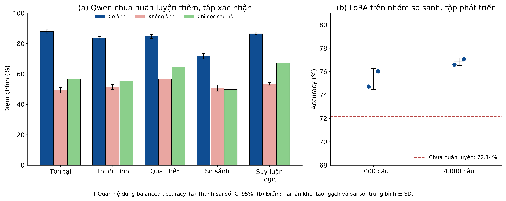
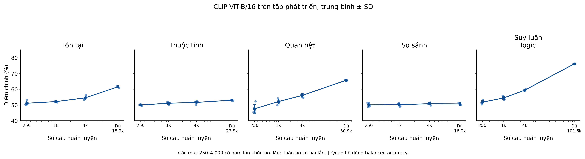
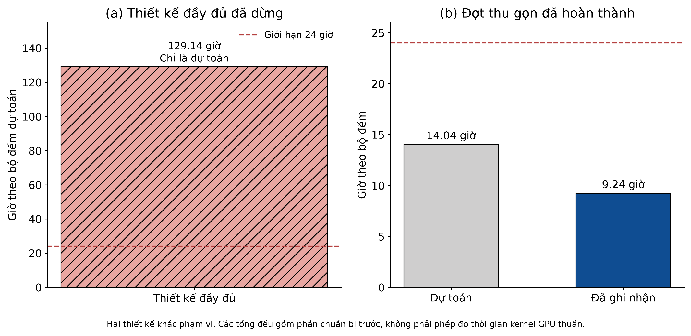

# Transfer-Guided Curriculum Learning for Multi-Task Visual Question Answering

## 1. Bối cảnh và bài toán

### 1.1. Multi-task learning

Trong cách tiếp cận truyền thống (single-task learning), mỗi nhiệm vụ được huấn luyện và đánh giá trên một mô hình độc lập. Phương pháp này đơn giản và dễ triển khai, nhưng lại bỏ lỡ cơ hội tận dụng kiến thức dùng chung giữa các nhiệm vụ có liên quan. Ví dụ, khả năng **nhận diện** màu sắc của một vật thể hoàn toàn có thể hỗ trợ trực tiếp cho việc **so sánh** màu sắc giữa hai vật thể khác nhau.

Multi-task learning (MTL) khắc phục hạn chế này bằng cách huấn luyện đồng thời nhiều nhiệm vụ trên một không gian biểu diễn chung, qua đó tận dụng tín hiệu giám sát từ nhiệm vụ này để cải thiện khả năng tổng quát hóa (generalization) cho nhiệm vụ khác. Về nguyên lý, việc cùng quan sát nhiều nhiệm vụ liên quan giúp mô hình học được những đặc trưng mang tính bản chất và hữu ích hơn so với việc chỉ học đơn lẻ từng nhiệm vụ. Tuy nhiên ta cần làm rõ, đây chỉ là giả thuyết về lợi ích của việc chia sẻ biểu diễn, chứ không bảo đảm rằng ghép bất kỳ nhóm nhiệm vụ nào lại cũng mang lại kết quả tốt hơn [Caruana, Multitask Learning, 1997](https://doi.org/10.1023/A:1007379606734).

Về mặt kiến trúc, việc chia sẻ thông tin trong MTL thường được thực hiện theo hai hướng chính là hard sharing và soft sharing. Với hard sharing, các nhiệm vụ dùng chung một backbone để trích xuất đặc trưng và chỉ tách nhánh ở các head đầu ra riêng biệt, trong khi soft sharing cho phép mỗi nhiệm vụ giữ bộ tham số riêng nhưng có cơ chế ràng buộc hoặc trao đổi thông tin với nhau trong quá trình tối ưu. Khi quá trình chia sẻ diễn ra thuận lợi, mô hình sẽ đạt được **positive transfer**, tức hiệu năng của một hoặc nhiều nhiệm vụ được cải thiện nhờ học chung. Ngược lại, nếu tín hiệu học giữa các nhiệm vụ cạnh tranh và kéo biểu diễn chung theo những hướng bất lợi, hiện tượng **negative transfer** sẽ xảy ra và làm suy giảm chất lượng mô hình.

Chính vì vậy, khi nghiên cứu, ta không chỉ dừng lại ở vấn đề liệu MTL có tốt hay không, mà còn quan tâm việc xác định **nên kết hợp những nhiệm vụ nào, chia sẻ theo cách nào và trong điều kiện dữ liệu ra sao**. Các nghiên cứu về phân nhóm nhiệm vụ (task grouping) chỉ ra rằng mối quan hệ hợp tác hay cạnh tranh giữa các nhiệm vụ phụ thuộc rất lớn vào thiết lập thực nghiệm cụ thể. Ngay cả khi việc học trước một nhiệm vụ đem lại lợi ích, điều đó cũng không tự động dự đoán được hiệu quả khi đem hai nhiệm vụ đi huấn luyện đồng thời [Standley và cộng sự, Which Tasks Should Be Learned Together in Multi-task Learning?, 2020](https://proceedings.mlr.press/v119/standley20a.html).

### 1.2. Bài toán cụ thể của dự án

Dự án tập trung vào bài toán visual question answering (VQA), trong đó đầu vào gồm một hình ảnh và một câu hỏi tiếng Anh liên quan đến nội dung bức ảnh đó. Trong phạm vi nghiên cứu hiện tại, đầu ra của mô hình được giới hạn ở dạng phân loại nhị phân với hai nhãn là `yes` và `no`, đi kèm một điểm số thể hiện mức độ nghiêng về đáp án `yes`. Việc chỉ sử dụng dạng câu hỏi `yes`/`no` là một lựa chọn thiết kế có chủ đích nhằm kiểm soát chặt chẽ các biến số thực nghiệm. Nếu sử dụng câu hỏi mở, mỗi nhóm nhiệm vụ sẽ gắn với một tập từ vựng đáp án riêng biệt như tên vật thể, màu sắc hay số lượng, khiến sự khác biệt về phân phối nhãn đầu ra dễ làm nhiễu quá trình đánh giá. Bằng cách đưa toàn bộ các nhiệm vụ về cùng một không gian đầu ra nhị phân và dùng chung thước đo đánh giá, nghiên cứu có thể cô lập hoàn toàn yếu tố suy luận thị giác, qua đó đo lường chính xác mức độ chuyển giao tri thức giữa các nhiệm vụ mà không bị ảnh hưởng bởi sự sai lệch về từ vựng câu trả lời.

Dù có chung không gian đầu ra nhị phân, các câu hỏi trong bài toán vẫn được chia thành năm nhóm năng lực suy luận khác nhau và mỗi nhóm được xem là một nhiệm vụ nghiên cứu độc lập:

| Nhóm nhiệm vụ | Điều muốn kiểm tra | Ví dụ câu hỏi đặc trưng trong GQA |
|---|---|---|
| Tồn tại (`exist`) | Có xuất hiện vật thỏa mãn điều kiện cho trước hay không | *Is there a red car to the left of the man?* |
| Thuộc tính (`verifyAttr`) | Một vật có mang đặc điểm được hỏi hay không | *Is the shirt that the man is wearing blue?* |
| Quan hệ (`verifyRel`) | Quan hệ giữa các vật có đúng như mô tả không | *Is the man holding a cell phone?* |
| So sánh (`compare`) | Thuộc tính của các vật giống hoặc khác nhau thế nào | *Do the shirt and the pants have the same color?* |
| Suy luận logic (`logic`) | Kết hợp nhiều điều kiện suy luận đồng thời | *Are there both forks and knives on the table?* |

Trong thực nghiệm, hệ thống sử dụng câu hỏi tiếng Anh gốc cùng danh sách mẫu dữ liệu đã được khóa cố định. Các thông tin như nhãn nhóm, loại câu hỏi hay chương trình suy luận chỉ phục vụ cho bước phân tích kết quả và tuyệt đối không được đưa vào làm đầu vào cho mô hình.

Từ thiết lập này, câu hỏi nghiên cứu chính của dự án là **với cùng một lượng dữ liệu của nhiệm vụ đích, việc dùng thêm dữ liệu từ một nhiệm vụ nguồn có giúp mô hình trả lời nhóm câu hỏi đích tốt hơn so với học riêng lẻ hay không**. Chẳng hạn, ta giữ nguyên tập câu hỏi thuộc nhóm so sánh (`compare`) dùng để huấn luyện, sau đó bổ sung thêm dữ liệu từ nhóm thuộc tính (`verifyAttr`) để đo lường xem sự kết hợp này có mang lại lợi ích cải thiện đáng tin cậy hay không.

Nhìn rộng hơn về mặt phương pháp luận, dự án đặt ra một câu hỏi nền tảng hơn là **làm thế nào để định nghĩa nhiệm vụ một cách chuẩn hóa nhằm tách bạch rạch ròi giữa nhiệm vụ đang được đánh giá với các phép toán suy luận bên dưới mà câu hỏi đó đòi hỏi**. Trong thực tế, mỗi câu hỏi không chỉ tương ứng với một kỹ năng bề mặt duy nhất mà thường bao hàm nhiều phép/ bước suy luận kết hợp bên dưới. Chẳng hạn, một câu hỏi được xếp vào nhóm thuộc tính (`verifyAttr`) như *"Is the shirt that the man is wearing blue?"* không chỉ đơn thuần kiểm tra màu sắc, mà đòi hỏi mô hình thực hiện lần lượt chuỗi thao tác suy luận gồm xác định người đàn ông, tìm chiếc áo thông qua quan hệ đang mặc rồi mới kiểm tra thuộc tính màu xanh. Nếu không giữ lại mô tả về các thao tác suy luận để thực hiện nhiệm vụ như một thông tin độc lập nhằm bóc tách hai lớp này, ta khó có thể kết luận liệu hiệu quả chuyển giao đến từ bản chất của nhiệm vụ hay chỉ do sự trùng lặp các bước xử lý thành phần. Vì vậy, dự án hướng tới việc **xây dựng một khung định nghĩa các nhiệm nhiệm vụ dựa trên dữ liệu chú thích về thao tác suy luận sẵn có**, tạo tiền đề chuẩn mực để phân tích cơ chế chuyển giao trong VQA dựa trên thao tác suy luận, một cách tổng quát và có thể kiểm chứng trên nhiều bộ dữ liệu khác nhau.

### 1.3. Vì sao các baseline ban đầu chưa đủ

Để trả lời câu hỏi về chuyển giao tri thức và kiểm chứng vai trò của các thao tác suy luận đã nêu ở Mục 1.2, việc chỉ dựa vào các điểm số baseline thông thường là chưa đủ. Trước hết, một mô hình đạt độ chính xác cao trên bài toán VQA chưa chắc đã thực sự hiểu nội dung hình ảnh. Chỉ cần đọc câu hỏi, mô hình hoàn toàn có thể khai thác các đường tắt ngôn ngữ như cấu trúc diễn đạt, tần suất xuất hiện của đáp án hay các từ mang tính phủ định để đoán đúng. Nếu không thiết lập một baseline chỉ sử dụng văn bản (question-only) để đối chứng, ta rất dễ nhầm lẫn lợi thế thống kê về ngôn ngữ thành năng lực suy luận thị giác và đánh giá sai tác động thực sự của việc ghép nhiệm vụ.

Ngược lại, một mô hình có năng lực quá yếu hoặc chưa hội tụ, cho kết quả gần mức đoán ngẫu nhiên trên nhiệm vụ đích, cũng không thể dùng làm cơ sở để kết luận về multi-task learning. Khi mô hình còn chưa học nổi nhiệm vụ ban đầu, việc bổ sung dữ liệu nguồn mà không mang lại cải thiện có thể chỉ phản ánh giới hạn của kiến trúc, sự thiếu hụt dữ liệu hoặc quá trình tối ưu chưa phù hợp, chứ chưa chứng minh được rằng hai nhóm năng lực không có khả năng hỗ trợ nhau.

Trong khi đó, việc thử nghiệm với các mô hình ngôn ngữ thị giác lớn đã được huấn luyện trước như Qwen đóng vai trò như một phép kiểm tra tính khả thi, giúp xác nhận rằng bộ dữ liệu thực sự chứa tín hiệu thị giác hợp lệ và bài toán hoàn toàn có thể học được. Tuy nhiên, những kết quả này không thể thay thế phép so sánh có đối chứng giữa học riêng và học chung vì chúng trả lời hai câu hỏi hoàn toàn khác nhau. Cụ thể, điểm số zero-shot chỉ phản ánh lượng tri thức có sẵn từ quá trình tiền huấn luyện quy mô lớn chứ không cho thấy động lực học tập khi mô hình tiếp nhận thêm một nhiệm vụ mới. Tương tự, việc fine-tuning riêng lẻ từng nhóm chỉ đo lường năng lực hội tụ độc lập của mô hình trên từng tác vụ, hoàn toàn không chỉ ra được liệu việc bổ sung dữ liệu nguồn có tạo ra positive transfer hay gây ra negative transfer so với khi giữ nguyên lượng dữ liệu đích ban đầu. Hơn nữa, vì các mô hình lớn như Qwen vốn đã tích hợp sẵn kiến thức đan xen của nhiều tác vụ ngay từ giai đoạn tiền huấn luyện, ta không thể dùng các chỉ số đơn lẻ này để bóc tách rạch ròi tác động chuyển giao giữa từng cặp nhiệm vụ. Chính vì vậy, dự án cần kết hợp đồng bộ cả việc kiểm toán dữ liệu, đo lường baseline thuần ngôn ngữ, kiểm tra ngưỡng học được của mô hình thị giác và thiết kế các thực nghiệm ghép nhiệm vụ có kiểm soát chặt chẽ.

### 1.4. Ý tưởng cốt lõi và giới hạn của bản đồ chuyển giao

Trên nền tảng các đối chứng đó, ta xây dựng một bản đồ chuyển giao có hướng, trong đó mỗi cặp từ nhiệm vụ nguồn sang nhiệm vụ đích biểu thị mức độ thay đổi hiệu năng trên nhiệm vụ đích khi sử dụng thêm dữ liệu từ nhiệm vụ nguồn. Với năm nhóm năng lực đã xác định, hệ thống hình thành 20 hướng tương tác khác nhóm và mỗi hướng được khảo sát đồng thời dưới hai cơ chế huấn luyện khác nhau. Ở cơ chế học tuần tự (sequential transfer, viết tắt là **Seq**), mô hình được huấn luyện trên dữ liệu nguồn trước rồi mới tiếp tục học trên dữ liệu đích nhằm đo lường khả năng kế thừa biểu diễn qua các giai đoạn. Ở cơ chế học đồng thời (joint training, viết tắt là **Joint**), mô hình học từ đầu trên tập dữ liệu trộn chung cả nguồn lẫn đích để đánh giá trực tiếp hiệu ứng multi-task learning theo từng cặp. Cả hai thiết lập này đều được đem so sánh trực tiếp với mô hình chỉ học riêng trên cùng một tập dữ liệu đích, qua đó tách bạch rõ hai câu hỏi khác nhau về việc học trước hay học chung sẽ mang lại positive transfer hoặc gây ra negative transfer.

Để bảo đảm mọi chênh lệch đo được đều phản ánh đúng tương tác giữa các nhiệm vụ như đã đặt ra ở Mục 1.1 và Mục 1.2, kiến trúc thử nghiệm áp dụng cơ chế hard sharing thuần túy. Cụ thể, hình ảnh và câu hỏi đi qua các bộ mã hóa được đóng băng, sau đó đi qua một bộ kết hợp đặc trưng và hội tụ về một đầu ra nhị phân dùng chung duy nhất, hoàn toàn không có nhánh đầu ra riêng cho từng nhóm và cũng không cung cấp tên nhóm vào đầu vào của mô hình. Thiết lập này cho phép ta đối chiếu kết quả thực nghiệm với cấu trúc thao tác suy luận của từng câu hỏi. Vì các nhóm nhiệm vụ khác nhau vẫn có thể dùng chung những bước xử lý nền tảng như xác định vật thể, kiểm tra đặc điểm hay kết hợp điều kiện logic, mức độ chồng lấn về thao tác suy luận đóng vai trò là cơ sở để hình thành giả thuyết về khả năng hỗ trợ lẫn nhau, trong khi bằng chứng kết luận cuối cùng vẫn phải đến từ độ lệch thực nghiệm, tính ổn định qua nhiều lần chạy và các phép đối chứng nghiêm ngặt.

Cuối cùng, cần xác định rõ giới hạn của cách tiếp cận này là bản đồ chuyển giao từng cặp mới chỉ phản ánh tương tác giữa hai nhiệm vụ tại một thời điểm, chứ chưa tự động khẳng định được chiến lược kết hợp tối ưu cho cả năm nhóm cùng lúc. Khi mở rộng từ hai lên ba nhóm nhiệm vụ trở lên, sự cộng hưởng hoặc cạnh tranh tín hiệu học có thể diễn biến phức tạp hơn tổng các tác động từng cặp riêng lẻ, và bản đồ thu được ở giai đoạn này sẽ đóng vai trò là cơ sở thực nghiệm định hướng cho các bước mở rộng đa nhiệm phức tạp hơn về sau.

## 2. Dữ liệu nghiên cứu

### 2.1. Nguồn gốc và lý do chọn GQA

Về dữ liệu, án lựa chọn GQA, một bộ dữ liệu công khai về hỏi đáp thị giác trên ảnh thực. Điểm mạnh cốt lõi của GQA là các câu hỏi được sinh có cấu trúc từ đồ thị cảnh (scene graph), luôn đi kèm một chương trình suy luận mô tả chi tiết từng bước xử lý. Đặc tính này đáp ứng trực tiếp mục tiêu phân chia nhóm năng lực suy luận và kiểm tra khả năng shortcut ngôn ngữ của nghiên cứu. Tuy nhiên, chính quy trình sinh câu hỏi tự động này cũng tiềm ẩn rủi ro để lại những dấu hiệu ngữ pháp đặc trưng giúp mô hình đoán nhãn mà không cần nhìn ảnh [bài báo GQA của Hudson và Manning, 2019](https://openaccess.thecvf.com/content_CVPR_2019/html/Hudson_GQA_A_New_Dataset_for_Real-World_Visual_Reasoning_and_Compositional_Question_Answering.html).

Thay vì dùng toàn bộ dữ liệu gốc khổng lồ của GQA, dự án lấy phiên bản **GQA balanced** (bộ dữ liệu chuẩn đã được tác giả cân bằng lại phân phối đáp án) làm điểm xuất phát. Các tệp dữ liệu lưu cục bộ này được cố định phiên bản tại [bản khóa đầu vào](gqa_audit/config/FROZEN_MANIFEST.json) để bảo đảm tính tái lập cho toàn bộ thực nghiệm, với quy mô ban đầu như sau:

| Tệp balanced gốc | Số câu hỏi | Số ảnh khác nhau |
|---|---:|---:|
| Train | 943.000 | 72.140 |
| Validation | 132.062 | 10.234 |
| Testdev | 12.578 | 398 |

Kết quả đối chiếu từ [báo cáo schema giai đoạn 1](gqa_audit/outputs/stage1/schema_report.md) và [kiểm tra giao ảnh](gqa_audit/outputs/stage2/split_image_overlap.csv) xác nhận rằng tập hình ảnh giữa ba phần Train, Validation và Testdev hoàn toàn tách biệt nhau. Lưu ý rằng các con số trong bảng trên chỉ là quy mô đầu vào thô của bộ balanced, còn số lượng mẫu thực tế dùng để huấn luyện sẽ nhỏ hơn đáng kể sau khi lọc riêng các câu hỏi `yes`/`no` cho năm nhóm nhiệm vụ ở bước tiếp theo.

### 2.2. Chia tập theo ảnh và phân bố sau lọc

Trong quy trình thực nghiệm, nếu dùng trực tiếp tập validation gốc để tinh chỉnh siêu tham số, chọn điểm dừng huấn luyện hay thử nghiệm hàng loạt cấu hình ghép nhiệm vụ, mô hình sẽ dễ bị quá khớp (overfit) và làm mất đi tính khách quan khi đánh giá. Để bảo toàn tập validation gốc như một **tập xác nhận** độc lập nhằm kiểm chứng kết quả cuối cùng (trong khi `testdev` không được dùng để đánh giá mô hình), dự án cần một tập kiểm thử trung gian đóng vai trò môi trường thăm dò, theo dõi hội tụ và lựa chọn mô hình. Vì lý do đó, quy trình đã trích xuất ngẫu nhiên 10% số ảnh từ tập train với `seed = 0`, tương ứng với 7.214 ảnh, để xây dựng tập phát triển nội bộ gọi là `dev`, đồng thời giữ lại phần còn lại làm tập huấn luyện chính `train_core`. Việc chia dữ liệu được thực hiện nghiêm ngặt theo cấp độ hình ảnh nhằm bảo đảm mọi câu hỏi thuộc cùng một bức ảnh luôn nằm về cùng một phía, và giữ nguyên cách chia duy nhất này mà không thử lại hay tái cân bằng nhãn để chọn một phân bố đẹp hơn.

Thiết kế thực nghiệm chính sử dụng một bộ lọc nghiêm ngặt `program_strict`. Thống kê chi tiết về quy mô từng nhóm nhiệm vụ được trích xuất từ [thống kê nhiệm vụ](gqa_audit/outputs/stage2/task_stats.csv) và lưu bản phục vụ báo cáo tại [dataset.csv](docs/tables/project_overview/dataset.csv).

| Nhóm | Train core | Dev | Validation | Testdev | Yes trong train | No trong train |
|---|---:|---:|---:|---:|---:|---:|
| Tồn tại | 18.921 | 2.083 | 2.879 | 162 | 9.419 | 9.502 |
| Thuộc tính | 23.462 | 2.721 | 3.633 | 573 | 11.595 | 11.867 |
| Quan hệ | 50.947 | 5.576 | 7.933 | 769 | 24.964 | 25.983 |
| So sánh | 15.994 | 1.705 | 2.504 | 291 | 8.025 | 7.969 |
| Suy luận logic | 101.611 | 11.117 | 15.926 | 1.755 | 50.857 | 50.754 |
| Tổng từ năm nhóm | 210.935 | 23.202 | 32.875 | 3.550 | 104.860 | 106.075 |

Nhìn vào phân bố trên, nhóm suy luận logic có số lượng mẫu áp đảo so với bốn nhóm còn lại. Ngoài ra, sự cân bằng giữa hai nhãn `yes` và `no` ở cấp độ toàn nhóm không đồng nghĩa với việc các họ câu hỏi hay tập con bên trong cũng cân bằng.

Trường hợp điển hình là nhóm quan hệ, nơi thước đo đánh giá chính chỉ tính trên tập con `verifyRel_relation` gồm 31.206 câu trong train, 3.556 câu trong dev và 4.881 câu trong validation. Riêng trên tập dev của tập con này, đáp án `yes` chiếm tới 2.813 câu, tương đương tỷ lệ 79,11%. Nếu dùng độ chính xác thông thường (accuracy), kết quả rất dễ bị che khuất bởi hành vi đoán thiên về nhãn đa số. Vì vậy, nghiên cứu sử dụng **balanced accuracy**, tức trung bình cộng giá trị recall của cả hai lớp, làm thước đo chuẩn cho tập con này dựa trên [danh sách tập con](gqa_audit/outputs/stage2b/analysis_subsets.json), [báo cáo kiểm toán](gqa_audit/outputs/stage2/AUDIT_REPORT.md) và [baseline trong từng tập con quan hệ](gqa_audit/outputs/stage2b/verifyrel_within_subset_baselines.csv).


*Hình 1. Quy mô năm nhóm sau lọc và tỷ lệ yes ở train core. Cột quan hệ trong hình thể hiện cả nhóm, trong khi metric chính chỉ dùng tập con quan hệ đã nêu. [PDF](docs/figures/project_overview/01_dataset.pdf).*

Từ cấu trúc phân bố này, ba đặc điểm quan trọng cần lưu ý xuyên suốt quá trình phân tích kết quả là sự chênh lệch quy mô giữa các nhóm khiến việc so sánh dưới cùng một ngân sách dữ liệu đích trở nên thiết yếu hơn so với dùng toàn bộ dữ liệu, sự cân bằng nhãn ở bề mặt tổng thể vẫn có thể ẩn chứa mất cân bằng cục bộ bên trong từng tập con, và việc chia tập theo ảnh tuy ngăn chặn rò rỉ hình ảnh giữa `train_core` với `dev` nhưng chưa thể loại bỏ hoàn toàn sự trùng lặp về mẫu câu hay các đường tắt ngôn ngữ.

### 2.3. Một mẫu dữ liệu thực tế

Để hình dung rõ cách tổ chức dữ liệu, đoạn mã dưới đây trích xuất rút gọn một mẫu huấn luyện từ [báo cáo schema](gqa_audit/outputs/stage1/schema_report.md).

```json
{
  "question_id": "02930152",
  "imageId": "2354786",
  "question": "Is the sky dark?",
  "answer": "yes",
  "types": {
    "detailed": "verifyAttr",
    "semantic": "attr",
    "structural": "verify"
  }
}
```

Với mẫu này, chương trình suy luận đi kèm mô tả hai bước tuần tự là xác định vùng bầu trời rồi kiểm tra thuộc tính màu tối. Tuy nhiên, đầu vào thực tế đưa vào mô hình chỉ bao gồm hình ảnh mang mã `2354786` cùng chuỗi câu hỏi `Is the sky dark?`, và nhãn giám sát là `yes`. Các mã định danh chỉ dùng để liên kết dữ liệu và kiểm soát số lượng mẫu, trong khi thông tin phân loại câu hỏi và chương trình suy luận được giữ tách biệt hoàn toàn để phục vụ khâu chia nhóm và phân tích kết quả.

### 2.4. Làm sạch, lọc và kiểm soát đường tắt

Quy trình làm sạch dữ liệu tuân thủ nghiêm ngặt các quy tắc đã khóa trong [task_rules.yaml](gqa_audit/config/task_rules.yaml) và [answer_families.yaml](gqa_audit/config/answer_families.yaml) nhằm giữ lại các câu hỏi có đáp án `yes` hoặc `no` hợp lệ, bắt buộc phải có chương trình suy luận đi kèm và ánh xạ chính xác từng câu hỏi vào năm nhóm nhiệm vụ. Để tách bạch các thao tác suy luận như đã đặt vấn đề ở Mục 1.2, biến thể `program_strict` tiến hành loại bỏ những câu hỏi có chứa thao tác quan hệ `relate` ra khỏi các nhóm đơn lẻ như tồn tại, thuộc tính và so sánh, trong khi nhóm suy luận logic vẫn giữ nguyên cấu trúc tổ hợp của nó.

Bên cạnh việc lọc thao tác, quá trình kiểm toán dữ liệu được ghi lại tại [báo cáo kiểm toán](gqa_audit/outputs/stage2/AUDIT_REPORT.md) cũng loại bỏ những họ câu hỏi gây lệch phân phối nghiêm trọng. Cụ thể, hai họ `verifyAttrAnd` và `verifyMaterialAnd` gồm 1.301 câu trong tập train đã bị loại khỏi nhóm logic vì toàn bộ đáp án đều là `yes`. Tương tự, họ `twoSameMaterial` cũng bị loại khỏi nhóm so sánh do tỷ lệ đáp án `yes` chỉ đạt 0,379, nằm ngoài ngưỡng cân bằng từ 0,4 đến 0,6 đã quy định. Dự án không sinh thêm mẫu tổng hợp hay can thiệp tái cân bằng tập huấn luyện để bù đắp cho các phần bị cắt bỏ này.

Để ngăn chặn tuyệt đối việc rò rỉ đáp án vào đầu vào, mô tả chương trình suy luận không bao giờ được dùng làm đặc trưng cho mô hình chính. Trong giai đoạn 2b, nhóm nghiên cứu từng thử nghiệm một baseline chỉ dựa trên cấu trúc chương trình để rà soát nguy cơ rò rỉ thông tin và phát hiện rằng ký hiệu `(-)` làm điểm số tăng vọt bất thường ở một số nhóm, qua đó khẳng định đặc trưng này chỉ được phép sử dụng cho mục đích chẩn đoán. Song song đó, theo [báo cáo giai đoạn 2b](gqa_audit/outputs/stage2b/STAGE2B_REPORT.md), baseline thuần ngôn ngữ chỉ đọc câu hỏi được huấn luyện trên `train_core` bằng đặc trưng TF-IDF word n-gram bậc 1 đến 2 với ngưỡng `min_df=2` kết hợp bộ phân loại logistic regression có tham số `C=1`, `max_iter=2000` và bộ giải `lbfgs`. Các tập câu hỏi khó dùng để đánh giá chuyên sâu được xác định dựa trên chính những mẫu mà baseline đã khóa này dự đoán sai, nên điểm số của baseline trên tập lỗi đó bằng 0 theo đúng cách xây dựng chứ không phải một phát hiện độc lập về độ khó. Tương tự, việc khảo sát nhóm logic sau khi loại bỏ các từ phủ định cũng chỉ đóng vai trò phân tích bổ sung.

### 2.5. Xử lý ảnh và ranh giới sử dụng tập kiểm tra

Ở khâu tiền xử lý hình ảnh, nhánh mô hình dùng CLIP chuyển đổi ảnh sang hệ màu RGB, đặt ảnh vào chính giữa một khung vuông có màu nền trung bình của CLIP là `(122, 116, 104)` bằng cách thêm viền, sau đó thay đổi kích thước về chuẩn 224 × 224 bằng nội suy bicubic và chuẩn hóa theo thông số CLIP. Kỹ thuật thêm viền này giúp bảo toàn trọn vẹn bố cục khung hình gốc thay vì cắt xén phần trung tâm vốn dễ làm mất các vật thể nằm ở rìa ảnh. Toàn bộ pipeline thăm dò không sử dụng cắt ngẫu nhiên (random crop) hay bất kỳ phép tăng cường dữ liệu ảnh (augmentation) ngẫu nhiên nào, và cơ chế dropout trong bộ kết hợp đặc trưng chỉ đóng vai trò điều chuẩn (regularization).

Đối với nhánh Qwen, hệ thống sử dụng bộ xử lý ảnh và mẫu hội thoại (chat template) mặc định của mô hình với giới hạn số lượng điểm ảnh được khóa chặt trong [cấu hình giai đoạn 3](configs/stage3_protocol.FROZEN.yaml). Do hai kiến trúc này khác nhau cả về phương thức tiền xử lý hình ảnh lẫn nền tảng tiền huấn luyện, sự chênh lệch điểm số giữa chúng không được diễn giải như một phép thử nghiệm loại trừ (ablation) chỉ thay đổi duy nhất phần mạng lõi.

Cuối cùng, ranh giới sử dụng dữ liệu kiểm tra được quy định minh bạch theo từng giai đoạn. Trong giai đoạn 1, hệ thống có đọc cấu trúc schema và một số ví dụ từ `testdev` để kiểm tra định dạng dữ liệu. Tuy nhiên, kể từ khi áp dụng giao thức khóa ở các giai đoạn sau, tập `testdev` hoàn toàn không được dùng để chạy suy luận hay lựa chọn mô hình. Cụ thể, giai đoạn 3.5 và đợt thực nghiệm CLIP quy mô lớn chỉ đánh giá trên tập `dev`, đồng thời bộ nhớ đệm đặc trưng của CLIP chỉ lưu trữ ảnh của tập xác nhận (validation) mà không chứa ảnh của `testdev`. Vì vậy, phạm vi báo cáo khẳng định chính xác rằng **tập testdev không được dùng để đánh giá trong các thực nghiệm mô hình này**, thay vì tuyên bố rằng tập dữ liệu này chưa từng được mở xem ở bất kỳ bước chuẩn bị nào.

## 3. Kiến trúc hệ thống và quy trình thực hiện

### 3.1. Luồng xử lý tổng thể


*Hình 2. Từ thống kê dữ liệu đến bản đồ có đối chứng. Các mốc Qwen và chỉ đọc câu hỏi giúp hiểu giới hạn bài toán trước khi diễn giải ma trận CLIP. [PDF](docs/figures/project_overview/02_pipeline.pdf).*

Quy trình thực nghiệm bắt đầu bằng việc đọc các tệp câu hỏi gốc, kiểm tra tính toàn vẹn của lược đồ dữ liệu (schema) và phân chia các tập dữ liệu theo cấp độ hình ảnh. Sau bước lọc, hệ thống đóng băng danh sách định danh câu hỏi (`question_id`) cho từng nhóm nhiệm vụ, từng biến thể và từng tập dữ liệu vào một kho đăng ký trung tâm (registry). Từ thời điểm này, mọi nhánh mô hình đều trích xuất mẫu trực tiếp từ kho đăng ký đã khóa thay vì tự động phân loại lại, bảo đảm toàn bộ các phép so sánh đều diễn ra trên cùng một nền dữ liệu chuẩn.

Đối với nhánh thí nghiệm dùng CLIP, đặc trưng hình ảnh được trích xuất duy nhất một lần từ bộ mã hóa thị giác và lưu trữ dưới dạng tệp nhị phân ánh xạ bộ nhớ (FP16 memmap) để tối ưu tốc độ truy xuất. Trong mỗi lượt huấn luyện, mô hình đọc trực tiếp đặc trưng ảnh từ bộ nhớ đệm, kết hợp với đặc trưng mã hóa của câu hỏi rồi đưa qua bộ kết hợp đa phương thức (fusion module) để dự đoán nhãn. Quá trình đánh giá được thực hiện trên cùng một danh sách tập `dev` và lưu lại toàn bộ kết quả dự đoán theo từng mã câu hỏi. Cuối cùng, khâu phân tích thống kê sẽ ghép cặp từng nhánh thí nghiệm với mô hình baseline tương ứng có cùng hạt giống khởi tạo và cùng tập dữ liệu đích, từ đó tính toán độ chênh lệch hiệu năng, khoảng tin cậy (CI) và đưa ra kết luận theo các quy tắc đã khóa từ trước.

### 3.2. Kiến trúc mô hình thăm dò

Để đo lường chính xác khả năng chuyển giao tri thức giữa các nhóm câu hỏi mà không bị nhiễu bởi sự thay đổi trọng số của các mô hình nền tảng khổng lồ, hệ thống sử dụng kiến trúc thăm dò (probe) với các bộ mã hóa đầu vào được giữ đóng băng hoàn toàn. Bảng dưới đây đối chiếu cấu hình chi tiết giữa hai phiên bản mô hình CLIP được sử dụng trong quá trình nghiên cứu.

| Thành phần | CLIP ViT-B/16 ban đầu | CLIP ViT-L/14 dùng cho đợt báo cáo |
|---|---|---|
| Mã hóa ảnh | Đóng băng, lớp áp chót | Đóng băng, lớp áp chót |
| Đặc trưng mỗi ảnh | 197 × 768 | 257 × 1.024 |
| Đặc trưng token câu hỏi | Chiều 512 | Chiều 768 |
| Bộ kết hợp | 4 tầng Transformer pre-LN, chiều 512 | 4 tầng Transformer pre-LN, chiều 512 |
| Attention và FFN | 8 head, FFN 2.048 | 8 head, FFN 2.048 |
| Đầu dự đoán | Một logit trên token `[FUS]` | Một logit trên token `[FUS]` |
| Tham số học được ở cấu hình chọn | 13.271.041 | 13.533.185 |
| Tổng tham số đối tượng probe khi chạy | 76.436.993 | 136.593.665 |

Cần lưu ý rằng tổng số tham số của đối tượng probe trong bảng trên bao gồm cả bộ mã hóa văn bản nhưng không tính phần mạng trích xuất ảnh (vision tower), do thành phần này đã được tách riêng để tạo bộ nhớ đệm đặc trưng từ trước. Vì vậy, các con số này phản ánh quy mô thực thi của mô hình thăm dò chứ không đại diện cho kích thước của toàn bộ checkpoint CLIP gốc, như đã ghi nhận tại trường `parameters` trong hồ sơ `run.json`, trích xuất tại [sources.json](docs/tables/project_overview/sources.json) và định nghĩa trong [model.py](src/vqa_research/probe/model.py).

Về cơ chế lan truyền xuôi, các đặc trưng ảnh và văn bản sau khi trích xuất được chiếu tuyến tính về cùng không gian 512 chiều, cộng thêm embedding phân biệt loại phương thức (modality type embedding) và ghép nối với một token tổng hợp `[FUS]` ở đầu chuỗi. Bộ kết hợp gồm 4 tầng Transformer pre-LN xử lý chuỗi đặc trưng này với mặt nạ chú ý (attention mask) để bỏ qua phần đệm của câu hỏi. Tại đầu ra, giá trị logit duy nhất tại vị trí token `[FUS]` đi qua hàm sigmoid để tính xác suất đáp án `yes`, đồng thời mô hình quyết định nhãn `yes` khi giá trị logit lớn hơn 0. Quá trình tối ưu sử dụng hàm mất mát binary cross-entropy trực tiếp trên logit mà không áp dụng trọng số bù đắp cho từng lớp.

Cấu hình huấn luyện tiêu chuẩn cho nhánh CLIP sử dụng bộ tối ưu AdamW với tốc độ học 0,0001, kích thước lô (batch size) 64, lịch trình giảm tốc độ học dạng cosine kèm 5% bước khởi động (warmup), ngưỡng cắt gradient (gradient clipping) bằng 1 và tỷ lệ dropout 0,1. Mô hình được huấn luyện bằng độ chính xác hỗn hợp bf16 autocast trong khi vẫn duy trì các tham số chính ở định dạng FP32, với cả hai bộ mã hóa ảnh và câu hỏi đều đóng băng. Ngoài ra, đợt thực nghiệm chính trên kiến trúc L/14 sử dụng thuật toán tính toán attention chuẩn xác (math SDPA), trong khi các lượt thăm dò cũ trên B/16 từng ghi nhận cảnh báo về tính xác định trong tính toán song song. Do đó, sự khác biệt giữa B/16 và L/14 bao gồm cả yếu tố ổn định của đường tính toán chứ không chỉ đơn thuần là sự nâng cấp kích thước bộ mã hóa.

### 3.3. Tra cứu theo bước công việc

Toàn bộ mã nguồn, tệp cấu hình và dữ liệu đầu ra của từng giai đoạn thực nghiệm được tổ chức thành các mô-đun độc lập giúp dễ dàng kiểm tra và đối chiếu.

| Bước | Code và cấu hình chính | Đầu ra cần xem |
|---|---|---|
| Kiểm tra dữ liệu gốc | [stage1.py](gqa_audit/stage1.py) | [schema_report.md](gqa_audit/outputs/stage1/schema_report.md) |
| Chia tập và lập nhóm | [stage2.py](gqa_audit/stage2.py), [stage2_data.py](gqa_audit/stage2_data.py), [task_rules.yaml](gqa_audit/config/task_rules.yaml) | [task_registry.json](gqa_audit/outputs/stage2/task_registry.json), [task_stats.csv](gqa_audit/outputs/stage2/task_stats.csv) |
| Thống kê shortcut và tập con | [stage2b.py](gqa_audit/stage2b.py), [stage2b_analysis.py](gqa_audit/stage2b_analysis.py) | [STAGE2B_REPORT.md](gqa_audit/outputs/stage2b/STAGE2B_REPORT.md), [analysis_subsets.json](gqa_audit/outputs/stage2b/analysis_subsets.json) |
| Chạy Qwen zero-shot | [run_experiment.py](scripts/run_experiment.py), [inference.py](src/vqa_research/inference.py), [stage3_protocol.FROZEN.yaml](configs/stage3_protocol.FROZEN.yaml) | [STAGE3_REPORT.md](gqa_audit/outputs/stage3/STAGE3_REPORT.md), [metrics_3b.csv](gqa_audit/outputs/stage3/metrics_3b.csv) |
| Cache và mô hình CLIP | [probe/features.py](src/vqa_research/probe/features.py), [probe/model.py](src/vqa_research/probe/model.py) | [manifest B/16](docs/tables/project_overview/clip_b16_feature_manifest.json), [manifest L/14](docs/tables/project_overview/clip_l14_feature_manifest.json) |
| Thăm dò P0 đến P4 | [run_stage3_5.py](scripts/run_stage3_5.py), [recipe.py](src/vqa_research/probe/recipe.py), [transfer.py](src/vqa_research/probe/transfer.py), [pilot_protocol.FROZEN.yaml](configs/pilot_protocol.FROZEN.yaml) | [thư mục giai đoạn 3.5](gqa_audit/outputs/stage3_5) |
| Qwen LoRA P5 | [lora_pilot.py](src/vqa_research/lora_pilot.py) | [qwen_runs](gqa_audit/outputs/stage3_5/qwen_runs) |
| Lập lịch và huấn luyện bản đồ mới | [queue_chuyen_giao.py](scripts/queue_chuyen_giao.py), [pipeline.py](src/vqa_research/chuyen_giao/pipeline.py), [engine.py](src/vqa_research/chuyen_giao/engine.py) | [design.FROZEN.json](gqa_audit/outputs/bao_cao_chuyen_giao_clip_l14/design.FROZEN.json), [matrix_manifest.json](gqa_audit/outputs/bao_cao_chuyen_giao_clip_l14/matrix_manifest.json) |
| Đánh giá và suy luận thống kê | [evaluation.py](gqa_audit/evaluation.py), [chuyen_giao/analysis.py](src/vqa_research/chuyen_giao/analysis.py) | [baselines.csv](gqa_audit/outputs/bao_cao_chuyen_giao_clip_l14/baselines.csv), [edges.csv](gqa_audit/outputs/bao_cao_chuyen_giao_clip_l14/edges.csv) |
| Xuất hình và bảng của tài liệu này | [plot_project_report.py](scripts/plot_project_report.py) | [hình](docs/figures/project_overview), [bảng và nguồn](docs/tables/project_overview) |

[bản đề xuất thiết kế](design/transfer_experiment_design.md) chỉ phản ánh định hướng nghiên cứu tổng thể ban đầu chứ không được xem là bằng chứng xác nhận mọi thực nghiệm nêu trong đó đều đã chạy.

### 3.4. Định nghĩa phép đo và đối chứng

Gọi $\mathcal{T}$ là tập năm nhóm nhiệm vụ nghiên cứu, với $S, T \in \mathcal{T}$ ($S \neq T$) lần lượt là nhiệm vụ nguồn và nhiệm vụ đích, $A \in \{\text{Seq}, \text{Joint}\}$ là chế độ huấn luyện và $r \in \{1000, 1001, 1002\}$ là seed ngẫu nhiên. Ký hiệu $M_T(f)$ là giá trị của thước đo chính khi đánh giá mô hình $f$ trên tập `dev` của nhiệm vụ $T$. Gọi $f_{A(S \rightarrow T, r)}$ là mô hình thu được khi huấn luyện nguồn $S$ và đích $T$ theo chế độ $A$ tại seed $r$, và $f_{\text{Base}(T, r)}$ là mô hình baseline chỉ học riêng trên $T$ tại cùng seed $r$. Khi đó, hiệu ứng chuyển giao có hướng $\Delta_A(S \rightarrow T, r)$ (tính bằng điểm phần trăm, đpt) được định nghĩa như sau:

$$
\Delta_A(S \rightarrow T, r) = M_T\big(f_{A(S \rightarrow T, r)}\big) - M_T\big(f_{\text{Base}(T, r)}\big)
$$

Chẳng hạn, nếu $M_T(f_{\text{Base}}) = 53\%$ và $M_T(f_A) = 55\%$, mức cải thiện ghi nhận là $\Delta_A = +2$ điểm phần trăm (đpt). Khi cả $\Delta_{\text{Seq}} < 0$ và $\Delta_{\text{Joint}} < 0$, cả hai phương thức bổ sung dữ liệu nguồn đều làm giảm hiệu năng trên nhiệm vụ đích trong thiết lập đang xét. Không có bất kỳ quy luật bắt buộc nào khiến $\Delta_{\text{Joint}} > 0$ khi $\Delta_{\text{Seq}} < 0$, bởi cơ chế tối ưu hóa và trình tự tiếp xúc dữ liệu của hai phương pháp này khác nhau về bản chất.

Trong mỗi lần chạy, seed ngẫu nhiên $r$ đồng thời kiểm soát quá trình trích xuất tập mẫu huấn luyện $(D_S^{(r)}, D_T^{(r)})$, khởi tạo trọng số mạng và thứ tự xáo trộn dữ liệu thông qua các bộ sinh số ngẫu nhiên tách biệt. Do đó, độ lệch chuẩn (SD) giữa các lần chạy phản ánh đồng thời cả biến động từ việc chọn mẫu lẫn quá trình tối ưu hóa, chứ không chỉ riêng sự khác biệt ở điểm khởi tạo ban đầu. Các nhánh thực nghiệm ghép cặp luôn sử dụng chung tập mẫu đích $D_T^{(r)}$ và cùng seed $r$ để giảm thiểu nhiễu ngẫu nhiên khi so sánh.

Ở đợt thực nghiệm thu gọn, quy mô dữ liệu được cố định ở mức $|D_S| = 10.000$ câu hỏi nguồn, $|D_T| = 1.000$ câu hỏi đích và thực hiện lặp lại trên ba seed 1000, 1001, 1002. Mô hình baseline chỉ huấn luyện 10 epoch trên tập dữ liệu đích $D_T^{(r)}$. Nhánh `Seq` huấn luyện 10 epoch trên tập nguồn $D_S^{(r)}$, nạp lại bộ trọng số đã học rồi khởi tạo mới hoàn toàn bộ tối ưu và lịch trình học để tiếp tục huấn luyện 10 epoch trên tập đích $D_T^{(r)}$. Trong khi đó, nhánh `Joint` huấn luyện từ đầu trong 10 epoch trên tập hợp trộn chung $D_S^{(r)} \cup D_T^{(r)}$ với hàm mất mát không gán trọng số riêng theo nhóm. Cách thiết lập này khiến nhánh `Joint` tiếp xúc với lượng câu hỏi nguồn nhiều gấp mười lần câu hỏi đích và có tổng số bước cập nhật lớn hơn so với baseline. Vì vậy, kết quả thu được phản ánh lợi ích tổng hợp của cả chế độ khai thác dữ liệu nguồn chứ chưa tách bạch riêng tác động ngữ nghĩa khỏi yếu tố gia tăng khối lượng tính toán. Riêng nhánh đối chứng ngoài nhóm chỉ có sẵn 5.371 câu hỏi trong kho dữ liệu đã khóa nên chưa thể khớp hoàn toàn về mặt số lượng với các nguồn thực nghiệm khác.

Để kiểm chứng xem mức cải thiện đến từ sự tương đồng về năng lực suy luận hay chỉ do hiệu ứng tăng dữ liệu thông thường, nghiên cứu thiết lập ba nhóm đối chứng chuyên biệt:

| Đối chứng | Cách tạo | Điều muốn tách ra |
|---|---|---|
| Cùng nhóm | Thêm 10.000 câu thuộc nhóm đích, không trùng question ID với mẫu đích | Mô hình có hưởng lợi khi được thêm dữ liệu liên quan trực tiếp không |
| Ngoài nhóm | Câu yes/no về khung cảnh toàn cục thuộc pool riêng | Lợi ích chung từ định dạng, phân bố nhãn hoặc nhìn thêm dữ liệu |
| Đảo nhãn | Giữ ảnh và câu hỏi của một nguồn chỉ định, hoán vị nhãn trong mẫu | Lợi ích có cần ánh xạ ngữ nghĩa đúng giữa đầu vào và nhãn không |

Lưu ý rằng đối chứng cùng nhóm chỉ lọc trùng theo định danh câu hỏi chứ không bảo đảm tách biệt hoàn toàn tập hình ảnh so với mẫu đích, đồng thời đợt thực nghiệm thu gọn cũng chưa triển khai các nhánh đối chứng phụ như nguồn tách ảnh hay ma trận ảnh trắng. Đối với phép thử đảo nhãn, nguồn dữ liệu bị xáo trộn nhãn được cố định là nhóm thuộc tính khi đích là so sánh hoặc tồn tại, và cố định là nhóm tồn tại đối với các nhiệm vụ đích còn lại, tuyệt đối không lựa chọn nguồn đảo nhãn theo hướng có lợi cho kết quả.

Về chỉ số đánh giá, hệ thống giữ cố định độ chính xác (accuracy) làm thước đo chính $M_T$ cho bốn nhóm nhiệm vụ và balanced accuracy trên tập con `verifyRel_relation` cho nhóm quan hệ, không thay đổi tiêu chí sau khi quan sát kết quả. Bên cạnh đó, chỉ số log-loss (càng thấp càng tốt, được tính cân bằng theo lớp đối với nhóm quan hệ) dùng để đánh giá độ tin cậy của phân phối xác suất đầu ra, còn chỉ số AUROC (càng cao càng tốt) dùng để đo khả năng phân tách thứ hạng giữa hai nhãn.

Để đưa ra kết luận thống kê nghiêm ngặt, khoảng tin cậy (CI) của độ chênh lệch hiệu năng trung bình $\bar{\Delta}_A(S \rightarrow T)$ được ước lượng bằng phương pháp hierarchical paired bootstrap với 2.000 lượt lặp, thực hiện lấy mẫu lại đồng thời theo seed khởi tạo và theo cụm hình ảnh nhằm khắc phục sự phụ thuộc giữa các câu hỏi cùng thuộc một bức ảnh. Một hướng chuyển giao chỉ được công nhận là **hỗ trợ thực sự** khi khoảng tin cậy nằm hoàn toàn trên ngưỡng cải thiện tối thiểu +1 đpt, cùng chiều cải thiện ở ít nhất 80% số seed (tương đương toàn bộ cả 3 lần chạy), giá trị $p$ sau điều chỉnh Benjamini–Hochberg không vượt quá 0,05 và thỏa mãn đồng thời các điều kiện về đối chứng lẫn tập câu hỏi khó. Ngược lại, một hướng bị kết luận là **gây hại** khi khoảng tin cậy nằm hoàn toàn dưới ngưỡng −1 đpt kèm các tiêu chuẩn tương ứng về độ ổn định và kiểm định thống kê, như được cài đặt chi tiết trong [analysis.py](src/vqa_research/chuyen_giao/analysis.py) và [thiết kế khóa](gqa_audit/outputs/bao_cao_chuyen_giao_clip_l14/design.FROZEN.json).

## 4. Quá trình thực nghiệm và các vấn đề đã gặp

### 4.1. Giai đoạn 1 và 2: biến dữ liệu thành các nhiệm vụ có thể kiểm toán

**Giả thuyết đặt ra.** Chương trình suy luận của GQA có thể giúp tạo các nhóm năng lực rõ hơn so với chỉ nhìn câu chữ. Nhưng trước khi đo quan hệ giữa nhóm, cần bảo đảm cách chia nhóm không đưa nhãn vào đầu vào hoặc tạo nhóm chỉ có một đáp án.

**Cách triển khai.** Kiểm tra schema, giữ câu yes/no, ánh xạ loại chi tiết vào năm nhóm, tạo biến thể unfiltered và strict, rồi chia train core và dev theo ảnh. Khóa registry cùng quy tắc để các giai đoạn sau dùng chung định nghĩa.

**Vấn đề phát sinh.** Một số họ chỉ có yes. Nhóm quan hệ trộn các tập con có phân bố khác nhau. Một số câu thuộc nhóm bề ngoài đơn giản lại có chương trình chứa thao tác quan hệ. Chỉ xem tỷ lệ nhãn ở cấp nhóm dễ bỏ qua các vấn đề này.

**Hướng xử lý.** Loại các họ không đạt quy tắc, tách tập con quan hệ và chỉ định balanced accuracy. Ghi riêng các biến thể để không trộn kết quả. Kết quả của giai đoạn này là định nghĩa dữ liệu ổn định, chưa phải kết quả MTL. Nguồn: [AUDIT_REPORT.md](gqa_audit/outputs/stage2/AUDIT_REPORT.md).

### 4.2. Giai đoạn 2b: kiểm tra điểm số có thể đến từ đường tắt nào

**Giả thuyết đặt ra.** Câu hỏi và cấu trúc chương trình có thể chứa dấu hiệu đoán nhãn. Mức giống nhau về thao tác chưa đủ để khẳng định hai nhóm hỗ trợ nhau.

**Cách triển khai.** Huấn luyện baseline chỉ đọc câu hỏi, kiểm tra cấu trúc chương trình có và không có dấu phủ định, phân tích trong từng tập con quan hệ, tạo tập câu khó và tập logic bỏ cue phủ định. Đồng thời kiểm tra kết quả giai đoạn trước không bị thay đổi ngoài ý muốn.

**Vấn đề phát sinh.** Có 18 cảnh báo shortcut ở cấp họ câu hỏi. Dấu `(-)` làm baseline chương trình tăng mạnh. Mức chồng lấn thao tác còn đi cùng độ dài chương trình và sự hiện diện của thao tác lọc, nên dễ bị diễn giải nhầm thành quan hệ nhân quả.

**Hướng xử lý.** Giữ chương trình ngoài mô hình chính, dùng baseline ngôn ngữ làm mốc, báo tập con riêng và chỉ xem tương đồng thao tác là nguồn giả thuyết. Có 169 kiểm tra hồi quy đạt và 49 kiểm thử tại thời điểm giai đoạn 2b. Hồ sơ rà soát tay có 300 mục và 75 mục bổ sung nhưng trường `human_ok` còn trống, nên không coi toàn bộ đã được con người xác nhận. Nguồn: [STAGE2B_REPORT.md](gqa_audit/outputs/stage2b/STAGE2B_REPORT.md).

### 4.3. Giai đoạn 3: hỏi một mô hình lớn xem bài toán có tín hiệu thị giác không

**Giả thuyết đặt ra.** Nếu mô hình thị giác ngôn ngữ mạnh hơn vượt baseline câu hỏi và vượt chính nó khi không có ảnh, dữ liệu có tín hiệu hữu ích cho nghiên cứu. Đây là bước kiểm tra bài toán trước khi đầu tư vào nhiều lượt MTL.

**Cách triển khai.** Đánh giá Qwen2.5-VL-3B-Instruct đã huấn luyện trước với cùng template, cả có ảnh và không ảnh. Điểm yes được tính từ `logsumexp` của logits token `yes` và `Yes`, trừ phần tương ứng của `no` và `No`. Vì vậy, metric không phụ thuộc việc mô hình sinh một câu trả lời dài hay ngắn.

**Vấn đề phát sinh.** Bản archive ảnh ban đầu bị cắt cụt, không đủ ảnh. Đổi batch làm điểm số lệch, mức lệch lớn nhất ghi nhận là 0,375. Một tối ưu attention cần kiểm tra tính tương đương. Phản biện sau chạy cũng phát hiện bảng chênh lệch ghép cặp cần sửa.

**Hướng xử lý.** Kiểm tra lại archive ảnh hoàn chỉnh và các ảnh registry cần dùng. Chốt đánh giá batch 1. Chỉ chấp nhận tối ưu grouped attention sau kiểm tra tương đương trên mẫu đã chọn, không mở rộng kết luận thành bảo đảm trên mọi đầu vào. Sửa 8 dòng chênh lệch ghép cặp, gồm 4 dòng cấp nhóm và 4 dòng cấp họ. Các điểm tổng chính không đổi. Nguồn: [STAGE3_REPORT.md](gqa_audit/outputs/stage3/STAGE3_REPORT.md), [kiểm tra tối ưu](gqa_audit/outputs/stage3/optimization_validation.json), [bảng sửa](gqa_audit/outputs/stage3/paired_difference_corrections.csv).

### 4.4. P0 và P1: tạo mô hình CLIP rẻ hơn và chọn một cách huấn luyện chung

**Giả thuyết đặt ra.** Đóng băng CLIP và học bộ kết hợp nhỏ giúp thực hiện nhiều nhánh nguồn → đích với chi phí thấp hơn fine-tuning mô hình lớn. Một recipe chung tránh tùy chỉnh từng nhóm theo kết quả mong muốn.

**Cách triển khai.** P0 tạo cache 82.374 ảnh với đặc trưng 197 × 768 và kiểm tra 64 ảnh. P1 thử 120 lượt, từ 8 cấu hình trên 5 nhóm và 3 ngân sách, dùng một chỉ số khởi tạo. Chọn cấu hình theo thứ hạng log-loss trên dev trong từng ô, rồi lấy trung bình thứ hạng.

**Vấn đề phát sinh.** Kiểm tra cache từng báo sai khác 0,0625, cao hơn ngưỡng 0,02. Lỗi pandas xuất hiện khi `question_id` vừa là tên index vừa là cột. Cảnh báo CuBLAS và kernel làm tính xác định không tuyệt đối. Khi GPU có tiến trình khác, kiểm tra độc quyền cũng chủ động dừng nhánh.

**Hướng xử lý.** So cache và tính lại với cùng kích thước batch 32 thay vì nới ngưỡng. Manifest cuối ghi sai khác bằng 0 trên 64 ảnh. Bỏ tên index gây nhập nhằng trước khi merge. Dùng queue và khóa GPU để chờ tài nguyên. Giữ phép chạy lặp để ghi nhận sai khác số học còn lại. Recipe thắng là tốc độ học 0,0001, đóng băng text encoder và 10 epoch. Nguồn: [manifest đặc trưng](docs/tables/project_overview/clip_b16_feature_manifest.json), [selected_recipe.json](gqa_audit/outputs/stage3_5/selected_recipe.json), [repeat.json](gqa_audit/outputs/stage3_5/repeat.json).

Phép chạy lặp của probe cũ còn ghi nhận sai khác logit lớn nhất 0,203125 và trạng thái FLAG. Vì vậy, không gọi toàn bộ thăm dò B/16 là tái lập bit tuyệt đối chỉ dựa vào việc đã đặt chỉ số ngẫu nhiên.

### 4.5. P2 và P3: kiểm tra mô hình có học và có cần ảnh không

**Giả thuyết đặt ra.** Trước khi dùng một mô hình làm công cụ đo MTL, tăng dữ liệu đích phải giúp nó học và ảnh thật phải tạo lợi ích so với ảnh trắng.

**Cách triển khai.** P2 hoàn thành 85 lượt, gồm 75 lượt ở các ngân sách 250, 1.000, 4.000 với năm lần khởi tạo, cộng 10 lượt toàn bộ dữ liệu với hai lần. P3 có 25 lượt ảnh trắng, gồm mức 4.000 và toàn bộ dữ liệu. Ảnh trắng được dùng cả khi học và đánh giá.

**Vấn đề phát sinh.** Nhóm so sánh và thuộc tính tăng rất ít. Ở mức toàn bộ dữ liệu, ảnh thật còn kém ảnh trắng trên thuộc tính, quan hệ và so sánh. Cả năm nhóm không đạt yêu cầu lợi ích ảnh 10 đpt và vượt baseline câu hỏi 10 đpt.

**Hướng xử lý.** Giữ đầy đủ các cờ chất lượng thay vì đổi chuẩn sau khi xem số. Diễn giải ma trận CLIP cơ sở là thăm dò của một mô hình còn yếu. Chuyển sang kiểm tra Qwen có thể học nhóm khó hay không và chuẩn bị phương án CLIP lớn đã được dự kiến. Nguồn: [curves_manifest.json](gqa_audit/outputs/stage3_5/curves_manifest.json), [blank_manifest.json](gqa_audit/outputs/stage3_5/blank_manifest.json), [bảng cờ tái tính](docs/tables/project_overview/clip_b16_gates.csv).

### 4.6. P4: đo chuyển giao trên một tập nhỏ các cặp

**Giả thuyết đặt ra.** Nếu các nhóm hỗ trợ nhau, dùng nguồn phải cải thiện đích so với học riêng và không chỉ có hiệu ứng thêm dữ liệu bất kỳ.

**Cách triển khai.** Dùng CLIP B/16 với 1.000 câu đích, 10.000 câu nguồn và ba lần khởi tạo. Có ba đích là logic, quan hệ và so sánh. Mỗi đích có hai nguồn thật và ba đối chứng. Hoàn thành 27 lượt nguồn cùng 99 lượt đích. Mỗi nguồn được đo bằng Seq và Joint, ngoài ra checkpoint nguồn được đánh giá trước khi học đích.

**Vấn đề phát sinh.** Các nguồn khác nhóm đã thử không tạo lợi ích rõ. Nhiều chênh lệch âm xuất hiện ở cả Seq và Joint. Trong khi đó, thêm dữ liệu cùng nhóm giúp logic và quan hệ. Đây là tín hiệu rằng hiệu quả phụ thuộc nguồn và đích, nhưng cũng bị giới hạn bởi chất lượng mô hình ban đầu.

**Hướng xử lý.** Không ghép các ô âm thành kết luận rằng mọi nhiệm vụ đều xung đột. Dùng kết quả để thiết kế đối chứng và chọn bước kiểm tra tiếp theo. Bảng tổng P4 được tái tính từ các dự đoán đã lưu, vì báo cáo tổng `PILOT_REPORT.md` của đợt cũ chưa hoàn tất sau khi tiến trình tổng hợp chậm bị dừng. Nguồn: [transfer_manifest.json](gqa_audit/outputs/stage3_5/transfer_manifest.json), [bảng P4 tái tính](docs/tables/project_overview/clip_b16_transfer_summary.csv).

### 4.7. P5: kiểm tra nhóm so sánh bằng Qwen LoRA

**Giả thuyết đặt ra.** Nếu Qwen học được nhóm so sánh trong khi probe CLIP gần ngẫu nhiên, thất bại của probe chưa đủ để kết luận nhiệm vụ không học được.

**Cách triển khai.** Chỉ fine-tuning nhóm so sánh với 1.000 và 4.000 câu, hai lần khởi tạo, hai epoch. LoRA có rank 16, alpha 32, dropout 0,05, chỉ gắn vào phần ngôn ngữ. Vision tower và merger đóng băng. Micro-batch 4, tích lũy 4 bước, batch hiệu dụng 16. Bộ đánh giá giữ batch 1 và quy tắc chấm điểm giai đoạn 3.

**Vấn đề phát sinh.** Cần bảo đảm bộ đánh giá mới cho cùng điểm với bộ cũ trước khi gán cải thiện cho fine-tuning. Đồng thời, bốn lượt trên một nhóm chưa đủ cho kết luận MTL và chưa phải so sánh công bằng về mọi nguồn lực với CLIP.

**Hướng xử lý.** Kiểm tra hồi quy 128 câu dev, sai khác điểm số bằng 0. Hoàn thành bốn lượt và lưu dự đoán cùng hồ sơ thời gian. Điểm tăng so với zero-shot dev cho thấy khả năng thích nghi trên nhóm so sánh, nhưng không có ma trận chuyển giao Qwen trong nghiên cứu hiện tại. Nguồn: [qwen_regression.json](gqa_audit/outputs/stage3_5/qwen_regression.json), [các lượt P5](docs/tables/project_overview/qwen_lora_runs.csv).

### 4.8. CLIP L/14: từ thiết kế đầy đủ sang đợt thu gọn có thể báo cáo

**Giả thuyết đặt ra.** Biểu diễn CLIP lớn hơn có thể giúp probe, đồng thời một thiết kế có đủ các hướng và đối chứng sẽ cho bản đồ dễ kiểm tra hơn.

**Cách triển khai.** Tạo cache L/14 với 82.374 ảnh, đặc trưng 257 × 1.024, kiểm tra 64 ảnh cho sai khác bằng 0. Giữ bộ kết hợp bốn tầng chiều 512, đóng băng hai encoder và dùng math SDPA. Thiết kế đầy đủ ban đầu còn có kiểm tra chất lượng, nhiều ngân sách, cấp họ và các biến thể kiểm soát.

**Vấn đề phát sinh.** Một lỗi khởi động do hàm băm nhận chuỗi `__file__` thay vì `Path` đã được sửa trước khi tiếp tục. Dự toán đầy đủ lên 129,14 giờ, vượt ngân sách 24 giờ. Đây là dự toán, không phải thời gian đã chạy ma trận. Việc tiếp tục toàn bộ thiết kế không phù hợp mục tiêu có một đợt thực nghiệm để báo cáo.

**Hướng xử lý.** Theo yêu cầu thu gọn, bỏ cấp 14 họ, các đường học, bộ kiểm chứng đầy đủ chất lượng mô hình, ma trận ảnh trắng và nguồn tách ảnh. Giữ năm nhóm, đủ 20 hướng, hai cách học, ba lần khởi tạo và ba đối chứng. Kiểm thử kỹ thuật vẫn chạy. Đợt cuối hoàn thành 39 lượt nguồn và 225 lượt đích, trong đó 15 lượt là baseline. Tính cả 5 lượt smoke và 2 lượt benchmark có 271 hồ sơ chạy được lưu. Nguồn: [dự toán đầy đủ](gqa_audit/outputs/chuyen_giao_clip_l14/projection.json), [thiết kế thu gọn](gqa_audit/outputs/bao_cao_chuyen_giao_clip_l14/design.FROZEN.json), [manifest cuối](gqa_audit/outputs/bao_cao_chuyen_giao_clip_l14/matrix_manifest.json).

## 5. Tổng hợp kết quả và phân tích ý nghĩa

### 5.1. Baseline ngôn ngữ và nguy cơ rò rỉ từ chương trình

| Nhóm | Chỉ đọc câu hỏi, validation | Cấu trúc chương trình bỏ dấu `(-)` | Cấu trúc có dấu `(-)` |
|---|---:|---:|---:|
| Tồn tại | 56,51% | 50,82% | 78,29% |
| Thuộc tính | 55,22% | Không đưa vào bảng này | Không đưa vào bảng này |
| Quan hệ | 64,63% | 58,28% | 87,19% |
| So sánh | 49,84% | Không đưa vào bảng này | Không đưa vào bảng này |
| Suy luận logic | 67,36% | 49,42% | 62,02% |

Cột baseline câu hỏi của quan hệ dùng balanced accuracy trong `verifyRel_relation`. Hai cột chương trình là accuracy cấp nhóm trong bảng chẩn đoán gốc, có phạm vi khác. Chỉ so hai cột chương trình với nhau trong cùng dòng, không lấy chúng trừ trực tiếp với baseline quan hệ. Các ô không đưa vào bảng không có nghĩa bằng 0. Nguồn: [demo_eval_blind.csv](gqa_audit/outputs/stage2b/demo_eval_blind.csv), [verifyrel_within_subset_baselines.csv](gqa_audit/outputs/stage2b/verifyrel_within_subset_baselines.csv), [program_structure_baseline.csv](gqa_audit/outputs/stage2b/program_structure_baseline.csv).

Ba nhận xét:

- Logic đạt 67,36% chỉ bằng câu chữ, nên một mô hình thị giác vượt 50% chưa đủ chứng minh nó dùng ảnh hiệu quả.
- Dấu phủ định trong chương trình tạo mức tăng rất lớn ở tồn tại và quan hệ, cho thấy nguy cơ dùng metadata sai vai trò.
- Nhóm so sánh gần 50% ở baseline câu hỏi là ứng viên hữu ích để kiểm tra năng lực thị giác, nhưng vẫn cần kiểm tra mô hình có học được nhóm này.

### 5.2. Qwen zero-shot: tín hiệu ảnh rõ trong thiết lập đã đo

| Nhóm | Có ảnh, validation | Không ảnh, validation | Baseline chỉ đọc câu hỏi |
|---|---:|---:|---:|
| Tồn tại | 87,91% | 49,29% | 56,51% |
| Thuộc tính | 83,43% | 51,33% | 55,22% |
| Quan hệ | 84,73% | 56,76% | 64,63% |
| So sánh | 71,73% | 50,60% | 49,84% |
| Suy luận logic | 86,48% | 53,39% | 67,36% |

Đây là biến thể strict, với balanced accuracy trên tập con quan hệ và accuracy cho các nhóm còn lại. Nguồn: [metrics_3b.csv](gqa_audit/outputs/stage3/metrics_3b.csv), [bản trích Qwen](docs/tables/project_overview/qwen_zero_shot.csv) và các baseline giai đoạn 2b. Mô hình là Qwen2.5-VL-3B-Instruct, revision `66285546d2b821cf421d4f5eb2576359d3770cd3`.



*Hình 3. Bên trái là zero-shot trên validation, thanh sai số là CI 95% trong bảng kết quả gốc. Bên phải là LoRA trên dev của nhóm so sánh, thể hiện hai lần khởi tạo và trung bình ± SD. Hai panel dùng tập đánh giá khác nhau, không nối thành một đường học. [PDF](docs/figures/project_overview/03_qwen.pdf).*

Ba nhận xét:

- Có ảnh giúp Qwen vượt điều kiện không ảnh ở cả năm nhóm, hỗ trợ việc tiếp tục nghiên cứu tín hiệu thị giác trên dữ liệu này.
- So sánh vẫn thấp hơn các nhóm khác dù vượt baseline rõ, nên là phép thử khó hữu ích cho giai đoạn sau.
- Đây là năng lực của mô hình đã huấn luyện trước. Nó chưa chứng minh nguồn nào cải thiện đích nào, và chưa loại trừ ảnh hưởng dữ liệu tiền huấn luyện.

### 5.3. P1: cách huấn luyện dài hơn chưa tốt hơn

| Tốc độ học | Text encoder | Epoch | Thứ hạng log-loss trung bình, thấp hơn tốt hơn |
|---|---|---:|---:|
| 0,0001 | Đóng băng | 10 | 1,27 |
| 0,0001 | Học tiếp | 10 | 2,53 |
| 0,0003 | Đóng băng | 10 | 2,67 |
| 0,0003 | Học tiếp | 10 | 3,53 |
| 0,0001 | Đóng băng | 30 | 5,60 |
| 0,0001 | Học tiếp | 30 | 6,47 |
| 0,0003 | Đóng băng | 30 | 6,47 |
| 0,0003 | Học tiếp | 30 | 7,47 |

Mỗi cấu hình được xếp hạng trong 15 ô nhóm × ngân sách, dùng chỉ số khởi tạo 1000. Khi text encoder được học tiếp, tốc độ học của nó là 0,00001. Nguồn: [recipe_selection.csv](gqa_audit/outputs/stage3_5/recipe_selection.csv), [bảng thứ hạng](docs/tables/project_overview/recipe_ranks.csv).

Ba nhận xét:

- Cấu hình đơn giản hơn, đóng băng text và học 10 epoch, có thứ hạng tốt nhất theo quy tắc chọn đã đặt.
- Tăng lên 30 epoch làm chất lượng xác suất trên dev kém hơn trong lưới đã thử. Không có cơ sở nói cứ học lâu sẽ khắc phục probe yếu.
- Kết quả phù hợp với khả năng overfitting hoặc quá tự tin, nhưng hồ sơ hiện tại không có chuỗi train loss theo epoch để xác nhận nguyên nhân này.

### 5.4. P2: thêm dữ liệu chỉ giúp rõ ở một số nhóm

| Nhóm | 250 câu | 1.000 câu | 4.000 câu | Toàn bộ train core |
|---|---:|---:|---:|---:|
| Tồn tại | 51,16% | 52,19% | 54,56% | 61,57% |
| Thuộc tính | 50,05% | 51,17% | 51,69% | 53,11% |
| Quan hệ | 47,60% | 52,20% | 56,13% | 65,74% |
| So sánh | 50,10% | 50,25% | 50,85% | 50,70% |
| Suy luận logic | 51,85% | 54,47% | 59,47% | 76,11% |

Đánh giá trên dev. Ba ngân sách nhỏ là trung bình năm lần khởi tạo, mức toàn bộ là trung bình hai lần. Quan hệ dùng metric chính trên tập con đã quy định, nhưng ngân sách huấn luyện vẫn lấy từ cả nhóm strict. Nguồn: dự đoán trong [curves_manifest.json](gqa_audit/outputs/stage3_5/curves_manifest.json), được tái tính ở [clip_b16_learning_summary.csv](docs/tables/project_overview/clip_b16_learning_summary.csv).



*Hình 4. Đường học theo số câu đích. Các chấm mờ là từng lần khởi tạo, đường đậm là trung bình và thanh sai số là SD. Trục ngang logarit phản ánh lượng dữ liệu thực tế, mức toàn bộ khác nhau giữa các nhóm. [PDF](docs/figures/project_overview/04_learning_curves.pdf).*

Ở ngân sách 1.000, SD lần lượt là 0,34 đpt cho tồn tại, 0,85 cho thuộc tính, 1,58 cho quan hệ, 0,99 cho so sánh và 1,04 cho logic. Một mức tăng nhỏ cỡ một điểm có thể nằm cùng thang với biến động giữa các lần chạy. Vì vậy, không chọn cặp hỗ trợ chỉ dựa trên một lượt có điểm dương.

Ba nhận xét:

- Logic, quan hệ và tồn tại có đường học tăng khi thêm dữ liệu, cho thấy probe học được một phần tín hiệu trong các nhóm này.
- So sánh gần mức ngẫu nhiên ngay cả khi dùng toàn bộ dữ liệu. Chưa nên dùng sự thất bại đó làm bằng chứng rằng quan hệ giữa các năng lực bằng 0.
- Điểm cao hơn khi dùng toàn bộ dữ liệu còn đi cùng nhiều bước cập nhật hơn, nên bảng không tách riêng tác động số mẫu với chi phí tối ưu.

### 5.5. P3: ảnh thật chưa tạo lợi ích ổn định cho probe

| Nhóm | Ảnh thật | Ảnh trắng | Lợi ích ảnh | Baseline câu hỏi trên dev |
|---|---:|---:|---:|---:|
| Tồn tại | 61,57% | 56,19% | +5,38 đpt | 56,75% |
| Thuộc tính | 53,11% | 53,99% | −0,88 đpt | 54,25% |
| Quan hệ | 65,74% | 67,12% | −1,38 đpt | 64,11% |
| So sánh | 50,70% | 53,49% | −2,79 đpt | 52,20% |
| Suy luận logic | 76,11% | 69,87% | +6,24 đpt | 66,64% |

Toàn bộ train core, trung bình hai lần khởi tạo, đánh giá dev. Ảnh trắng là mô hình được học lại bằng đặc trưng ảnh trắng, khác với chỉ xóa ảnh ở thời điểm suy luận. Nguồn: [image_blank_summary.csv](docs/tables/project_overview/image_blank_summary.csv), dự đoán P2/P3 và các baseline đã khóa.


*Hình 5. Hai chấm trên mỗi cột là hai lần khởi tạo. Số phía trên là ảnh thật trừ ảnh trắng theo đpt. Quan hệ dùng balanced accuracy. [PDF](docs/figures/project_overview/05_image_blank.pdf).*

| Nhóm | G1 vượt baseline câu hỏi 10 đpt | G2 lợi ích ảnh 10 đpt | G3 tăng ít nhất 1 đpt mỗi lần gấp đôi từ 1.000 đến 4.000 | G4 SD tại 1.000 không quá 1,5 đpt |
|---|---|---|---|---|
| Tồn tại | FLAG | FLAG | PASS | PASS |
| Thuộc tính | FLAG | FLAG | FLAG | PASS |
| Quan hệ | FLAG | FLAG | PASS | FLAG |
| So sánh | FLAG | FLAG | FLAG | PASS |
| Suy luận logic | FLAG | FLAG | PASS | PASS |

Nguồn quy tắc: [pilot_protocol.FROZEN.yaml](configs/pilot_protocol.FROZEN.yaml). Trạng thái được tái tính từ số gốc trong [clip_b16_gates.csv](docs/tables/project_overview/clip_b16_gates.csv). FLAG là không đạt chuẩn tương ứng, không đồng nghĩa lỗi chương trình.

Ba nhận xét:

- Tồn tại và logic có lợi ích ảnh dương nhưng vẫn dưới ngưỡng chất lượng đã đặt, nên chưa đạt điều kiện mong muốn cho công cụ đo.
- Quan hệ có điểm tương đối cao nhưng ảnh trắng còn cao hơn. Chỉ nhìn điểm tuyệt đối sẽ đánh giá quá mức khả năng khai thác ảnh.
- Các cờ này tạo lý do thực nghiệm để thử mô hình mạnh hơn và giữ mức kết luận thăm dò cho bản đồ CLIP.

### 5.6. P4 cũ: đối chứng cùng nhóm đáng chú ý hơn các nguồn khác nhóm

| Nguồn → đích trong P4 B/16 | Seq, Δ đpt | Joint, Δ đpt |
|---|---:|---:|
| Tồn tại → logic | −0,64 | −1,42 |
| So sánh → logic | −2,43 | −2,28 |
| Tồn tại → quan hệ | −1,06 | +0,08 |
| So sánh → quan hệ | −2,11 | −4,17 |
| Thuộc tính → so sánh | −0,12 | −0,47 |
| Tồn tại → so sánh | −0,20 | −1,54 |
| Cùng nhóm → logic | +7,10 | +8,25 |
| Cùng nhóm → quan hệ | +4,41 | +5,67 |
| Cùng nhóm → so sánh | −0,86 | −1,84 |

Bảng là trung bình chênh lệch ghép cặp của ba lần khởi tạo, không kèm kết luận kiểm định. Có đủ các đối chứng ngoài nhóm và đảo nhãn trong [bảng đầy đủ P4](docs/tables/project_overview/clip_b16_transfer_summary.csv). Các con số được tái tính từ dự đoán theo [manifest P4](gqa_audit/outputs/stage3_5/transfer_manifest.json), không lấy từ một báo cáo tổng chưa hoàn tất.

Ba nhận xét:

- Thêm dữ liệu cùng nhóm giúp logic và quan hệ nhiều hơn các nguồn khác nhóm đã thử, cho thấy loại dữ liệu nguồn có vai trò.
- Việc cả Seq và Joint âm có thể xảy ra vì cả hai đều làm đích kém baseline. Bảng không đo trực tiếp gradient xung đột nên chưa xác định nguyên nhân.
- P4 chỉ có sáu hướng thật với ba đích. Nó không phải bản đồ đủ 20 hướng và không được trộn với đợt L/14 thành một ma trận chung.

### 5.7. P5: Qwen học được nhóm so sánh với ít dữ liệu hơn probe

| Số câu học | Chỉ số khởi tạo | Accuracy dev | Log-loss | AUROC | Huấn luyện, giây | Đánh giá, giây |
|---|---:|---:|---:|---:|---:|---:|
| 1.000 | 1000 | 74,72% | 0,5784 | 0,8342 | 542,62 | 249,26 |
| 1.000 | 1001 | 76,01% | 0,5384 | 0,8413 | 520,27 | 231,62 |
| 4.000 | 1000 | 76,60% | 0,5478 | 0,8473 | 2.151,79 | 231,56 |
| 4.000 | 1001 | 77,07% | 0,5378 | 0,8489 | 2.203,78 | 230,97 |

Mỗi lượt đánh giá đủ 1.705 câu dev của nhóm so sánh. Trung bình là 75,37% ở 1.000 câu và 76,83% ở 4.000 câu. Mốc zero-shot trên **cùng dev** là 72,14%, tương ứng mức tăng trung bình +3,23 và +4,69 đpt. Không dùng mốc validation 71,73% để tính các mức tăng này. Peak GPU allocation lớn nhất của bốn hồ sơ khoảng 9,37 GiB. Nguồn: [qwen_lora_runs.csv](docs/tables/project_overview/qwen_lora_runs.csv) và [hồ sơ P5 gốc](gqa_audit/outputs/stage3_5/qwen_runs).

Ba nhận xét:

- Nhóm so sánh học được với mô hình này, nên kết quả gần 50% của probe B/16 phản ánh giới hạn thiết lập probe ít nhất một phần.
- Tăng từ 1.000 lên 4.000 câu có cải thiện trung bình, nhưng chỉ hai lần khởi tạo chưa đủ mô tả chắc chắn phân bố lợi ích.
- Đây là fine-tuning một nhiệm vụ, chưa có nguồn khác nhóm và chưa có đối chứng MTL. Không đưa nó vào số hướng hỗ trợ đã xác nhận.

### 5.8. L/14 ở cùng ngân sách: mô hình lớn hơn chưa tự giải quyết được vấn đề

| Nhóm | B/16, 1.000 câu, cùng ba chỉ số khởi tạo | L/14, 1.000 câu | SD của L/14, đpt |
|---|---:|---:|---:|
| Tồn tại | 52,34% | 53,14% | 0,59 |
| Thuộc tính | 51,43% | 51,39% | 0,47 |
| Quan hệ | 52,28% | 52,86% | 1,42 |
| So sánh | 50,95% | 49,64% | 1,34 |
| Suy luận logic | 55,11% | 54,79% | 0,34 |

Hai cột chỉ lấy các chỉ số 1000, 1001 và 1002. Do đó, cột B/16 khác trung bình năm lần ở bảng đường học. Nguồn: [matched_baselines.csv](docs/tables/project_overview/matched_baselines.csv), [baselines.csv của L/14](gqa_audit/outputs/bao_cao_chuyen_giao_clip_l14/baselines.csv). Không trộn hai phạm vi khởi tạo trong cùng phép so sánh.

| Nhóm, baseline L/14 | Log-loss trung bình | AUROC trung bình |
|---|---:|---:|
| Tồn tại | 1,5087 | 0,5433 |
| Thuộc tính | 1,5935 | 0,5156 |
| Quan hệ | 1,6658 | 0,5360 |
| So sánh | 1,5994 | 0,5006 |
| Suy luận logic | 1,5546 | 0,5694 |

Bảng bổ sung lấy trung bình ba lần từ cùng [baseline L/14](docs/tables/project_overview/clip_l14_baselines.csv). AUROC của so sánh cũng gần 0,5, nên vấn đề không chỉ nằm ở ngưỡng nhị phân bằng 0. Log-loss cao cho thấy cần kiểm tra chất lượng xác suất và các dự đoán sai nhưng tự tin. Chưa có phân tích lỗi theo mẫu đủ chi tiết để xác định cơ chế gây ra hiện tượng đó.

Ba nhận xét:

- Không có mức cải thiện đồng đều khi đổi sang L/14 ở ngân sách đích 1.000. Điểm so sánh vẫn gần ngẫu nhiên.
- Số tham số lớn hơn chưa đủ để bảo đảm bộ kết hợp học tốt với ít nhãn. Bảng chưa chỉ ra thành phần nào là nguyên nhân.
- Vì L/14 chưa chạy lại bộ kiểm chứng chất lượng đầy đủ, không thể suy từ tên backbone rằng các cờ chất lượng B/16 đã được giải quyết.

### 5.9. Bản đồ L/14: đủ hướng đo nhưng chưa có hướng được xác nhận


*Hình 6. Hàng là nguồn, cột là đích. Mỗi ô là trung bình chênh lệch với học riêng, tính theo đpt. Hai ma trận dùng chung thang màu đối xứng. Ô chéo bỏ trống vì đối chứng cùng nhóm được phân tích riêng. Màu dương hoặc âm không tự mang ý nghĩa đã qua kiểm định. [PDF](docs/figures/project_overview/06_transfer_matrices.pdf).*

| Nguồn → đích | Seq, Δ đpt | Joint, Δ đpt |
|---|---:|---:|
| Tồn tại → thuộc tính | −0,87 | −0,61 |
| Tồn tại → quan hệ | −1,85 | −0,44 |
| Tồn tại → so sánh | +1,29 | +1,13 |
| Tồn tại → logic | +0,40 | −0,85 |
| Thuộc tính → tồn tại | −1,14 | −2,19 |
| Thuộc tính → quan hệ | +0,24 | +0,05 |
| Thuộc tính → so sánh | +1,72 | +0,49 |
| Thuộc tính → logic | −1,35 | −1,73 |
| Quan hệ → tồn tại | −0,22 | −2,45 |
| Quan hệ → thuộc tính | −1,24 | −0,10 |
| Quan hệ → so sánh | +1,04 | +1,52 |
| Quan hệ → logic | −0,69 | −1,94 |
| So sánh → tồn tại | −1,44 | −1,55 |
| So sánh → thuộc tính | −0,83 | −1,30 |
| So sánh → quan hệ | −0,24 | −0,62 |
| So sánh → logic | −1,73 | −1,51 |
| Logic → tồn tại | +0,78 | −1,04 |
| Logic → thuộc tính | −1,38 | −1,41 |
| Logic → quan hệ | −0,47 | −2,17 |
| Logic → so sánh | +0,18 | +0,16 |

Nguồn: [edges.csv gốc](gqa_audit/outputs/bao_cao_chuyen_giao_clip_l14/edges.csv), bản sao phục vụ báo cáo [clip_l14_edges.csv](docs/tables/project_overview/clip_l14_edges.csv). Mỗi giá trị được ghép với baseline cùng chỉ số khởi tạo và cùng mẫu đích. Bảng đầy đủ có CI, kiểm định và đối chứng nằm trong CSV và [BAO_CAO.md của đợt chạy](gqa_audit/outputs/bao_cao_chuyen_giao_clip_l14/BAO_CAO.md).

Trong 40 chênh lệch nguồn thật, 12 trung bình dương và 28 trung bình âm. **Cả 40 có nhãn “chưa đủ bằng chứng”**. Không có hướng nào được chấp nhận là hỗ trợ hoặc gây hại theo toàn bộ quy tắc. Điều này không có nghĩa mọi CI đều đi qua 0. Có 7 CI thô nằm hoàn toàn dưới 0, nhưng vẫn chưa đạt đầy đủ điều kiện cho nhãn gây hại.

Ví dụ, thuộc tính → so sánh theo Seq tăng trung bình +1,72 đpt, CI 95% từ −0,66 đến +4,18 đpt. Ước lượng trung bình vượt một điểm nhưng cận dưới chưa vượt +1, nên không đủ điều kiện hỗ trợ. Quan hệ → tồn tại theo Joint giảm −2,45 đpt, CI từ −5,03 đến −0,05. CI này loại 0 nhưng cận trên chưa thấp hơn −1, nên cũng không đủ điều kiện gây hại theo ngưỡng hiệu ứng tối thiểu.

Ba nhận xét:

- Các nguồn tồn tại, thuộc tính và quan hệ tạo trung bình dương khi đích là so sánh, nhưng độ bất định còn lớn và baseline đích yếu. Đây là ứng viên kiểm tra tiếp, không phải quan hệ đã xác nhận.
- Bản đồ có tính bất đối xứng về ước lượng. Ví dụ tồn tại → so sánh dương, còn so sánh → tồn tại âm. Không nên ép nó thành ma trận đối xứng chỉ vì hai nhóm cùng có thao tác chung.
- Seq và Joint có thể đổi dấu, như logic → tồn tại. Kết quả phù hợp với việc cách tổ chức học ảnh hưởng phép đo, nhưng chưa có kiểm định trực tiếp chứng minh khác biệt giữa hai cách học ở từng ô.

### 5.10. Đối chứng giúp hiểu những ô gần 0


*Hình 7. Mỗi panel là một đích, gồm bốn nguồn thật và ba đối chứng. Thanh sai số là CI 95% ghép cặp qua lần khởi tạo và cụm ảnh. Vùng xám từ −1 đến +1 đpt là vùng hiệu ứng nhỏ theo ngưỡng đã đặt, không phải khoảng tin cậy. [PDF](docs/figures/project_overview/07_effects_controls.pdf).*

| Đích với nguồn cùng nhóm | Seq, Δ và CI 95%, đpt | Joint, Δ và CI 95%, đpt |
|---|---|---|
| Tồn tại | +4,26 [2,19, 6,33] | +4,93 [2,72, 7,10] |
| Thuộc tính | +0,45 [−1,48, 2,39] | +0,48 [−1,50, 2,42] |
| Quan hệ | +4,24 [2,41, 6,24] | +5,68 [3,61, 7,74] |
| So sánh | +1,33 [−1,15, 3,66] | +1,74 [−0,91, 4,27] |
| Suy luận logic | +7,75 [6,45, 9,00] | +8,81 [7,29, 10,49] |

Nguồn: các dòng `source=self` trong [edges.csv](gqa_audit/outputs/bao_cao_chuyen_giao_clip_l14/edges.csv). Đây là đối chứng được báo kèm CI thô. Không tính các dòng này thành hướng khác nhóm được xác nhận và không áp nhãn kiểm định của nguồn thật cho chúng.

Ba nhận xét:

- Thêm dữ liệu cùng nhóm cho mức tăng rõ hơn ở tồn tại, quan hệ và logic. Probe có thể hưởng lợi từ dữ liệu trong một số điều kiện dù chưa có lợi ích khác nhóm được xác nhận.
- Thuộc tính và so sánh vẫn có CI rộng quanh mức tăng nhỏ khi thêm dữ liệu cùng nhóm. Vấn đề của chúng có thể nằm ở cách biểu diễn hoặc học, cần thực nghiệm riêng để xác định.
- Đối chứng ngoài nhóm hoặc đảo nhãn cũng có thể có trung bình khác 0 do dữ liệu, tối ưu và nhiễu. Chỉ nhìn dấu của nguồn thật sẽ bỏ qua những khả năng giải thích này.

### 5.11. Chi phí và mức hoàn tất thực tế

| Thiết kế hoặc bộ đếm | Giờ | Ý nghĩa |
|---|---:|---|
| Thiết kế đầy đủ L/14 | 129,14 | Dự toán tổng, đã dừng trước khi chạy toàn bộ |
| Thiết kế thu gọn | 14,04 | Dự toán tổng gồm phần chuẩn bị đã tiêu trước |
| Đợt thu gọn hoàn tất | 9,24 | Tổng theo bộ đếm tài nguyên, có phần chuẩn bị từ đợt trước |
| Phần ghi nhận trước đợt thu gọn | 0,47 | Chuẩn bị, cache và hoạt động trước đó |
| Phần tăng thêm sau đó | 8,77 | Hiệu hai bộ đếm gốc, không phải chỉ thời gian kernel |

Nguồn: [projection.json đầy đủ](gqa_audit/outputs/chuyen_giao_clip_l14/projection.json), [projection.json thu gọn](gqa_audit/outputs/bao_cao_chuyen_giao_clip_l14/projection.json), [budget.json cũ](gqa_audit/outputs/chuyen_giao_clip_l14/budget.json), [status.json cuối](gqa_audit/outputs/bao_cao_chuyen_giao_clip_l14/status.json). Bộ đếm cuối là 33.268,170042 giây, trong đó 1.706,403674 giây được mang từ đợt trước. Nó là thời gian giữ tài nguyên được theo dõi, có cả thao tác CPU và I/O trong pha tương ứng, không phải phép đo GPU kernel bằng profiler.



*Hình 8. Dự toán đầy đủ và đợt thu gọn khác phạm vi. Không lấy tỷ số hai cột này làm tốc độ tăng do tối ưu mô hình. [PDF](docs/figures/project_overview/08_cost.pdf).*

Cache L/14 có 43.356.401.664 byte đặc trưng thô, khoảng 40,38 GiB trên đĩa. Đây không phải VRAM cần nạp toàn bộ cùng lúc. Thời gian trích cache ghi nhận là 1.455,72 giây. Nguồn: [manifest L/14](docs/tables/project_overview/clip_l14_feature_manifest.json). Thời gian huấn luyện và đánh giá từng lượt được lưu trong [run_timings.csv](docs/tables/project_overview/run_timings.csv), giúp tách thời gian từng nhánh khỏi tổng bộ đếm.

Ba nhận xét:

- Thu gọn phạm vi giúp hoàn thành một đợt có đủ 20 hướng trong ngân sách, nhưng phải đánh đổi bộ kiểm chứng chất lượng và các biến thể kiểm soát.
- Chi phí Joint cao hơn đáng kể vì học trên hợp nguồn và đích trong mỗi epoch. Số lượt chạy một mình chưa mô tả đủ tổng lượng tính toán.
- Dự toán và thời gian ghi nhận có mục đích quản lý khác với profiler GPU. Chỉ báo cáo chúng đúng phạm vi, không suy thành mức tiết kiệm thuật toán.

## 6. Hạn chế hiện tại và hướng đi tiếp theo

### 6.1. Điều đã có thể kết luận và điều còn thiếu

Nghiên cứu đã xây được định nghĩa năm nhóm trên dữ liệu đã kiểm toán, các baseline và một hệ thống đo chuyển giao có đối chứng. Đợt cuối có đủ các ô cần đo trong phạm vi năm nhóm, một ngân sách đích và hai cách học. Nhưng một bản đồ đủ ô chưa đồng nghĩa một bản đồ quan hệ hỗ trợ đã được xác nhận.

| Hạn chế | Hệ quả đối với cách đọc kết quả |
|---|---|
| Probe yếu ở thuộc tính và so sánh, L/14 chưa chạy bộ kiểm chứng đầy đủ | Không gán các ô gần 0 hoàn toàn cho bản chất nhiệm vụ |
| Chỉ một ngân sách đích và ba lần khởi tạo trong đợt cuối | Chưa mô tả được tác động của lượng dữ liệu và biến động hiếm |
| Đánh giá thăm dò trên dev, các chỉ số khởi tạo trùng thăm dò cũ | Chưa phải xác nhận độc lập trên validation hoặc các lần ngẫu nhiên dành riêng |
| Không có ma trận ảnh trắng hoặc nguồn tách ảnh | Chưa chứng minh lợi ích, nếu có, là chuyển giao kiến thức thị giác thay vì ngôn ngữ hoặc dùng chung ảnh |
| Nguồn ngoài nhóm chỉ có 5.371 câu | Đối chứng chưa khớp hoàn toàn số mẫu với nguồn thật 10.000 |
| Các nhóm chứa nhiều họ và có quy mô khác nhau | Trung bình nhóm có thể che các họ hợp tác hoặc cạnh tranh |
| Kiểm tra tay có trường xác nhận còn trống | Còn thiếu kết quả rà soát con người hoàn chỉnh để đánh giá lỗi nhóm và nhãn |
| Chưa kiểm tra trùng dữ liệu tiền huấn luyện của Qwen hoặc CLIP với ảnh nghiên cứu | Không loại trừ hoàn toàn ảnh hưởng tiền huấn luyện |
| So mô hình thay cả encoder, đường attention và lịch sử huấn luyện trước | Không quy nguyên nhân chênh lệch chỉ cho kích thước backbone |
| Chưa huấn luyện cả năm nhóm đồng thời và chưa đo tương tác bậc cao | Ma trận cặp chưa cho đáp án nhóm MTL tối ưu |
| Seq chưa có đánh giá nguồn sau khi học đích trong bảng chính | Chưa đo trực tiếp catastrophic forgetting |
| Chưa lưu chuỗi train loss theo epoch và adapter Qwen trong các thư mục P5 | Khó chẩn đoán quá trình học và không thể nạp lại adapter P5 chỉ từ dự đoán hiện có |

Hai hạn chế cuối được đối chiếu với [train.py](src/vqa_research/probe/train.py), [lora_pilot.py](src/vqa_research/lora_pilot.py) và các đầu ra đã lưu. Không suy từ việc có `run.json` rằng mọi trọng số fine-tuning đều đã được lưu.

### 6.2. Các bước tiếp theo theo thứ tự ưu tiên

**Bước 1: làm cho mô hình đo có chất lượng đủ rõ trước khi mở rộng ma trận.** Kiểm tra lại learning curve, lợi ích ảnh, log-loss, AUROC và lỗi cụ thể của hai nhóm yếu trên L/14. Bổ sung train loss theo epoch và kiểm tra khả năng khớp một tập nhỏ. Mục đích là phân biệt giới hạn tối ưu, quá tự tin và giới hạn biểu diễn. Không cần lập tức chạy lại toàn bộ thiết kế 129 giờ.

**Bước 2: kiểm tra một số ứng viên với đối chứng chặt hơn.** Các hướng như thuộc tính → so sánh có thể được chọn để thăm dò tiếp vì trung bình dương, đồng thời chọn một số hướng âm làm đối sánh. Chạy nguồn tách ảnh và ảnh trắng trên cùng danh sách mẫu. Giữ cách lấy mẫu và cách chấm điểm, bổ sung mốc cùng chi phí cập nhật để tách hiệu ứng kiến thức nguồn với việc học lâu hơn. Đây là đề xuất thiết kế, chưa phải kết quả đã có.

**Bước 3: khóa một tập giả thuyết xác nhận nhỏ.** Sau khi chọn ứng viên trên dev, đăng ký trước hướng, ngân sách, số lần khởi tạo, ngưỡng hiệu ứng, đối chứng và cách điều chỉnh nhiều phép thử. Dùng các lần ngẫu nhiên dành riêng và đánh giá validation theo một giao thức mới. Vì validation đã được dùng để đo zero-shot giai đoạn 3, phải nêu rõ lịch sử đó, không gọi nó là tập chưa từng xem trong toàn bộ dự án. Quy mô cần chọn từ độ bất định và chi phí đã đo, hiện chưa có cơ sở chốt một số lượt tối ưu.

**Bước 4: dùng Qwen để kiểm tra tính phụ thuộc mô hình khi đến giai đoạn được duyệt.** Bốn lượt P5 đã chứng minh tính khả thi trên nhóm so sánh, nhưng phải bổ sung lưu adapter và đối chứng trước khi đo cặp. Kết quả Qwen sẽ giúp kiểm tra một quan hệ có còn xuất hiện với mô hình mạnh hơn hay chỉ là đặc điểm của probe CLIP. Đây là công việc để sau, chưa khởi chạy trong đợt viết báo cáo.

**Bước 5: từ quan hệ từng cặp đến thiết kế MTL thật sự.** Chỉ khi có một số cạnh được xác nhận mới thử ghép ba nhóm hoặc cả năm nhóm. So học riêng, học chung toàn bộ và các nhóm được chọn từ bản đồ với cùng quy tắc ngân sách. Sau đó mới cân nhắc soft sharing, cân bằng loss hoặc phương pháp giảm xung đột gradient. Các phương pháp này cần có chẩn đoán tương ứng, không nên thêm chỉ vì ma trận có ô âm.

Đầu ra mong muốn của bước xác nhận là một bản đồ trong đó mỗi cạnh có định nghĩa nhiệm vụ, nguồn dữ liệu, mô hình, ngân sách, khoảng bất định và mức bằng chứng đi kèm. Các cạnh còn thiếu bằng chứng được giữ nguyên trạng thái. Cách trình bày này giúp nhóm dùng bản đồ để thiết kế MTL mà không biến các dao động thực nghiệm thành một định nghĩa cứng về quan hệ giữa các năng lực.
