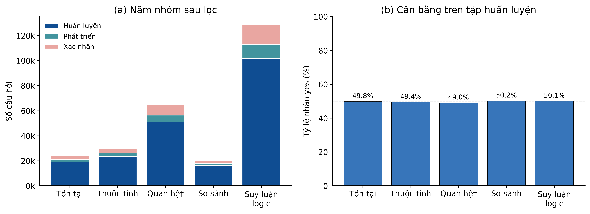
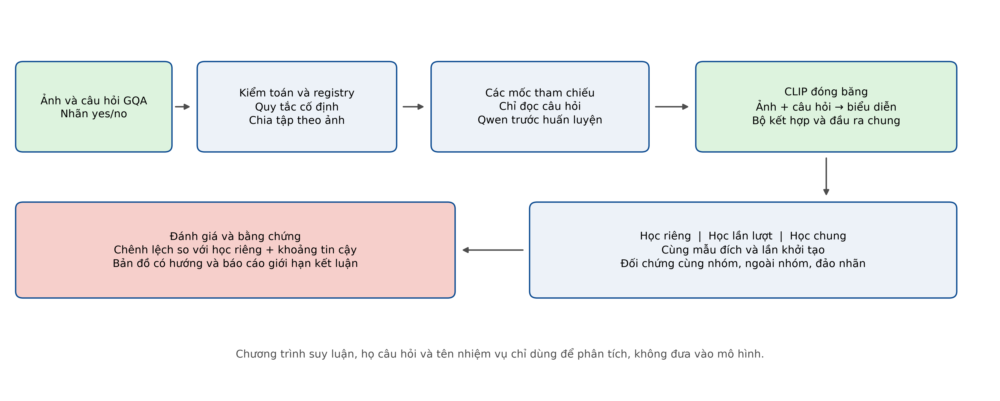
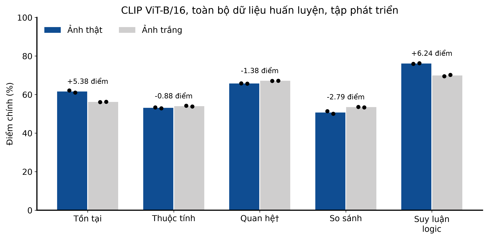
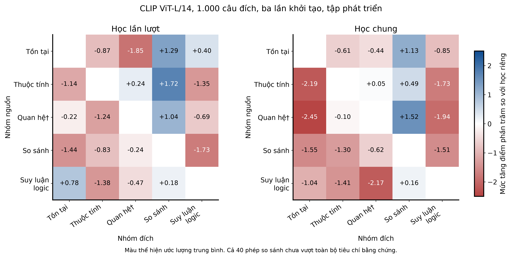
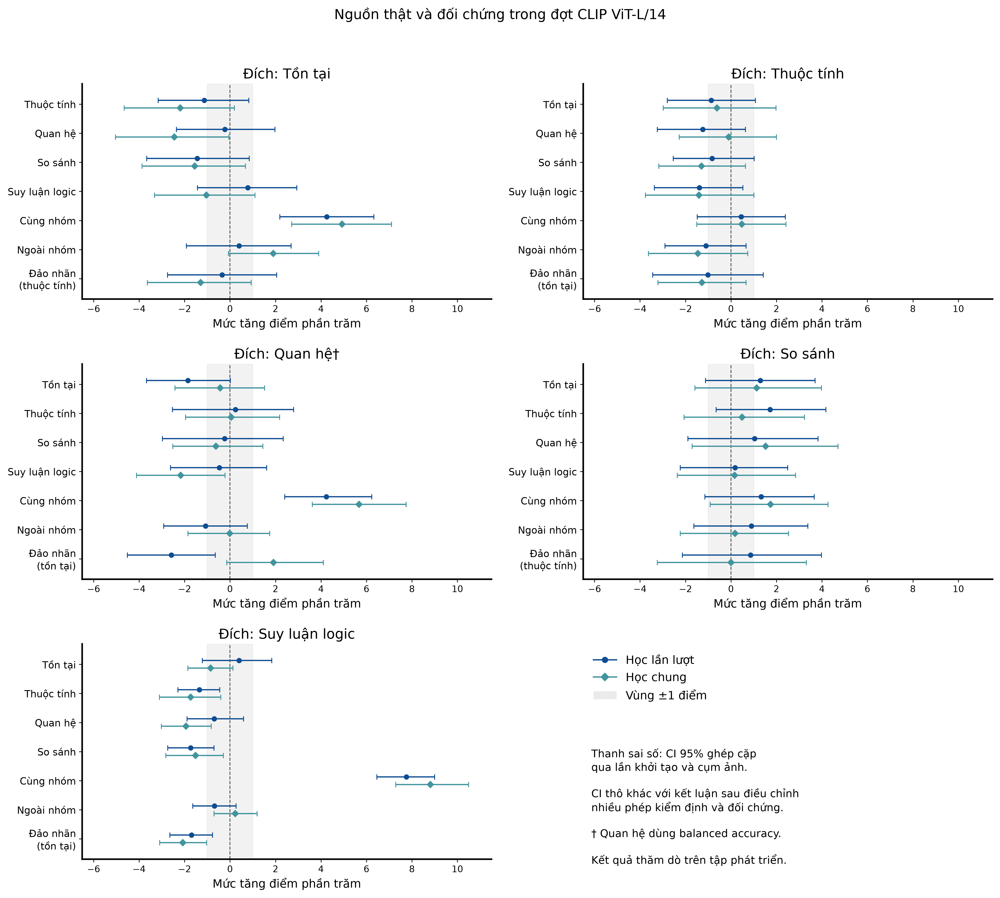

# Transfer-Guided Curriculum Learning for Multi-Task Visual Question Answering

## 1. Background and Problem Formulation

### 1.1. Multi-task learning

In conventional single-task learning, each task is trained and evaluated using a separate model. This approach is straightforward to implement, but it misses opportunities to use knowledge shared across related tasks. For example, the ability to **identify** an object's color could directly support **comparing** the colors of two objects.

Multi-task learning (MTL) addresses this limitation by jointly training multiple tasks in a shared representation space, using supervision from one task to improve generalization on another. In principle, observing related tasks together can help a model learn more general and useful features than training each task independently. However, the benefits of representation sharing remain a hypothesis, rather than a guarantee that combining any set of tasks will improve performance [Caruana, Multitask Learning, 1997](https://doi.org/10.1023/A:1007379606734).

Architecturally, information sharing in MTL typically follows two approaches: hard parameter sharing and soft parameter sharing. With hard parameter sharing, tasks share a feature-extraction backbone and branch into separate output heads. Soft parameter sharing allows each task to retain its own parameters while introducing constraints or mechanisms for exchanging information during optimization. Successful sharing produces **positive transfer**, where joint learning improves performance on one or more tasks. Conversely, competing training signals can pull shared representations in unfavorable directions, causing **negative transfer** and degrading performance.

The research question therefore extends beyond whether MTL is beneficial to **which tasks should be combined, how they should share information, and under what data conditions**. Research on task grouping shows that cooperation and competition between tasks depend strongly on the experimental setting. Even when pretraining on one task helps another, this does not automatically predict the outcome of training them jointly [Standley et al., Which Tasks Should Be Learned Together in Multi-task Learning?, 2020](https://proceedings.mlr.press/v119/standley20a.html).

### 1.2. The project's specific problem

This project studies visual question answering (VQA), where the input consists of an image and an English question about its contents. The current study restricts the output to binary classification with labels `yes` and `no`, together with a score indicating the model's preference for `yes`. Restricting the study to `yes`/`no` questions is a deliberate experimental control. With open-ended questions, each task group would have a different answer vocabulary, such as object names, colors, or counts, allowing differences in output-label distributions to confound evaluation. Mapping all tasks to a common binary output space and using shared evaluation criteria is intended to isolate visual reasoning and measure transfer without confounding differences in answer vocabulary.

Despite sharing a binary output space, questions are divided into five reasoning groups, each treated as a distinct research task:

| Task group | Capability being assessed | Representative GQA question |
|---|---|---|
| Existence (`exist`) | Whether an object satisfying the specified conditions is present | *Is there a red car to the left of the man?* |
| Attribute verification (`verifyAttr`) | Whether an object has the queried attribute | *Is the shirt that the man is wearing blue?* |
| Relation verification (`verifyRel`) | Whether a relation between objects holds | *Is the man holding a cell phone?* |
| Comparison (`compare`) | Whether object attributes are the same or different | *Do the shirt and the pants have the same color?* |
| Logical reasoning (`logic`) | Combining multiple reasoning conditions | *Are there both forks and knives on the table?* |

Experiments use the original English questions and frozen sample lists. Group labels, question types, and reasoning programs are reserved for grouping and analysis and are never provided as model inputs.

The main research question is **whether adding data from a source task improves performance on a target task relative to single-task learning, while holding the amount of target-task data fixed**. For example, the training questions for comparison (`compare`) remain fixed while attribute-verification (`verifyAttr`) questions are added to determine whether the combination provides a reliable improvement.

More broadly, the project asks **how to define tasks consistently while distinguishing the task being evaluated from the underlying reasoning operations required to answer its questions**. A question often requires several compositional reasoning steps rather than a single surface-level skill. For example, the attribute-verification question *"Is the shirt that the man is wearing blue?"* requires identifying the man, locating his shirt through the wearing relation, and then checking whether it is blue. Without retaining the reasoning-operation annotations as a separate source of information, it is difficult to determine whether transfer arises from task-level relationships or overlap in component operations. The project therefore aims to **develop a task-definition framework based on existing reasoning-operation annotations**, providing a consistent basis for operation-aware transfer analysis in VQA that can be tested across datasets.

### 1.3. Why the initial baselines are insufficient

Conventional baseline scores alone cannot answer the transfer question or establish the role of reasoning operations described in Section 1.2. High VQA accuracy does not necessarily imply that a model understands the image. A question-only model can exploit linguistic shortcuts, including phrasing, answer frequencies, and negation cues. Without a question-only baseline, linguistic statistical advantages can be mistaken for visual reasoning, leading to incorrect interpretations of task combination.

A model that is too weak or has not converged, and performs near chance on the target task, is also an unreliable basis for conclusions about MTL. If the model cannot learn the original task, failure to benefit from source data may reflect architectural limitations, insufficient data, or unsuitable optimization rather than an absence of useful relationships between the tasks.

Experiments with larger pretrained vision-language models such as Qwen serve as feasibility checks, helping establish whether the dataset contains useful visual signals and whether the task is learnable. However, these results cannot replace controlled comparisons between single-task and joint learning. Zero-shot performance reflects knowledge acquired during large-scale pretraining rather than learning dynamics after exposure to a new task. Likewise, fine-tuning each group independently measures single-task learnability but does not show whether adding source data yields positive or negative transfer at a fixed target-data budget. Because models such as Qwen already integrate knowledge from many tasks during pretraining, isolated performance scores cannot disentangle transfer between individual task pairs. The project therefore combines data auditing, question-only baselines, checks of visual-model learnability, and controlled task-pair experiments.

### 1.4. Core idea and limitations of the transfer map

Building on these controls, the study constructs a directed transfer map. Each source-to-target pair represents the change in target-task performance after adding source-task data. The five task groups yield 20 directed cross-group pairs, each evaluated under two training regimes. In **sequential transfer (Seq)**, the model trains on the source first and then on the target, measuring the reuse of learned representations across stages. In **joint training (Joint)**, it trains from scratch on the pooled source and target data, measuring pairwise MTL directly. Both regimes are compared against a model trained only on the same target sample, distinguishing whether prior source training or joint exposure produces positive or negative transfer.

The experimental architecture uses hard parameter sharing to support analysis of task interactions as formulated in Sections 1.1 and 1.2. Images and questions pass through frozen encoders, followed by a shared fusion module and a single shared binary output head. There are no group-specific output heads, and the group name is not supplied to the model. This setup allows empirical transfer to be compared with the reasoning-operation structure of the questions. Different task groups can share component operations, such as object identification, attribute verification, and logical composition. Operation overlap therefore motivates hypotheses about mutual support, while conclusions must rely on measured effects, stability across runs, and rigorous controls.

A pairwise transfer map characterizes interactions between two tasks at a time. It does not automatically identify the best strategy for combining all five groups. With three or more tasks, cooperation and competition can be more complex than the sum of pairwise effects. The current map provides an empirical basis for subsequent studies of more complex multi-task settings.

## 2. Research Data

### 2.1. Dataset provenance and the choice of GQA

The project uses GQA, a public visual question answering dataset based on real images. Its central strength is that questions are generated systematically from scene graphs and accompanied by reasoning programs describing the required operations. This directly supports the study's goals of defining reasoning groups and investigating linguistic shortcuts. However, automatic question generation can also leave grammatical cues that enable label prediction without inspecting the image [Hudson and Manning, GQA, 2019](https://openaccess.thecvf.com/content_CVPR_2019/html/Hudson_GQA_A_New_Dataset_for_Real-World_Visual_Reasoning_and_Compositional_Question_Answering.html).

Rather than using the entire original GQA corpus, the project starts from **GQA balanced**, the standard version whose answer distribution was rebalanced by the dataset authors. Versions of the local input files are fixed in the [frozen input manifest](gqa_audit/config/FROZEN_MANIFEST.json) to support reproducibility. The initial dataset sizes are:

| Original balanced split | Questions | Unique images |
|---|---:|---:|
| Train | 943,000 | 72,140 |
| Validation | 132,062 | 10,234 |
| Testdev | 12,578 | 398 |

The [Stage 1 schema report](gqa_audit/outputs/stage1/schema_report.md) and [image-overlap checks](gqa_audit/outputs/stage2/split_image_overlap.csv) confirm that the image sets in Train, Validation, and Testdev are mutually disjoint. These are raw input counts for the balanced dataset. Actual training counts are substantially smaller after selecting `yes`/`no` questions for the five task groups.

### 2.2. Image-level splitting and the filtered distribution

Directly using the original validation split for hyperparameter tuning, stopping decisions, or repeated task-combination experiments would risk overfitting to the evaluation set. To retain the original validation split as an independent **confirmation set** for final findings, while excluding `testdev` from model evaluation, the project requires an intermediate development set for exploration, convergence monitoring, and model selection. It randomly selects 10% of the training images with `seed = 0`, corresponding to 7,214 images, to form the internal `dev` split. The remainder forms `train_core`. Splitting is strictly image-level: all questions about an image remain on the same side. This single split is retained without repeated splitting or label rebalancing to obtain a more favorable distribution.

The main experimental design uses the strict `program_strict` filter. Group counts are drawn from the [task statistics](gqa_audit/outputs/stage2/task_stats.csv), with a report copy in [dataset.csv](docs/tables/project_overview/dataset.csv).

| Group | Train core | Dev | Validation | Testdev | Yes in train | No in train |
|---|---:|---:|---:|---:|---:|---:|
| Existence | 18,921 | 2,083 | 2,879 | 162 | 9,419 | 9,502 |
| Attribute verification | 23,462 | 2,721 | 3,633 | 573 | 11,595 | 11,867 |
| Relation verification | 50,947 | 5,576 | 7,933 | 769 | 24,964 | 25,983 |
| Comparison | 15,994 | 1,705 | 2,504 | 291 | 8,025 | 7,969 |
| Logical reasoning | 101,611 | 11,117 | 15,926 | 1,755 | 50,857 | 50,754 |
| Total across five groups | 210,935 | 23,202 | 32,875 | 3,550 | 104,860 | 106,075 |

Logical reasoning has substantially more examples than the other four groups. Moreover, balance between `yes` and `no` across an entire group does not imply balance within its question families or subsets.

Relation verification illustrates this issue. Its primary metric is computed only on `verifyRel_relation`, comprising 31,206 training, 3,556 development, and 4,881 validation questions. In this subset's development split, 2,813 answers are `yes`, or 79.11%. Ordinary accuracy can therefore obscure a bias toward majority-label predictions. The study instead uses **balanced accuracy**, the arithmetic mean of recall for the two classes, as specified by the [subset definitions](gqa_audit/outputs/stage2b/analysis_subsets.json), [audit report](gqa_audit/outputs/stage2/AUDIT_REPORT.md), and [within-subset relation baselines](gqa_audit/outputs/stage2b/verifyrel_within_subset_baselines.csv).



*Figure 1. Sizes of the five filtered groups and their yes proportions in train core. The relation bar shows the entire group, whereas its primary metric uses only the relation subset described above. [PDF](docs/figures/project_overview/01_dataset.pdf).*

Three properties of this distribution matter throughout the analysis. Unequal group sizes make comparisons at a fixed target-data budget more informative than comparisons using all available data. Aggregate label balance can conceal local imbalance within subsets. Finally, image-level splitting prevents image leakage between `train_core` and `dev`, but does not eliminate repeated question templates or linguistic shortcuts.

### 2.3. An actual data example

The following abbreviated training example from the [schema report](gqa_audit/outputs/stage1/schema_report.md) illustrates the data structure.

```json
{
  "question_id": "02930152",
  "imageId": "2354786",
  "question": "Is the sky dark?",
  "answer": "yes",
  "types": {
    "detailed": "verifyAttr",
    "semantic": "attr",
    "structural": "verify"
  }
}
```

Its reasoning program specifies two successive operations: identify the sky and check whether it is dark. The model receives only image `2354786` and the question `Is the sky dark?`, with `yes` as the supervision label. Identifiers link records and control sample counts. Question-type annotations and reasoning programs remain separate for grouping and analysis.

### 2.4. Cleaning, filtering, and shortcut controls

Data cleaning follows the frozen rules in [task_rules.yaml](gqa_audit/config/task_rules.yaml) and [answer_families.yaml](gqa_audit/config/answer_families.yaml). It retains valid `yes`/`no` questions, requires a reasoning program, and maps each question to one of the five task groups. To separate reasoning operations as discussed in Section 1.2, `program_strict` removes questions containing the `relate` operation from the existence, attribute-verification, and comparison groups, while preserving the compositional structure of logical reasoning.

The [audit report](gqa_audit/outputs/stage2/AUDIT_REPORT.md) also documents the exclusion of severely imbalanced question families. Specifically, `verifyAttrAnd` and `verifyMaterialAnd`, totaling 1,301 training questions, were removed from logical reasoning because all their answers were `yes`. Similarly, `twoSameMaterial` was removed from comparison because its yes proportion of 0.379 fell outside the prescribed 0.4–0.6 balance range. No synthetic examples or training-set rebalancing were introduced to compensate for these exclusions.

Reasoning programs are never used as features for the main model, to prevent answer leakage through those annotations. In Stage 2b, a program-structure-only baseline was used to diagnose leakage risk. The `(-)` marker caused unusually large score increases in some groups, confirming that such features must remain diagnostic. According to the [Stage 2b report](gqa_audit/outputs/stage2b/STAGE2B_REPORT.md), the question-only baseline was trained on `train_core` using TF-IDF word unigrams and bigrams with `min_df=2`, followed by logistic regression with `C=1`, `max_iter=2000`, and the `lbfgs` solver. Hard-question subsets consist of examples misclassified by this frozen baseline. Its score on those error subsets is therefore zero by construction, rather than an independent finding about their difficulty. Analysis of logical reasoning after removing negation cues is likewise supplementary.

### 2.5. Image preprocessing and boundaries on test-set use

The CLIP pipeline converts images to RGB, centers each image in a square padded with the CLIP mean color `(122, 116, 104)`, resizes it to 224 × 224 using bicubic interpolation, and applies CLIP normalization. Padding preserves the full image layout, whereas center cropping can remove objects near the edges. The entire pilot pipeline uses neither random cropping nor other random image augmentation. Dropout in the fusion module serves as regularization.

The Qwen branch uses the model's default image processor and chat template, with pixel-count limits frozen in the [Stage 3 configuration](configs/stage3_protocol.FROZEN.yaml). Because the architectures differ in both preprocessing and pretraining, their score differences cannot be interpreted as an ablation that changes only the backbone.

Test-data use is documented separately for each stage. Stage 1 inspected the schema and several `testdev` examples to verify the format. After adoption of the frozen protocols in later stages, `testdev` was not used for inference or model selection. Stage 3.5 and the larger CLIP experiments evaluate only on `dev`. The CLIP feature cache includes validation images but excludes `testdev` images. The precise claim is therefore that **testdev was not used for evaluation in these model experiments**, rather than that it was never inspected during preparation.

## 3. System Architecture and Workflow

### 3.1. Overall pipeline



*Figure 2. From dataset statistics to a controlled transfer map. Qwen and question-only reference results help establish the problem's limitations before interpreting the CLIP matrices. [PDF](docs/figures/project_overview/02_pipeline.pdf).*

The workflow starts by reading the original question files, validating the schema, and creating image-level splits. After filtering, question identifiers (`question_id`) for each task group, variant, and split are frozen in a central registry. All model branches subsequently draw samples directly from this registry rather than reassigning groups, ensuring that comparisons use consistent data definitions.

For CLIP, visual features are extracted once and stored in FP16 memory-mapped binary files for efficient access. Each training run reads cached image features, combines them with encoded question features in a multimodal fusion module, and predicts the label. Evaluation uses the same `dev` lists and saves predictions by question ID. Statistical analysis pairs each experimental arm with its corresponding baseline using the same random seed and target sample, then computes performance differences, confidence intervals (CIs), and conclusions under the frozen rules.

### 3.2. Probe architecture

The study uses a probe architecture with frozen input encoders to measure transfer between question groups without changes to the large pretrained encoders' weights. The following table compares the two CLIP versions used in the study.

| Component | Initial CLIP ViT-B/16 | CLIP ViT-L/14 used for the report experiment |
|---|---|---|
| Image encoder | Frozen, penultimate layer | Frozen, penultimate layer |
| Features per image | 197 × 768 | 257 × 1,024 |
| Question-token features | 512 dimensions | 768 dimensions |
| Fusion module | 4 pre-LN Transformer layers, width 512 | 4 pre-LN Transformer layers, width 512 |
| Attention and FFN | 8 heads, FFN width 2,048 | 8 heads, FFN width 2,048 |
| Prediction head | One logit at the `[FUS]` token | One logit at the `[FUS]` token |
| Trainable parameters in the selected configuration | 13,271,041 | 13,533,185 |
| Total parameters in the runtime probe object | 76,436,993 | 136,593,665 |

The probe parameter totals include the text encoder but exclude the vision tower, which is separated out for offline feature extraction. These counts describe the runtime probe rather than the full original CLIP checkpoint, as recorded in the `parameters` field of `run.json`, extracted in [sources.json](docs/tables/project_overview/sources.json), and defined in [model.py](src/vqa_research/probe/model.py).

During the forward pass, image and text features are linearly projected into a shared 512-dimensional space, augmented with modality type embeddings, and concatenated with a leading aggregation token `[FUS]`. Four pre-LN Transformer layers process the sequence using an attention mask to ignore question padding. A sigmoid converts the single logit at `[FUS]` into a probability for `yes`. The predicted label is `yes` when the logit exceeds zero. Optimization uses binary cross-entropy with logits without class weighting.

The standard CLIP training configuration uses AdamW with a learning rate of 0.0001, batch size 64, cosine learning-rate decay with 5% warmup, gradient clipping at 1, and dropout of 0.1. Training uses bf16 mixed-precision autocast while retaining FP32 master parameters, with both image and question encoders frozen. The main L/14 experiment additionally uses the mathematical scaled dot-product attention backend (math SDPA), whereas the earlier B/16 pilot recorded warnings about computational determinism. Differences between B/16 and L/14 therefore include the attention computation path and numerical stability, in addition to encoder size.

### 3.3. Workflow reference

Code, configuration, and outputs for each experimental stage are organized into separate modules for inspection and cross-checking.

| Step | Main code and configuration | Outputs to inspect |
|---|---|---|
| Audit raw data | [stage1.py](gqa_audit/stage1.py) | [schema_report.md](gqa_audit/outputs/stage1/schema_report.md) |
| Create splits and task groups | [stage2.py](gqa_audit/stage2.py), [stage2_data.py](gqa_audit/stage2_data.py), [task_rules.yaml](gqa_audit/config/task_rules.yaml) | [task_registry.json](gqa_audit/outputs/stage2/task_registry.json), [task_stats.csv](gqa_audit/outputs/stage2/task_stats.csv) |
| Analyze shortcuts and subsets | [stage2b.py](gqa_audit/stage2b.py), [stage2b_analysis.py](gqa_audit/stage2b_analysis.py) | [STAGE2B_REPORT.md](gqa_audit/outputs/stage2b/STAGE2B_REPORT.md), [analysis_subsets.json](gqa_audit/outputs/stage2b/analysis_subsets.json) |
| Run zero-shot Qwen evaluation | [run_experiment.py](scripts/run_experiment.py), [inference.py](src/vqa_research/inference.py), [stage3_protocol.FROZEN.yaml](configs/stage3_protocol.FROZEN.yaml) | [STAGE3_REPORT.md](gqa_audit/outputs/stage3/STAGE3_REPORT.md), [metrics_3b.csv](gqa_audit/outputs/stage3/metrics_3b.csv) |
| Cache features and build CLIP models | [probe/features.py](src/vqa_research/probe/features.py), [probe/model.py](src/vqa_research/probe/model.py) | [B/16 manifest](docs/tables/project_overview/clip_b16_feature_manifest.json), [L/14 manifest](docs/tables/project_overview/clip_l14_feature_manifest.json) |
| Run pilot phases P0–P4 | [run_stage3_5.py](scripts/run_stage3_5.py), [recipe.py](src/vqa_research/probe/recipe.py), [transfer.py](src/vqa_research/probe/transfer.py), [pilot_protocol.FROZEN.yaml](configs/pilot_protocol.FROZEN.yaml) | [Stage 3.5 directory](gqa_audit/outputs/stage3_5) |
| Run Qwen LoRA P5 | [lora_pilot.py](src/vqa_research/lora_pilot.py) | [qwen_runs](gqa_audit/outputs/stage3_5/qwen_runs) |
| Schedule and train the new transfer map | [queue_chuyen_giao.py](scripts/queue_chuyen_giao.py), [pipeline.py](src/vqa_research/chuyen_giao/pipeline.py), [engine.py](src/vqa_research/chuyen_giao/engine.py) | [design.FROZEN.json](gqa_audit/outputs/bao_cao_chuyen_giao_clip_l14/design.FROZEN.json), [matrix_manifest.json](gqa_audit/outputs/bao_cao_chuyen_giao_clip_l14/matrix_manifest.json) |
| Evaluate and perform statistical inference | [evaluation.py](gqa_audit/evaluation.py), [chuyen_giao/analysis.py](src/vqa_research/chuyen_giao/analysis.py) | [baselines.csv](gqa_audit/outputs/bao_cao_chuyen_giao_clip_l14/baselines.csv), [edges.csv](gqa_audit/outputs/bao_cao_chuyen_giao_clip_l14/edges.csv) |
| Export this report's figures and tables | [plot_project_report.py](scripts/plot_project_report.py) | [Figures](docs/figures/project_overview), [tables and provenance](docs/tables/project_overview) |

The [design proposal](design/transfer_experiment_design.md) describes the original overall research direction. It is not evidence that every experiment it discusses was actually executed.

### 3.4. Transfer estimands and controls

Let $\mathcal{T}$ denote the five task groups, with $S, T \in \mathcal{T}$ ($S \neq T$) representing source and target tasks, $A \in \{\text{Seq}, \text{Joint}\}$ the training regime, and $r \in \{1000, 1001, 1002\}$ the random seed. Let $M_T(f)$ be the primary metric for model $f$ evaluated on task $T$'s `dev` split. Define $f_{A(S \rightarrow T, r)}$ as the model trained using source $S$ and target $T$ under regime $A$ and seed $r$, and $f_{\text{Base}(T, r)}$ as the target-only baseline with the same seed. The directed transfer effect $\Delta_A(S \rightarrow T, r)$, reported in percentage points (pp), is:

$$
\Delta_A(S \rightarrow T, r) = M_T\big(f_{A(S \rightarrow T, r)}\big) - M_T\big(f_{\text{Base}(T, r)}\big)
$$

For example, if $M_T(f_{\text{Base}}) = 53\%$ and $M_T(f_A) = 55\%$, then $\Delta_A = +2$ percentage points (pp). If both $\Delta_{\text{Seq}} < 0$ and $\Delta_{\text{Joint}} < 0$, both ways of adding source data reduce target performance in the setting under study. There is no requirement that $\Delta_{\text{Joint}} > 0$ whenever $\Delta_{\text{Seq}} < 0$, because optimization and the order of exposure to data differ between the regimes.

Within a run, seed $r$ controls training-sample selection $(D_S^{(r)}, D_T^{(r)})$, network initialization, and data shuffling through separate random-number generators. Consequently, the standard deviation (SD) across runs reflects both sampling variability and optimization variability, rather than initialization alone. Paired experimental arms use the same target sample $D_T^{(r)}$ and seed $r$ to reduce random variation in comparisons.

The reduced-scope experiment fixes $|D_S| = 10,000$ source questions and $|D_T| = 1,000$ target questions, using seeds 1000, 1001, and 1002. The baseline trains for 10 epochs on $D_T^{(r)}$ only. `Seq` trains for 10 epochs on $D_S^{(r)}$, reloads the learned weights, and initializes a fresh optimizer and learning-rate schedule before training for 10 epochs on $D_T^{(r)}$. `Joint` trains from scratch for 10 epochs on $D_S^{(r)} \cup D_T^{(r)}$ without group-specific loss weighting. Joint training therefore sees ten times as many source questions as target questions and performs more updates than the baseline. The resulting effect combines the benefits of the source-data training regime and does not isolate semantic transfer from additional computation. The out-of-group control has only 5,371 questions available in the frozen pool and is therefore not fully sample-count matched to the other sources.

Three controls assess whether improvements reflect related reasoning capabilities or generic benefits from additional data:

| Control | Construction | Effect being investigated |
|---|---|---|
| Same-group | Add 10,000 questions from the target group, excluding target-sample question IDs | Whether directly relevant additional data benefits the model |
| Out-of-group | Use global-scene yes/no questions from a separate pool | Generic benefits from format, label distribution, or additional data exposure |
| Shuffled-label | Retain images and questions from a designated source and permute labels within the sample | Whether benefits require the correct semantic input-to-label mapping |

The same-group control excludes duplicate question IDs but does not guarantee image-disjointness from the target sample. The reduced-scope experiment also omits image-disjoint-source controls and blank-image transfer matrices. For the shuffled-label control, the source is fixed to attribute verification when the target is comparison or existence, and to existence for all other targets. The source is not selected after observing which choice yields favorable results.

The primary metric $M_T$ is fixed as accuracy for four groups and balanced accuracy on `verifyRel_relation` for relation verification. Criteria are not changed after inspecting results. Log-loss, where lower is better and class-balanced computation is used for relation verification, assesses the quality of predicted probabilities. AUROC, where higher is better, assesses discrimination through the ranking of the two labels.

Confidence intervals for the mean performance difference $\bar{\Delta}_A(S \rightarrow T)$ are estimated using a hierarchical paired bootstrap with 2,000 replicates. Resampling occurs over both seeds and image clusters to account for dependence among questions about the same image. A directed edge is classified as **supportive** only when its CI lies entirely above the minimum improvement threshold of +1 pp, the effect is positive in at least 80% of seeds (all three runs here), its Benjamini–Hochberg-adjusted $p$-value is at most 0.05, and the control and hard-question-subset criteria are satisfied. An edge is classified as **harmful** when its CI lies entirely below −1 pp and the corresponding stability and statistical criteria are met. Details are implemented in [analysis.py](src/vqa_research/chuyen_giao/analysis.py) and the [frozen design](gqa_audit/outputs/bao_cao_chuyen_giao_clip_l14/design.FROZEN.json).

## 4. Experimental Development and Issues Encountered

### 4.1. Stages 1 and 2: turning the data into auditable tasks

**Hypothesis.** GQA reasoning programs can define clearer capability groups than question wording alone. Before measuring relationships between groups, however, the grouping procedure must avoid leaking labels into inputs or creating groups with only one answer class.

**Implementation.** Validate the schema, retain yes/no questions, map detailed types to five groups, create unfiltered and strict variants, and split train core and dev by image. Freeze the registry and rules so that subsequent stages share the same definitions.

**Issues.** Some families contain only yes answers. Relation verification mixes subsets with different distributions. Some apparently simple questions have programs containing relational operations. Group-level label proportions alone can conceal these issues.

**Resolution.** Exclude families that violate the rules, separate the relation subset, and specify balanced accuracy. Record variants separately to avoid mixing results. This stage establishes stable data definitions rather than MTL findings. Source: [AUDIT_REPORT.md](gqa_audit/outputs/stage2/AUDIT_REPORT.md).

### 4.2. Stage 2b: identifying possible sources of shortcut performance

**Hypothesis.** Questions and program structure may contain label-predictive cues. Similarity in reasoning operations alone does not establish that two groups support each other.

**Implementation.** Train a question-only baseline, examine program structure with and without the negation marker, analyze relation subsets separately, and construct hard-question and negation-cue-free logic subsets. Also verify that the previous stage's results have not changed unintentionally.

**Issues.** There are 18 family-level shortcut warnings. The `(-)` marker substantially improves the program baseline. Operation overlap also correlates with program length and the presence of filtering operations, making causal interpretations unreliable.

**Resolution.** Exclude programs from the main model, retain the linguistic baseline as a reference, report subsets separately, and treat operation similarity as a source of hypotheses. At Stage 2b, 169 regression checks and 49 tests passed. Manual-review records contain 300 entries plus 75 additional entries, but their `human_ok` fields remain blank, so they are not treated as fully human-validated. Source: [STAGE2B_REPORT.md](gqa_audit/outputs/stage2b/STAGE2B_REPORT.md).

### 4.3. Stage 3: using a larger model to check for visual signal

**Hypothesis.** If a stronger vision-language model outperforms the question-only baseline and its own no-image condition, the dataset contains useful signals for the study. This checks the problem before investing in many MTL runs.

**Implementation.** Evaluate pretrained Qwen2.5-VL-3B-Instruct with the same template, with and without images. The yes score is the `logsumexp` of the `yes` and `Yes` token logits minus the corresponding value for `no` and `No`. The metric therefore does not depend on generated answer length.

**Issues.** The initial image archive was truncated and incomplete. Changing batch size changed scores, with a maximum recorded discrepancy of 0.375. An attention optimization required an equivalence check. Post-run review also identified corrections needed in the paired-difference table.

**Resolution.** Verify the complete image archive and required registry images. Fix evaluation batch size at 1. Accept the grouped-attention optimization only after equivalence testing on the selected sample, without treating this as a guarantee for all inputs. Correct eight paired-difference rows: four group-level and four family-level rows. The main aggregate scores remain unchanged. Sources: [STAGE3_REPORT.md](gqa_audit/outputs/stage3/STAGE3_REPORT.md), [optimization validation](gqa_audit/outputs/stage3/optimization_validation.json), and [correction table](gqa_audit/outputs/stage3/paired_difference_corrections.csv).

### 4.4. P0 and P1: building a cheaper CLIP probe and selecting a shared training recipe

**Hypothesis.** Freezing CLIP and training a small fusion module allows many source-to-target experiments at a lower cost than fine-tuning a large model. A shared recipe avoids tailoring each group to obtain desired results.

**Implementation.** P0 caches 82,374 images with features of size 197 × 768 and validates 64 images. P1 evaluates 120 runs: eight configurations across five groups and three budgets, using one seed. Configurations are ranked by dev log-loss within each cell, and the ranks are averaged.

**Issues.** Cache validation initially reported a discrepancy of 0.0625, exceeding the 0.02 threshold. A pandas error occurred because `question_id` was both an index name and a column. CuBLAS and kernel warnings indicated that determinism was not absolute. GPU exclusivity checks also stopped an arm when another process was using the device.

**Resolution.** Compare cached and recomputed features using the same batch size of 32 rather than relaxing the threshold. The final manifest records zero discrepancy across 64 images. Remove the ambiguous index name before merging. Use a queue and GPU locks to wait for resources. Retain the repeated-run check to document residual numerical differences. The selected recipe uses a learning rate of 0.0001, a frozen text encoder, and 10 epochs. Sources: [feature manifest](docs/tables/project_overview/clip_b16_feature_manifest.json), [selected_recipe.json](gqa_audit/outputs/stage3_5/selected_recipe.json), and [repeat.json](gqa_audit/outputs/stage3_5/repeat.json).

The earlier probe's repeated-run check still recorded a maximum logit discrepancy of 0.203125 and a FLAG status. Setting random seeds therefore does not justify calling the entire B/16 pilot bitwise reproducible.

### 4.5. P2 and P3: checking learnability and dependence on images

**Hypothesis.** Before a model is used to measure MTL, it should benefit from more target data and perform better with real images than with blank images.

**Implementation.** P2 completes 85 runs: 75 at budgets of 250, 1,000, and 4,000 questions with five seeds, plus 10 full-data runs with two seeds. P3 includes 25 blank-image runs at the 4,000-question and full-data budgets. Blank images are used during both training and evaluation.

**Issues.** Comparison and attribute verification improve very little. At the full-data budget, real images underperform blank images for attribute verification, relation verification, and comparison. All five groups fail the requirements of a 10 pp image benefit and a 10 pp gain over the question-only baseline.

**Resolution.** Retain all quality flags rather than changing criteria after seeing the scores. Interpret the base CLIP transfer matrix as exploratory evidence from a weak model. Check whether Qwen can learn the difficult group and prepare the previously planned larger CLIP alternative. Sources: [curves_manifest.json](gqa_audit/outputs/stage3_5/curves_manifest.json), [blank_manifest.json](gqa_audit/outputs/stage3_5/blank_manifest.json), and [recomputed quality flags](docs/tables/project_overview/clip_b16_gates.csv).

### 4.6. P4: measuring transfer on a small set of pairs

**Hypothesis.** If groups support each other, source data should improve target performance relative to target-only training, beyond a generic benefit from additional data.

**Implementation.** Use CLIP B/16 with 1,000 target questions, 10,000 source questions, and three seeds. The targets are logical reasoning, relation verification, and comparison. Each target has two genuine source groups and three controls. Complete 27 source-training and 99 target-training runs. Each source is evaluated under Seq and Joint, and the source checkpoint is also evaluated before target training.

**Issues.** The tested cross-group sources provide no clear benefit. Many differences are negative under both Seq and Joint. In contrast, additional same-group data helps logical reasoning and relation verification. This suggests source- and target-dependent effects, but interpretation remains limited by the original model's quality.

**Resolution.** Avoid interpreting all negative cells as evidence that all tasks conflict. Use the findings to design controls and choose subsequent checks. The P4 summary is recomputed from saved predictions because the earlier `PILOT_REPORT.md` was not completed after a slow aggregation process was stopped. Sources: [transfer_manifest.json](gqa_audit/outputs/stage3_5/transfer_manifest.json) and [recomputed P4 summary](docs/tables/project_overview/clip_b16_transfer_summary.csv).

### 4.7. P5: testing comparison with Qwen LoRA

**Hypothesis.** If Qwen learns comparison while the CLIP probe remains near chance, probe failure alone is insufficient evidence that the task is unlearnable.

**Implementation.** Fine-tune only the comparison group with 1,000 and 4,000 questions, two seeds, and two epochs. LoRA uses rank 16, alpha 32, and dropout 0.05, and is applied only to the language component. The vision tower and merger are frozen. Micro-batch size is 4 with four gradient-accumulation steps, giving an effective batch size of 16. Evaluation retains batch size 1 and the Stage 3 scoring rule.

**Issues.** The new evaluator must reproduce the old evaluator's scores before improvements can be attributed to fine-tuning. Four runs on one group are insufficient for MTL conclusions and do not provide a fully resource-matched comparison with CLIP.

**Resolution.** Run a regression check on 128 dev questions, obtaining zero score discrepancy. Complete four runs and save predictions and timing records. Gains over zero-shot dev performance demonstrate adaptation on comparison, but the current study contains no Qwen transfer matrix. Sources: [qwen_regression.json](gqa_audit/outputs/stage3_5/qwen_regression.json) and [P5 runs](docs/tables/project_overview/qwen_lora_runs.csv).

### 4.8. CLIP L/14: from a full design to a reportable reduced-scope experiment

**Hypothesis.** Larger CLIP representations may improve the probe, while a design covering all directed pairs and controls should produce a more inspectable map.

**Implementation.** Cache L/14 features for 82,374 images at 257 × 1,024, with zero discrepancy on 64 validation images. Retain the four-layer fusion module with width 512, freeze both encoders, and use math SDPA. The original full design also includes quality checks, multiple budgets, family-level analyses, and control variants.

**Issues.** A startup error caused by passing the `__file__` string instead of a `Path` to a hashing function was fixed before proceeding. The full projection reached 129.14 hours, exceeding the 24-hour budget. This is a forecast rather than observed matrix runtime. Executing the full design was incompatible with obtaining a reportable experiment within the budget.

**Resolution.** Under the requested scope reduction, omit the 14-family analysis, learning curves, full model-quality validation suite, blank-image matrices, and image-disjoint-source variants. Retain all five groups, 20 directed pairs, two training regimes, three seeds, and three controls. Technical tests still run. The final experiment completes 39 source-training and 225 target-training runs, including 15 baselines. Including five smoke tests and two benchmarks, 271 run records are saved. Sources: [full projection](gqa_audit/outputs/chuyen_giao_clip_l14/projection.json), [reduced-scope design](gqa_audit/outputs/bao_cao_chuyen_giao_clip_l14/design.FROZEN.json), and [final manifest](gqa_audit/outputs/bao_cao_chuyen_giao_clip_l14/matrix_manifest.json).

## 5. Results and Interpretation

### 5.1. Linguistic baselines and the risk of program leakage

| Group | Question-only, validation | Program structure without `(-)` | Program structure with `(-)` |
|---|---:|---:|---:|
| Existence | 56.51% | 50.82% | 78.29% |
| Attribute verification | 55.22% | Not included in this table | Not included in this table |
| Relation verification | 64.63% | 58.28% | 87.19% |
| Comparison | 49.84% | Not included in this table | Not included in this table |
| Logical reasoning | 67.36% | 49.42% | 62.02% |

The question-only relation baseline uses balanced accuracy on `verifyRel_relation`. The two program columns use group-level accuracy from the original diagnostic table and therefore have a different scope. Compare those program columns only with each other within a row, rather than subtracting them directly from the relation baseline. Omitted cells do not mean zero. Sources: [demo_eval_blind.csv](gqa_audit/outputs/stage2b/demo_eval_blind.csv), [verifyrel_within_subset_baselines.csv](gqa_audit/outputs/stage2b/verifyrel_within_subset_baselines.csv), and [program_structure_baseline.csv](gqa_audit/outputs/stage2b/program_structure_baseline.csv).

Three observations:

- Logical reasoning reaches 67.36% from question text alone. A visual model scoring above 50% does not establish effective image use.
- The program's negation marker yields large gains for existence and relation verification, illustrating the risk of misusing metadata.
- Comparison's question-only baseline is near 50%, making it useful for investigating visual capability, provided the model can learn the task.

### 5.2. Zero-shot Qwen: clear image benefits in the evaluated setting

| Group | With images, validation | Without images, validation | Question-only baseline |
|---|---:|---:|---:|
| Existence | 87.91% | 49.29% | 56.51% |
| Attribute verification | 83.43% | 51.33% | 55.22% |
| Relation verification | 84.73% | 56.76% | 64.63% |
| Comparison | 71.73% | 50.60% | 49.84% |
| Logical reasoning | 86.48% | 53.39% | 67.36% |

These results use the strict variant, with balanced accuracy on the relation subset and accuracy for the remaining groups. Sources: [metrics_3b.csv](gqa_audit/outputs/stage3/metrics_3b.csv), [Qwen extract](docs/tables/project_overview/qwen_zero_shot.csv), and the Stage 2b baselines. The model is Qwen2.5-VL-3B-Instruct, revision `66285546d2b821cf421d4f5eb2576359d3770cd3`.


*Figure 3. Left: zero-shot evaluation on validation, with 95% CIs from the original results. Right: LoRA on comparison dev, showing two seeds and mean ± SD. The panels use different evaluation splits and must not be joined into a single learning curve. [PDF](docs/figures/project_overview/03_qwen.pdf).*

Three observations:

- Images improve Qwen's performance over its no-image condition in all five groups, supporting further study of visual signals in this dataset.
- Comparison remains below the other groups despite clearly exceeding the baseline, making it a useful challenge for later stages.
- These scores reflect pretrained capability. They do not identify which source improves which target, or rule out pretraining-data effects.

### 5.3. P1: longer training is not necessarily better

| Learning rate | Text encoder | Epochs | Mean log-loss rank, lower is better |
|---|---|---:|---:|
| 0.0001 | Frozen | 10 | 1.27 |
| 0.0001 | Fine-tuned | 10 | 2.53 |
| 0.0003 | Frozen | 10 | 2.67 |
| 0.0003 | Fine-tuned | 10 | 3.53 |
| 0.0001 | Frozen | 30 | 5.60 |
| 0.0001 | Fine-tuned | 30 | 6.47 |
| 0.0003 | Frozen | 30 | 6.47 |
| 0.0003 | Fine-tuned | 30 | 7.47 |

Each configuration is ranked within 15 group × budget cells using seed 1000. When the text encoder is fine-tuned, its learning rate is 0.00001. Sources: [recipe_selection.csv](gqa_audit/outputs/stage3_5/recipe_selection.csv) and [rank table](docs/tables/project_overview/recipe_ranks.csv).

Three observations:

- The simpler configuration, with frozen text and 10 epochs, ranks best under the specified selection rule.
- Increasing training to 30 epochs worsens dev probability quality within the evaluated grid. Longer training alone cannot be assumed to fix a weak probe.
- The pattern is consistent with overfitting or overconfidence, but the available records lack epoch-level training-loss histories needed to establish the cause.

### 5.4. P2: more data clearly helps only some groups

| Group | 250 questions | 1,000 questions | 4,000 questions | Full train core |
|---|---:|---:|---:|---:|
| Existence | 51.16% | 52.19% | 54.56% | 61.57% |
| Attribute verification | 50.05% | 51.17% | 51.69% | 53.11% |
| Relation verification | 47.60% | 52.20% | 56.13% | 65.74% |
| Comparison | 50.10% | 50.25% | 50.85% | 50.70% |
| Logical reasoning | 51.85% | 54.47% | 59.47% | 76.11% |

Evaluation is on dev. The three smaller budgets average five seeds, whereas the full-data results average two. Relation verification uses the primary metric on its designated subset, but training samples are drawn from the entire strict group. Sources: predictions listed in [curves_manifest.json](gqa_audit/outputs/stage3_5/curves_manifest.json), recomputed in [clip_b16_learning_summary.csv](docs/tables/project_overview/clip_b16_learning_summary.csv).


*Figure 4. Learning curves against target-question count. Faint points show individual seeds, solid lines show means, and error bars show SD. The horizontal axis is logarithmic, and full-data sizes differ between groups. [PDF](docs/figures/project_overview/04_learning_curves.pdf).*

At a budget of 1,000 questions, SDs are 0.34 pp for existence, 0.85 for attribute verification, 1.58 for relation verification, 0.99 for comparison, and 1.04 for logical reasoning. A small gain of approximately one point can be comparable to variation across runs. Supportive pairs should therefore not be selected from a single positive run.

Three observations:

- Logical reasoning, relation verification, and existence improve with additional data, indicating that the probe learns some signal in these groups.
- Comparison remains near chance even with all available data. This failure should not be treated as evidence of zero relationships between capabilities.
- Full-data training also performs more updates, so the table does not isolate sample-count effects from optimization cost.

### 5.5. P3: real images do not provide a consistent probe benefit

| Group | Real images | Blank images | Image benefit | Question-only baseline on dev |
|---|---:|---:|---:|---:|
| Existence | 61.57% | 56.19% | +5.38 pp | 56.75% |
| Attribute verification | 53.11% | 53.99% | −0.88 pp | 54.25% |
| Relation verification | 65.74% | 67.12% | −1.38 pp | 64.11% |
| Comparison | 50.70% | 53.49% | −2.79 pp | 52.20% |
| Logical reasoning | 76.11% | 69.87% | +6.24 pp | 66.64% |

Results use full train core, average two seeds, and are evaluated on dev. The blank-image model is retrained using blank-image features, rather than merely having images removed at inference time. Sources: [image_blank_summary.csv](docs/tables/project_overview/image_blank_summary.csv), P2/P3 predictions, and frozen baselines.



*Figure 5. The two points on each bar correspond to two seeds. Numbers above the bars show real-image minus blank-image performance in pp. Relation verification uses balanced accuracy. [PDF](docs/figures/project_overview/05_image_blank.pdf).*

| Group | G1: exceed question-only baseline by 10 pp | G2: 10 pp image benefit | G3: at least 1 pp gain per doubling from 1,000 to 4,000 | G4: SD at 1,000 at most 1.5 pp |
|---|---|---|---|---|
| Existence | FLAG | FLAG | PASS | PASS |
| Attribute verification | FLAG | FLAG | FLAG | PASS |
| Relation verification | FLAG | FLAG | PASS | FLAG |
| Comparison | FLAG | FLAG | FLAG | PASS |
| Logical reasoning | FLAG | FLAG | PASS | PASS |

Rules: [pilot_protocol.FROZEN.yaml](configs/pilot_protocol.FROZEN.yaml). Statuses are recomputed from the original values in [clip_b16_gates.csv](docs/tables/project_overview/clip_b16_gates.csv). FLAG indicates failure to meet the corresponding criterion, rather than a software error.

Three observations:

- Existence and logical reasoning have positive image benefits, but remain below the prescribed quality thresholds and therefore do not meet the desired conditions for a measurement model.
- Relation verification has a relatively high score, but its blank-image score is even higher. Absolute scores alone would overstate its ability to use images.
- These flags provide empirical motivation to test a stronger model and retain an exploratory interpretation of the CLIP transfer map.

### 5.6. Earlier P4: same-group controls are more informative than the tested cross-group sources

| Source → target in B/16 P4 | Seq, Δ pp | Joint, Δ pp |
|---|---:|---:|
| Existence → logical reasoning | −0.64 | −1.42 |
| Comparison → logical reasoning | −2.43 | −2.28 |
| Existence → relation verification | −1.06 | +0.08 |
| Comparison → relation verification | −2.11 | −4.17 |
| Attribute verification → comparison | −0.12 | −0.47 |
| Existence → comparison | −0.20 | −1.54 |
| Same-group → logical reasoning | +7.10 | +8.25 |
| Same-group → relation verification | +4.41 | +5.67 |
| Same-group → comparison | −0.86 | −1.84 |

The table reports mean paired differences across three seeds, without hypothesis-testing conclusions. The [full P4 table](docs/tables/project_overview/clip_b16_transfer_summary.csv) includes out-of-group and shuffled-label controls. Values are recomputed from predictions listed in the [P4 manifest](gqa_audit/outputs/stage3_5/transfer_manifest.json), rather than taken from an unfinished aggregate report.

Three observations:

- Additional same-group data helps logical reasoning and relation verification more than the tested cross-group sources, indicating that source-data type matters.
- Seq and Joint can both be negative because both underperform the target baseline. The table does not directly measure gradient conflict and therefore does not identify the cause.
- P4 contains only six genuine source-to-target directions across three targets. It is not a complete 20-direction map and must not be pooled with L/14 results into one matrix.

### 5.7. P5: Qwen learns comparison with less data than the probe

| Training questions | Seed | Dev accuracy | Log-loss | AUROC | Training, seconds | Evaluation, seconds |
|---|---:|---:|---:|---:|---:|---:|
| 1,000 | 1000 | 74.72% | 0.5784 | 0.8342 | 542.62 | 249.26 |
| 1,000 | 1001 | 76.01% | 0.5384 | 0.8413 | 520.27 | 231.62 |
| 4,000 | 1000 | 76.60% | 0.5478 | 0.8473 | 2,151.79 | 231.56 |
| 4,000 | 1001 | 77.07% | 0.5378 | 0.8489 | 2,203.78 | 230.97 |

Each run evaluates all 1,705 comparison dev questions. Mean accuracy is 75.37% with 1,000 training questions and 76.83% with 4,000. The zero-shot baseline on **the same dev split** is 72.14%, giving mean gains of +3.23 and +4.69 pp. The validation baseline of 71.73% is not used to calculate these gains. The largest recorded peak GPU memory allocation across the four runs is approximately 9.37 GiB. Sources: [qwen_lora_runs.csv](docs/tables/project_overview/qwen_lora_runs.csv) and [original P5 records](gqa_audit/outputs/stage3_5/qwen_runs).

Three observations:

- Comparison is learnable with this model, so the B/16 probe's near-50% performance reflects limitations of its setup at least in part.
- Increasing training data from 1,000 to 4,000 questions improves the mean, but two seeds are insufficient to characterize the distribution of benefits reliably.
- These are single-task fine-tuning results, without a cross-group source or MTL control. They are not counted as confirmed supportive directions.

### 5.8. L/14 at a matched budget: a larger model does not automatically solve the problem

| Group | B/16, 1,000 questions, same three seeds | L/14, 1,000 questions | L/14 SD, pp |
|---|---:|---:|---:|
| Existence | 52.34% | 53.14% | 0.59 |
| Attribute verification | 51.43% | 51.39% | 0.47 |
| Relation verification | 52.28% | 52.86% | 1.42 |
| Comparison | 50.95% | 49.64% | 1.34 |
| Logical reasoning | 55.11% | 54.79% | 0.34 |

Both columns use only seeds 1000, 1001, and 1002. The B/16 column therefore differs from the five-seed mean in the learning-curve table. Sources: [matched_baselines.csv](docs/tables/project_overview/matched_baselines.csv) and [L/14 baselines.csv](gqa_audit/outputs/bao_cao_chuyen_giao_clip_l14/baselines.csv). Different seed sets must not be mixed within this comparison.

| Group, L/14 baseline | Mean log-loss | Mean AUROC |
|---|---:|---:|
| Existence | 1.5087 | 0.5433 |
| Attribute verification | 1.5935 | 0.5156 |
| Relation verification | 1.6658 | 0.5360 |
| Comparison | 1.5994 | 0.5006 |
| Logical reasoning | 1.5546 | 0.5694 |

The supplementary table averages three seeds from the same [L/14 baselines](docs/tables/project_overview/clip_l14_baselines.csv). Comparison AUROC is also near 0.5, so the problem is not limited to the zero-logit decision threshold. High log-loss motivates examining probability quality and confident errors. No sufficiently detailed example-level error analysis is available to identify the underlying mechanism.

Three observations:

- Switching to L/14 does not yield consistent improvements at a target budget of 1,000 questions. Comparison remains near chance.
- A larger parameter count does not guarantee that the fusion module learns effectively from few labels. The table does not identify which component causes the problem.
- L/14 has not undergone the full quality-validation suite again. Its backbone name alone is insufficient evidence that the B/16 quality flags have been resolved.

### 5.9. The L/14 map: complete directional coverage, but no confirmed edges



*Figure 6. Rows are sources and columns are targets. Each cell shows the mean difference from target-only training in pp. Both matrices share a symmetric color scale. Diagonal cells are blank because same-group controls are analyzed separately. Positive or negative colors do not by themselves indicate a statistically established effect. [PDF](docs/figures/project_overview/06_transfer_matrices.pdf).*

| Source → target | Seq, Δ pp | Joint, Δ pp |
|---|---:|---:|
| Existence → attribute verification | −0.87 | −0.61 |
| Existence → relation verification | −1.85 | −0.44 |
| Existence → comparison | +1.29 | +1.13 |
| Existence → logical reasoning | +0.40 | −0.85 |
| Attribute verification → existence | −1.14 | −2.19 |
| Attribute verification → relation verification | +0.24 | +0.05 |
| Attribute verification → comparison | +1.72 | +0.49 |
| Attribute verification → logical reasoning | −1.35 | −1.73 |
| Relation verification → existence | −0.22 | −2.45 |
| Relation verification → attribute verification | −1.24 | −0.10 |
| Relation verification → comparison | +1.04 | +1.52 |
| Relation verification → logical reasoning | −0.69 | −1.94 |
| Comparison → existence | −1.44 | −1.55 |
| Comparison → attribute verification | −0.83 | −1.30 |
| Comparison → relation verification | −0.24 | −0.62 |
| Comparison → logical reasoning | −1.73 | −1.51 |
| Logical reasoning → existence | +0.78 | −1.04 |
| Logical reasoning → attribute verification | −1.38 | −1.41 |
| Logical reasoning → relation verification | −0.47 | −2.17 |
| Logical reasoning → comparison | +0.18 | +0.16 |

Sources: [original edges.csv](gqa_audit/outputs/bao_cao_chuyen_giao_clip_l14/edges.csv) and its report copy, [clip_l14_edges.csv](docs/tables/project_overview/clip_l14_edges.csv). Each value is paired with a baseline using the same seed and target sample. Full CIs, tests, and controls are available in the CSV and the [experiment's BAO_CAO.md](gqa_audit/outputs/bao_cao_chuyen_giao_clip_l14/BAO_CAO.md).

Among the 40 genuine-source effects, 12 means are positive and 28 are negative. **All 40 are labeled “insufficient evidence.”** No direction satisfies the complete criteria for either support or harm. This does not mean every CI includes zero. Seven unadjusted CIs lie entirely below zero, but still fail the full harmful-edge criteria.

For example, attribute verification → comparison under Seq has a mean gain of +1.72 pp and a 95% CI from −0.66 to +4.18 pp. The mean exceeds one point, but the lower bound does not exceed +1, so the supportive criterion is not met. Relation verification → existence under Joint declines by −2.45 pp, with a CI from −5.03 to −0.05. This CI excludes zero, but its upper bound is not below −1, so it also fails the minimum-effect criterion for harm.

Three observations:

- Existence, attribute verification, and relation verification have positive mean effects when comparison is the target, but uncertainty remains substantial and the target baseline is weak. These are candidates for follow-up, rather than confirmed relationships.
- Estimates are asymmetric. For example, existence → comparison is positive while comparison → existence is negative. Shared operations do not justify forcing the map to be symmetric.
- Seq and Joint can have opposite signs, as for logical reasoning → existence. This is consistent with training organization affecting the measurement, but no direct test has established a difference between regimes for each cell.

### 5.10. Controls help interpret effects near zero



*Figure 7. Each panel represents a target, with four genuine source groups and three controls. Error bars are paired 95% CIs across seeds and image clusters. The gray band from −1 to +1 pp represents the predefined small-effect region, rather than a confidence interval. [PDF](docs/figures/project_overview/07_effects_controls.pdf).*

| Target with a same-group source | Seq, Δ and 95% CI, pp | Joint, Δ and 95% CI, pp |
|---|---|---|
| Existence | +4.26 [2.19, 6.33] | +4.93 [2.72, 7.10] |
| Attribute verification | +0.45 [−1.48, 2.39] | +0.48 [−1.50, 2.42] |
| Relation verification | +4.24 [2.41, 6.24] | +5.68 [3.61, 7.74] |
| Comparison | +1.33 [−1.15, 3.66] | +1.74 [−0.91, 4.27] |
| Logical reasoning | +7.75 [6.45, 9.00] | +8.81 [7.29, 10.49] |

Source: `source=self` rows in [edges.csv](gqa_audit/outputs/bao_cao_chuyen_giao_clip_l14/edges.csv). These controls are reported with unadjusted CIs. They are not counted as confirmed cross-group directions, and the genuine-source hypothesis-testing labels are not applied to them.

Three observations:

- Additional same-group data produces clearer gains for existence, relation verification, and logical reasoning. The probe can benefit from data under some conditions despite the absence of confirmed cross-group benefits.
- Attribute verification and comparison still have wide CIs around small gains with extra same-group data. Their difficulties may involve representation or learning, requiring dedicated experiments to identify the cause.
- Out-of-group and shuffled-label controls can also have nonzero means because of data effects, optimization, and noise. Looking only at the sign of a genuine-source effect overlooks these alternative explanations.

### 5.11. Computational cost and actual completion

| Design or resource counter | Hours | Interpretation |
|---|---:|---|
| Full L/14 design | 129.14 | Total projection, stopped before full execution |
| Reduced-scope design | 14.04 | Total projection including previously incurred preparation |
| Completed reduced-scope experiment | 9.24 | Total resource-counter time, including preparation from the earlier experiment |
| Recorded before scope reduction | 0.47 | Preparation, caching, and prior activity |
| Subsequently added time | 8.77 | Difference between the original counters, rather than kernel time alone |

Sources: [full projection.json](gqa_audit/outputs/chuyen_giao_clip_l14/projection.json), [reduced-scope projection.json](gqa_audit/outputs/bao_cao_chuyen_giao_clip_l14/projection.json), [earlier budget.json](gqa_audit/outputs/chuyen_giao_clip_l14/budget.json), and [final status.json](gqa_audit/outputs/bao_cao_chuyen_giao_clip_l14/status.json). The final counter is 33,268.170042 seconds, including 1,706.403674 seconds carried over from the earlier experiment. It tracks time holding resources, including CPU work and I/O within the corresponding phases, rather than GPU-kernel time measured by a profiler.


*Figure 8. The full projection and reduced-scope experiment cover different workloads. Their ratio must not be interpreted as a speedup from model optimization. [PDF](docs/figures/project_overview/08_cost.pdf).*

The L/14 cache contains 43,356,401,664 bytes of raw features, approximately 40.38 GiB on disk. This is not a requirement to load the entire cache into VRAM at once. Recorded feature-extraction time is 1,455.72 seconds. Source: [L/14 manifest](docs/tables/project_overview/clip_l14_feature_manifest.json). Per-run training and evaluation times are stored in [run_timings.csv](docs/tables/project_overview/run_timings.csv), distinguishing individual-arm timings from the aggregate resource counter.

Three observations:

- Reducing scope enabled a complete 20-direction experiment within budget, at the cost of the full quality-validation suite and control variants.
- Joint training is substantially more expensive because each epoch uses the union of source and target data. Run counts alone do not describe total computation.
- Projections and recorded resource time serve management purposes distinct from GPU profiling. They should be reported within their actual scope rather than interpreted as algorithmic savings.

## 6. Current Limitations and Next Steps

### 6.1. Established findings and remaining gaps

The study has established definitions for five groups on audited data, baselines, and a controlled transfer-measurement system. The final experiment covers all required cells for five groups, one target budget, and two training regimes. Complete cell coverage, however, does not establish a map of confirmed supportive relationships.

| Limitation | Implication for interpretation |
|---|---|
| Weak probe on attribute verification and comparison, with no full L/14 quality-validation suite | Effects near 0 cannot be attributed entirely to the tasks themselves |
| Only one target budget and three seeds in the final experiment | Data-budget effects and rare variation remain uncharacterized |
| Exploratory evaluation on dev, using seeds shared with the earlier pilot | This is not independent confirmation on validation or held-out random seeds |
| No blank-image matrices or image-disjoint-source variants | Any benefit has not been established as visual knowledge transfer rather than language effects or shared images |
| Only 5,371 out-of-group source questions | This control is not fully sample-count matched to genuine sources of 10,000 questions |
| Groups contain multiple families and differ in size | Group means may conceal cooperating or competing families |
| Manual-review confirmation fields remain blank | Complete human review is still needed to assess grouping and labeling errors |
| No check for overlap between Qwen or CLIP pretraining data and study images | Pretraining effects cannot be fully ruled out |
| Model comparisons change encoders, attention computation, and pretraining history | Differences cannot be attributed solely to backbone size |
| No joint training across all five groups or measurement of higher-order interactions | The pairwise matrix does not identify the optimal MTL grouping |
| No source evaluation after target training in the main Seq table | Catastrophic forgetting is not measured directly |
| No epoch-level training-loss histories or saved Qwen adapters in P5 directories | Learning dynamics are harder to diagnose, and P5 adapters cannot be reloaded from saved predictions alone |

The final two limitations are checked against [train.py](src/vqa_research/probe/train.py), [lora_pilot.py](src/vqa_research/lora_pilot.py), and the saved outputs. The presence of `run.json` does not imply that all fine-tuned weights were saved.

### 6.2. Prioritized next steps

**Step 1: establish adequate measurement-model quality before expanding the matrix.** Reexamine learning curves, image benefits, log-loss, AUROC, and example-level errors for the two weak groups on L/14. Record training loss by epoch and test whether the model can overfit a small subset. The aim is to distinguish optimization limitations, overconfidence, and representation limitations. This does not require immediately rerunning the entire 129-hour design.

**Step 2: examine selected candidates with stronger controls.** Directions such as attribute verification → comparison can be selected for further exploration because of their positive means, alongside negative directions for comparison. Run image-disjoint-source and blank-image conditions on matched sample lists. Retain sampling and scoring procedures, and add an update-budget-matched baseline to separate source-knowledge effects from longer training. This is a proposed design rather than a completed result.

**Step 3: freeze a small set of confirmatory hypotheses.** After selecting candidates on dev, preregister directions, budgets, seed counts, effect thresholds, controls, and multiple-testing corrections. Use held-out random seeds and evaluate on validation under a new protocol. Since validation was already used for Stage 3 zero-shot evaluation, disclose that history rather than describing it as untouched throughout the project. Choose the scale from measured uncertainty and cost. There is currently insufficient evidence to specify an optimal run count.

**Step 4: use Qwen to assess model dependence when that stage is approved.** The four P5 runs establish feasibility for comparison, but adapter saving and controls must be added before measuring task pairs. Qwen results would help assess whether a relationship persists with a stronger model or is specific to the CLIP probe. This is future work and was not launched during report preparation.

**Step 5: progress from pairwise relationships to a full MTL design.** Once some edges are confirmed, test combinations of three groups or all five. Compare single-task learning, joint training on all groups, and groupings selected from the map under consistent budget rules. Only then consider soft parameter sharing, loss balancing, or gradient-conflict mitigation methods. Such methods require corresponding diagnostics and should not be introduced solely because the matrix contains negative cells.

The desired confirmatory output is a map in which every edge is accompanied by its task definitions, data provenance, model, budget, uncertainty interval, and evidence level. Edges with insufficient evidence retain that status. This presentation allows the map to guide MTL design without turning experimental fluctuations into fixed definitions of relationships between capabilities.
