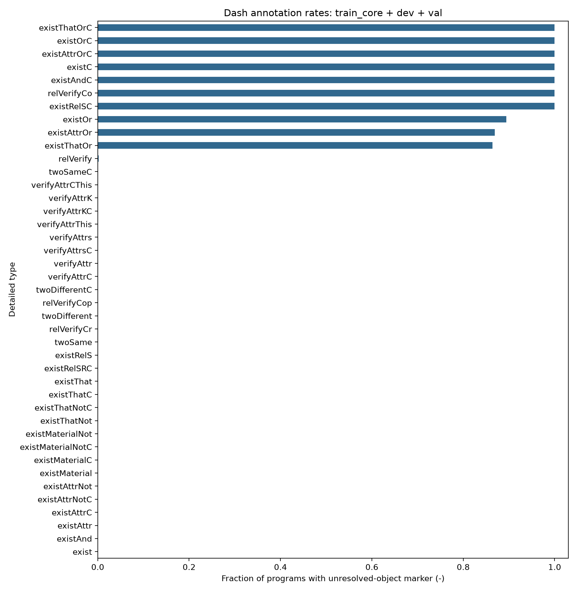
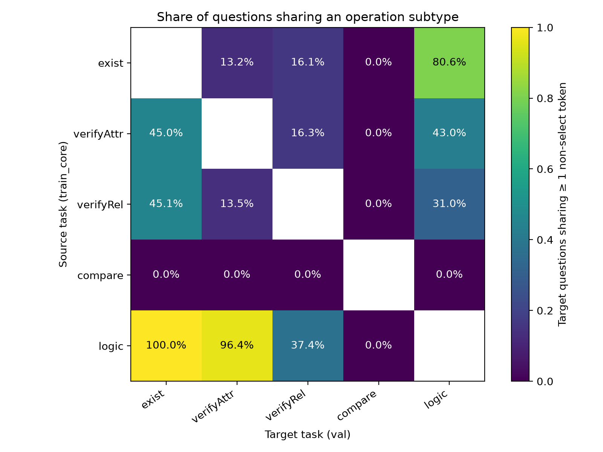
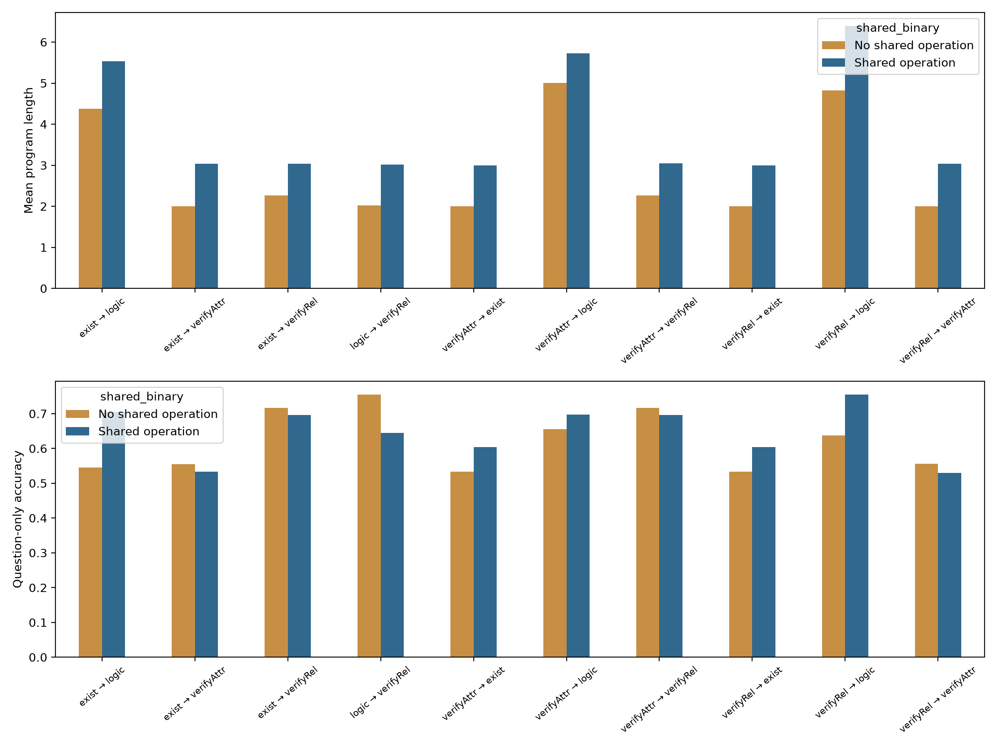
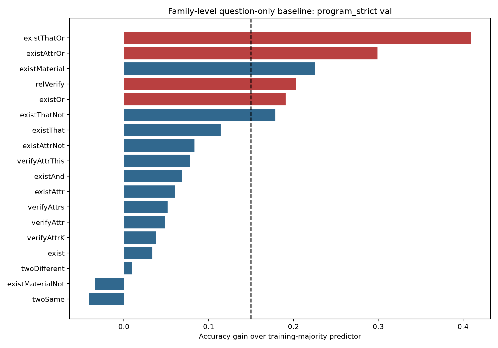

# GQA Stage 2b analysis addendum

Source commit: 414208103afa34c398003155fd2e6593c681e4a1

Registry: c122aac0bbb9ed8ad6eaa93843d95df664ba75c767946003e90ff2469c27b451

Frozen H-L plan: 0d23283638bbfa254994156fe30650ef5db6254f50c943f27c7233452b99520b

## Preflight and immutability

All pinned hashes and cache fingerprints passed. Stage 1 and Stage 2 were not rerun. Their output files and existing notebooks were hashed before and after this run; all bytes are unchanged. Testdev contributed assignment metadata only: no text, program or predictions were processed.

## Regression targets (expected versus actual)

| kind | key | field | expected | actual | status |
|---|---|---|---|---|---|
| text_hard | program_strict/dev/compare | n | 1705 | 1705 | PASS |
| text_hard | program_strict/dev/compare | text_hard | 815 | 815 | PASS |
| text_hard | program_strict/dev/compare | text_hard_yes | 415 | 415 | PASS |
| text_hard | program_strict/dev/exist | n | 2083 | 2083 | PASS |
| text_hard | program_strict/dev/exist | text_hard | 901 | 901 | PASS |
| text_hard | program_strict/dev/exist | text_hard_yes | 492 | 492 | PASS |
| text_hard | program_strict/dev/logic | n | 11117 | 11117 | PASS |
| text_hard | program_strict/dev/logic | text_hard | 3709 | 3709 | PASS |
| text_hard | program_strict/dev/logic | text_hard_yes | 1504 | 1504 | PASS |
| text_hard | program_strict/dev/verifyAttr | n | 2721 | 2721 | PASS |
| text_hard | program_strict/dev/verifyAttr | text_hard | 1245 | 1245 | PASS |
| text_hard | program_strict/dev/verifyAttr | text_hard_yes | 650 | 650 | PASS |
| text_hard | program_strict/dev/verifyRel | n | 5576 | 5576 | PASS |
| text_hard | program_strict/dev/verifyRel | text_hard | 1579 | 1579 | PASS |
| text_hard | program_strict/dev/verifyRel | text_hard_yes | 931 | 931 | PASS |
| text_hard | program_strict/val/compare | n | 2504 | 2504 | PASS |
| text_hard | program_strict/val/compare | text_hard | 1256 | 1256 | PASS |
| text_hard | program_strict/val/compare | text_hard_yes | 575 | 575 | PASS |
| text_hard | program_strict/val/exist | n | 2879 | 2879 | PASS |
| text_hard | program_strict/val/exist | text_hard | 1252 | 1252 | PASS |
| text_hard | program_strict/val/exist | text_hard_yes | 672 | 672 | PASS |
| text_hard | program_strict/val/logic | n | 15926 | 15926 | PASS |
| text_hard | program_strict/val/logic | text_hard | 5198 | 5198 | PASS |
| text_hard | program_strict/val/logic | text_hard_yes | 2212 | 2212 | PASS |
| text_hard | program_strict/val/verifyAttr | n | 3633 | 3633 | PASS |
| text_hard | program_strict/val/verifyAttr | text_hard | 1627 | 1627 | PASS |
| text_hard | program_strict/val/verifyAttr | text_hard_yes | 858 | 858 | PASS |
| text_hard | program_strict/val/verifyRel | n | 7933 | 7933 | PASS |
| text_hard | program_strict/val/verifyRel | text_hard | 2272 | 2272 | PASS |
| text_hard | program_strict/val/verifyRel | text_hard_yes | 1314 | 1314 | PASS |
| text_hard | unfiltered/dev/compare | n | 1705 | 1705 | PASS |
| text_hard | unfiltered/dev/compare | text_hard | 815 | 815 | PASS |
| text_hard | unfiltered/dev/compare | text_hard_yes | 415 | 415 | PASS |
| text_hard | unfiltered/dev/exist | n | 7528 | 7528 | PASS |
| text_hard | unfiltered/dev/exist | text_hard | 3252 | 3252 | PASS |
| text_hard | unfiltered/dev/exist | text_hard_yes | 1814 | 1814 | PASS |
| text_hard | unfiltered/dev/logic | n | 11117 | 11117 | PASS |
| text_hard | unfiltered/dev/logic | text_hard | 3709 | 3709 | PASS |
| text_hard | unfiltered/dev/logic | text_hard_yes | 1504 | 1504 | PASS |
| text_hard | unfiltered/dev/verifyAttr | n | 3583 | 3583 | PASS |
| text_hard | unfiltered/dev/verifyAttr | text_hard | 1616 | 1616 | PASS |
| text_hard | unfiltered/dev/verifyAttr | text_hard_yes | 839 | 839 | PASS |
| text_hard | unfiltered/dev/verifyRel | n | 5576 | 5576 | PASS |
| text_hard | unfiltered/dev/verifyRel | text_hard | 1579 | 1579 | PASS |
| text_hard | unfiltered/dev/verifyRel | text_hard_yes | 931 | 931 | PASS |
| text_hard | unfiltered/val/compare | n | 2504 | 2504 | PASS |
| text_hard | unfiltered/val/compare | text_hard | 1256 | 1256 | PASS |
| text_hard | unfiltered/val/compare | text_hard_yes | 575 | 575 | PASS |
| text_hard | unfiltered/val/exist | n | 10548 | 10548 | PASS |
| text_hard | unfiltered/val/exist | text_hard | 4597 | 4597 | PASS |
| text_hard | unfiltered/val/exist | text_hard_yes | 2545 | 2545 | PASS |
| text_hard | unfiltered/val/logic | n | 15926 | 15926 | PASS |
| text_hard | unfiltered/val/logic | text_hard | 5198 | 5198 | PASS |
| text_hard | unfiltered/val/logic | text_hard_yes | 2212 | 2212 | PASS |
| text_hard | unfiltered/val/verifyAttr | n | 4914 | 4914 | PASS |
| text_hard | unfiltered/val/verifyAttr | text_hard | 2191 | 2191 | PASS |
| text_hard | unfiltered/val/verifyAttr | text_hard_yes | 1150 | 1150 | PASS |
| text_hard | unfiltered/val/verifyRel | n | 7933 | 7933 | PASS |
| text_hard | unfiltered/val/verifyRel | text_hard | 2272 | 2272 | PASS |
| text_hard | unfiltered/val/verifyRel | text_hard_yes | 1314 | 1314 | PASS |
| logic_no_not_cue | unfiltered/dev | logic | 11117 | 11117 | PASS |
| logic_no_not_cue | unfiltered/dev | not_cue | 278 | 278 | PASS |
| logic_no_not_cue | unfiltered/dev | logic_no_not_cue | 10839 | 10839 | PASS |
| logic_no_not_cue | program_strict/dev | logic | 11117 | 11117 | PASS |
| logic_no_not_cue | program_strict/dev | not_cue | 278 | 278 | PASS |
| logic_no_not_cue | program_strict/dev | logic_no_not_cue | 10839 | 10839 | PASS |
| logic_no_not_cue | unfiltered/train_core | logic | 101611 | 101611 | PASS |
| logic_no_not_cue | unfiltered/train_core | not_cue | 2594 | 2594 | PASS |
| logic_no_not_cue | unfiltered/train_core | logic_no_not_cue | 99017 | 99017 | PASS |
| logic_no_not_cue | program_strict/train_core | logic | 101611 | 101611 | PASS |
| logic_no_not_cue | program_strict/train_core | not_cue | 2594 | 2594 | PASS |
| logic_no_not_cue | program_strict/train_core | logic_no_not_cue | 99017 | 99017 | PASS |
| logic_no_not_cue | unfiltered/val | logic | 15926 | 15926 | PASS |
| logic_no_not_cue | unfiltered/val | not_cue | 383 | 383 | PASS |
| logic_no_not_cue | unfiltered/val | logic_no_not_cue | 15543 | 15543 | PASS |
| logic_no_not_cue | program_strict/val | logic | 15926 | 15926 | PASS |
| logic_no_not_cue | program_strict/val | not_cue | 383 | 383 | PASS |
| logic_no_not_cue | program_strict/val | logic_no_not_cue | 15543 | 15543 | PASS |
| verifyRel | train_core | relVerify | 24964 | 24964 | PASS |
| verifyRel | train_core | relVerifyCr | 6242 | 6242 | PASS |
| verifyRel | train_core | Co_n | 44674 | 44674 | PASS |
| verifyRel | dev | relVerify | 2813 | 2813 | PASS |
| verifyRel | dev | relVerifyCr | 743 | 743 | PASS |
| verifyRel | dev | Co_n | 4829 | 4829 | PASS |
| verifyRel | val | relVerify | 3885 | 3885 | PASS |
| verifyRel | val | relVerifyCr | 996 | 996 | PASS |
| verifyRel | val | Co_n | 6931 | 6931 | PASS |
| overlap | verifyAttr->exist/dev | n_target | 2083 | 2083 | PASS |
| overlap | verifyAttr->exist/dev | n_sharing | 946 | 946 | PASS |
| overlap | verifyRel->exist/dev | n_target | 2083 | 2083 | PASS |
| overlap | verifyRel->exist/dev | n_sharing | 946 | 946 | PASS |
| overlap | compare->exist/dev | n_target | 2083 | 2083 | PASS |
| overlap | compare->exist/dev | n_sharing | 0 | 0 | PASS |
| overlap | logic->exist/dev | n_target | 2083 | 2083 | PASS |
| overlap | logic->exist/dev | n_sharing | 2083 | 2083 | PASS |
| overlap | verifyAttr->exist/val | n_target | 2879 | 2879 | PASS |
| overlap | verifyAttr->exist/val | n_sharing | 1296 | 1296 | PASS |
| overlap | verifyRel->exist/val | n_target | 2879 | 2879 | PASS |
| overlap | verifyRel->exist/val | n_sharing | 1297 | 1297 | PASS |
| overlap | compare->exist/val | n_target | 2879 | 2879 | PASS |
| overlap | compare->exist/val | n_sharing | 0 | 0 | PASS |
| overlap | logic->exist/val | n_target | 2879 | 2879 | PASS |
| overlap | logic->exist/val | n_sharing | 2879 | 2879 | PASS |
| overlap | exist->verifyAttr/dev | n_target | 2721 | 2721 | PASS |
| overlap | exist->verifyAttr/dev | n_sharing | 376 | 376 | PASS |
| overlap | verifyRel->verifyAttr/dev | n_target | 2721 | 2721 | PASS |
| overlap | verifyRel->verifyAttr/dev | n_sharing | 385 | 385 | PASS |
| overlap | compare->verifyAttr/dev | n_target | 2721 | 2721 | PASS |
| overlap | compare->verifyAttr/dev | n_sharing | 0 | 0 | PASS |
| overlap | logic->verifyAttr/dev | n_target | 2721 | 2721 | PASS |
| overlap | logic->verifyAttr/dev | n_sharing | 2637 | 2637 | PASS |
| overlap | exist->verifyAttr/val | n_target | 3633 | 3633 | PASS |
| overlap | exist->verifyAttr/val | n_sharing | 478 | 478 | PASS |
| overlap | verifyRel->verifyAttr/val | n_target | 3633 | 3633 | PASS |
| overlap | verifyRel->verifyAttr/val | n_sharing | 489 | 489 | PASS |
| overlap | compare->verifyAttr/val | n_target | 3633 | 3633 | PASS |
| overlap | compare->verifyAttr/val | n_sharing | 0 | 0 | PASS |
| overlap | logic->verifyAttr/val | n_target | 3633 | 3633 | PASS |
| overlap | logic->verifyAttr/val | n_sharing | 3502 | 3502 | PASS |
| overlap | exist->verifyRel/dev | n_target | 5576 | 5576 | PASS |
| overlap | exist->verifyRel/dev | n_sharing | 908 | 908 | PASS |
| overlap | verifyAttr->verifyRel/dev | n_target | 5576 | 5576 | PASS |
| overlap | verifyAttr->verifyRel/dev | n_sharing | 924 | 924 | PASS |
| overlap | compare->verifyRel/dev | n_target | 5576 | 5576 | PASS |
| overlap | compare->verifyRel/dev | n_sharing | 0 | 0 | PASS |
| overlap | logic->verifyRel/dev | n_target | 5576 | 5576 | PASS |
| overlap | logic->verifyRel/dev | n_sharing | 2049 | 2049 | PASS |
| overlap | exist->verifyRel/val | n_target | 7933 | 7933 | PASS |
| overlap | exist->verifyRel/val | n_sharing | 1279 | 1279 | PASS |
| overlap | verifyAttr->verifyRel/val | n_target | 7933 | 7933 | PASS |
| overlap | verifyAttr->verifyRel/val | n_sharing | 1295 | 1295 | PASS |
| overlap | compare->verifyRel/val | n_target | 7933 | 7933 | PASS |
| overlap | compare->verifyRel/val | n_sharing | 0 | 0 | PASS |
| overlap | logic->verifyRel/val | n_target | 7933 | 7933 | PASS |
| overlap | logic->verifyRel/val | n_sharing | 2970 | 2970 | PASS |
| overlap | exist->compare/dev | n_target | 1705 | 1705 | PASS |
| overlap | exist->compare/dev | n_sharing | 0 | 0 | PASS |
| overlap | verifyAttr->compare/dev | n_target | 1705 | 1705 | PASS |
| overlap | verifyAttr->compare/dev | n_sharing | 0 | 0 | PASS |
| overlap | verifyRel->compare/dev | n_target | 1705 | 1705 | PASS |
| overlap | verifyRel->compare/dev | n_sharing | 0 | 0 | PASS |
| overlap | logic->compare/dev | n_target | 1705 | 1705 | PASS |
| overlap | logic->compare/dev | n_sharing | 0 | 0 | PASS |
| overlap | exist->compare/val | n_target | 2504 | 2504 | PASS |
| overlap | exist->compare/val | n_sharing | 0 | 0 | PASS |
| overlap | verifyAttr->compare/val | n_target | 2504 | 2504 | PASS |
| overlap | verifyAttr->compare/val | n_sharing | 0 | 0 | PASS |
| overlap | verifyRel->compare/val | n_target | 2504 | 2504 | PASS |
| overlap | verifyRel->compare/val | n_sharing | 0 | 0 | PASS |
| overlap | logic->compare/val | n_target | 2504 | 2504 | PASS |
| overlap | logic->compare/val | n_sharing | 0 | 0 | PASS |
| overlap | exist->logic/dev | n_target | 11117 | 11117 | PASS |
| overlap | exist->logic/dev | n_sharing | 9099 | 9099 | PASS |
| overlap | verifyAttr->logic/dev | n_target | 11117 | 11117 | PASS |
| overlap | verifyAttr->logic/dev | n_sharing | 4711 | 4711 | PASS |
| overlap | verifyRel->logic/dev | n_target | 11117 | 11117 | PASS |
| overlap | verifyRel->logic/dev | n_sharing | 3449 | 3449 | PASS |
| overlap | compare->logic/dev | n_target | 11117 | 11117 | PASS |
| overlap | compare->logic/dev | n_sharing | 0 | 0 | PASS |
| overlap | exist->logic/val | n_target | 15926 | 15926 | PASS |
| overlap | exist->logic/val | n_sharing | 12838 | 12838 | PASS |
| overlap | verifyAttr->logic/val | n_target | 15926 | 15926 | PASS |
| overlap | verifyAttr->logic/val | n_sharing | 6843 | 6843 | PASS |
| overlap | verifyRel->logic/val | n_target | 15926 | 15926 | PASS |
| overlap | verifyRel->logic/val | n_sharing | 4930 | 4930 | PASS |
| overlap | compare->logic/val | n_target | 15926 | 15926 | PASS |
| overlap | compare->logic/val | n_sharing | 0 | 0 | PASS |
| vocabulary | program_strict/train_core | tokens | 104 | 104 | PASS |
| subset_intersection | val | not_cue_in_text_hard | 0 | 0 | PASS |

## Subsets and answer balance

| subset | variant | task | part | n | yes | yes_ratio |
|---|---|---|---|---|---|---|
| verifyRel_relation | unfiltered | verifyRel | train_core | 31206 | 24964 | 0.8000 |
| verifyRel_relation | unfiltered | verifyRel | dev | 3556 | 2813 | 0.7911 |
| verifyRel_relation | unfiltered | verifyRel | val | 4881 | 3885 | 0.7959 |
| verifyRel_relation | program_strict | verifyRel | train_core | 31206 | 24964 | 0.8000 |
| verifyRel_relation | program_strict | verifyRel | dev | 3556 | 2813 | 0.7911 |
| verifyRel_relation | program_strict | verifyRel | val | 4881 | 3885 | 0.7959 |
| verifyRel_Co | unfiltered | verifyRel | train_core | 44674 | 24964 | 0.5588 |
| verifyRel_Co | unfiltered | verifyRel | dev | 4829 | 2813 | 0.5825 |
| verifyRel_Co | unfiltered | verifyRel | val | 6931 | 3885 | 0.5605 |
| verifyRel_Co | program_strict | verifyRel | train_core | 44674 | 24964 | 0.5588 |
| verifyRel_Co | program_strict | verifyRel | dev | 4829 | 2813 | 0.5825 |
| verifyRel_Co | program_strict | verifyRel | val | 6931 | 3885 | 0.5605 |
| logic_no_not_cue | unfiltered | logic | train_core | 99017 | 50857 | 0.5136 |
| logic_no_not_cue | unfiltered | logic | dev | 10839 | 5605 | 0.5171 |
| logic_no_not_cue | unfiltered | logic | val | 15543 | 8181 | 0.5263 |
| logic_no_not_cue | program_strict | logic | train_core | 99017 | 50857 | 0.5136 |
| logic_no_not_cue | program_strict | logic | dev | 10839 | 5605 | 0.5171 |
| logic_no_not_cue | program_strict | logic | val | 15543 | 8181 | 0.5263 |
| text_hard | unfiltered | exist | dev | 3252 | 1814 | 0.5578 |
| text_hard | unfiltered | exist | val | 4597 | 2545 | 0.5536 |
| text_hard | unfiltered | verifyAttr | dev | 1616 | 839 | 0.5192 |
| text_hard | unfiltered | verifyAttr | val | 2191 | 1150 | 0.5249 |
| text_hard | unfiltered | verifyRel | dev | 1579 | 931 | 0.5896 |
| text_hard | unfiltered | verifyRel | val | 2272 | 1314 | 0.5783 |
| text_hard | unfiltered | compare | dev | 815 | 415 | 0.5092 |
| text_hard | unfiltered | compare | val | 1256 | 575 | 0.4578 |
| text_hard | unfiltered | logic | dev | 3709 | 1504 | 0.4055 |
| text_hard | unfiltered | logic | val | 5198 | 2212 | 0.4255 |
| text_hard | program_strict | exist | dev | 901 | 492 | 0.5461 |
| text_hard | program_strict | exist | val | 1252 | 672 | 0.5367 |
| text_hard | program_strict | verifyAttr | dev | 1245 | 650 | 0.5221 |
| text_hard | program_strict | verifyAttr | val | 1627 | 858 | 0.5274 |
| text_hard | program_strict | verifyRel | dev | 1579 | 931 | 0.5896 |
| text_hard | program_strict | verifyRel | val | 2272 | 1314 | 0.5783 |
| text_hard | program_strict | compare | dev | 815 | 415 | 0.5092 |
| text_hard | program_strict | compare | val | 1256 | 575 | 0.4578 |
| text_hard | program_strict | logic | dev | 3709 | 1504 | 0.4055 |
| text_hard | program_strict | logic | val | 5198 | 2212 | 0.4255 |

The 383 val not-cue exclusions intersect val text_hard in zero questions. The frozen blind model scores zero on text_hard by construction; this is a membership/scoring correctness check. Text-hard is conditional on this particular baseline and is not an independent test sample.

## Missing Stage 2 diagnostics

Detailed-type tables are annotation/structure audits. Predictive performance is reported by task/family/stratum; the three preregistered verifyRel type-specific recalls are explicitly class diagnostics. The dash-enabled model is a leakage demonstration and must not provide features to a VLM.

### Program-structure baseline

| task | part | condition | accuracy | balanced_accuracy | majority_accuracy | reference_accuracy | difference | status |
|---|---|---|---|---|---|---|---|---|
| exist | dev | structure | 0.5041 | 0.5052 | 0.4878 |  |  | INFO |
| exist | val | structure | 0.5082 | 0.5090 | 0.4918 | 0.5080 | 0.0002 | PASS |
| exist | dev | structure_dash | 0.7811 | 0.7756 | 0.4878 |  |  | INFO |
| exist | val | structure_dash | 0.7829 | 0.7793 | 0.4918 | 0.7830 | -0.0001 | PASS |
| verifyAttr | dev | structure | 0.5075 | 0.5005 | 0.5072 |  |  | INFO |
| verifyAttr | val | structure | 0.5081 | 0.5012 | 0.5070 | 0.5080 | 0.0001 | PASS |
| verifyAttr | dev | structure_dash | 0.5075 | 0.5005 | 0.5072 |  |  | INFO |
| verifyAttr | val | structure_dash | 0.5081 | 0.5012 | 0.5070 |  |  | INFO |
| verifyRel | dev | structure | 0.5732 | 0.5761 | 0.4955 |  |  | INFO |
| verifyRel | val | structure | 0.5828 | 0.5761 | 0.5103 | 0.5830 | -0.0002 | PASS |
| verifyRel | dev | structure_dash | 0.8653 | 0.8641 | 0.4955 |  |  | INFO |
| verifyRel | val | structure_dash | 0.8719 | 0.8744 | 0.5103 | 0.8720 | -0.0001 | PASS |
| compare | dev | structure | 0.4979 | 0.5000 | 0.4979 |  |  | INFO |
| compare | val | structure | 0.4816 | 0.5000 | 0.4816 | 0.4820 | -0.0004 | PASS |
| compare | dev | structure_dash | 0.4979 | 0.5000 | 0.4979 |  |  | INFO |
| compare | val | structure_dash | 0.4816 | 0.5000 | 0.4816 |  |  | INFO |
| logic | dev | structure | 0.5068 | 0.5091 | 0.5042 |  |  | INFO |
| logic | val | structure | 0.4942 | 0.5020 | 0.5137 | 0.4940 | 0.0002 | PASS |
| logic | dev | structure_dash | 0.6255 | 0.6286 | 0.5042 |  |  | INFO |
| logic | val | structure_dash | 0.6202 | 0.6303 | 0.5137 | 0.6200 | 0.0002 | PASS |

Structure features use StandardScaler fit on train_core only, frozen C/solver/seed, numeric length/depth/relate count and frozen operation-family presence flags. Optional dash is the sole difference between fits. Reference differences above 0.01 are flagged without modifying settings; exact input feature columns are recorded in the CSV.

### Models trained within verifyRel subsets

| variant | subset | part | train_n | n | accuracy | balanced_accuracy | majority_accuracy |
|---|---|---|---|---|---|---|---|
| unfiltered | verifyRel_relation | dev | 31206 | 3556 | 0.8152 | 0.6411 | 0.7911 |
| unfiltered | verifyRel_relation | val | 31206 | 4881 | 0.8244 | 0.6463 | 0.7959 |
| unfiltered | verifyRel_Co | dev | 44674 | 4829 | 0.7832 | 0.7916 | 0.5825 |
| unfiltered | verifyRel_Co | val | 44674 | 6931 | 0.7769 | 0.7833 | 0.5605 |
| program_strict | verifyRel_relation | dev | 31206 | 3556 | 0.8152 | 0.6411 | 0.7911 |
| program_strict | verifyRel_relation | val | 31206 | 4881 | 0.8244 | 0.6463 | 0.7959 |
| program_strict | verifyRel_Co | dev | 44674 | 4829 | 0.7832 | 0.7916 | 0.5825 |
| program_strict | verifyRel_Co | val | 44674 | 6931 | 0.7769 | 0.7833 | 0.5605 |

### Per-class recall of the existing pooled verifyRel model

| variant | part | detailed | n | class_recall | reference_recall |
|---|---|---|---|---|---|
| unfiltered | dev | relVerify | 2813 | 0.6690 |  |
| unfiltered | dev | relVerifyCo | 2016 | 0.8800 |  |
| unfiltered | dev | relVerifyCr | 743 | 0.4590 |  |
| unfiltered | val | relVerify | 3885 | 0.6618 | 0.6620 |
| unfiltered | val | relVerifyCo | 3046 | 0.8677 | 0.8680 |
| unfiltered | val | relVerifyCr | 996 | 0.4488 | 0.4490 |
| program_strict | dev | relVerify | 2813 | 0.6690 |  |
| program_strict | dev | relVerifyCo | 2016 | 0.8800 |  |
| program_strict | dev | relVerifyCr | 743 | 0.4590 |  |
| program_strict | val | relVerify | 3885 | 0.6618 | 0.6620 |
| program_strict | val | relVerifyCo | 3046 | 0.8677 | 0.8680 |
| program_strict | val | relVerifyCr | 996 | 0.4488 | 0.4490 |

### Family-level flags

| variant | part | task | family | n | accuracy | majority_accuracy | gain_over_majority |
|---|---|---|---|---|---|---|---|
| unfiltered | dev | exist | existThat | 291 | 0.6804 | 0.5292 | 0.1512 |
| unfiltered | dev | logic | existAttrOr | 1633 | 0.7979 | 0.5266 | 0.2713 |
| unfiltered | dev | logic | existOr | 4214 | 0.6903 | 0.4907 | 0.1996 |
| unfiltered | dev | logic | existThatOr | 840 | 0.9226 | 0.5214 | 0.4012 |
| unfiltered | dev | verifyRel | relVerify | 5576 | 0.7168 | 0.4955 | 0.2213 |
| unfiltered | val | logic | existAttrOr | 2314 | 0.8129 | 0.5138 | 0.2990 |
| unfiltered | val | logic | existOr | 6135 | 0.6841 | 0.4932 | 0.1909 |
| unfiltered | val | logic | existThatOr | 1120 | 0.9375 | 0.5277 | 0.4098 |
| unfiltered | val | verifyRel | relVerify | 7933 | 0.7136 | 0.5103 | 0.2033 |
| program_strict | dev | exist | existThat | 291 | 0.7010 | 0.5292 | 0.1718 |
| program_strict | dev | logic | existAttrOr | 1633 | 0.7979 | 0.5266 | 0.2713 |
| program_strict | dev | logic | existOr | 4214 | 0.6903 | 0.4907 | 0.1996 |
| program_strict | dev | logic | existThatOr | 840 | 0.9226 | 0.5214 | 0.4012 |
| program_strict | dev | verifyRel | relVerify | 5576 | 0.7168 | 0.4955 | 0.2213 |
| program_strict | val | logic | existAttrOr | 2314 | 0.8129 | 0.5138 | 0.2990 |
| program_strict | val | logic | existOr | 6135 | 0.6841 | 0.4932 | 0.1909 |
| program_strict | val | logic | existThatOr | 1120 | 0.9375 | 0.5277 | 0.4098 |
| program_strict | val | verifyRel | relVerify | 7933 | 0.7136 | 0.5103 | 0.2033 |

All family rows, dash expectations, descriptor UNSEEN counts, structure reference differences and regression checks appear in preregistered_checks.csv. A FLAG reports an observation and never changes frozen rules.

## Question-level descriptors and overlap

Vocabulary size (program_strict train_core including select and negation indicators): 104. Arguments, IDs, detailed types, task/family labels and the dash marker never enter the token vocabulary. Task/family/answer columns in descriptor tables are audit metadata and are not model features.

Binary overlap uses distinct non-select operation tokens. Continuous overlap sums source train_core document frequencies. These are raw counts; comparisons across differently sized source tasks require care. Vocabulary and source frequencies never use dev/val programs for fitting.

| source | exist | verifyAttr | verifyRel | compare | logic |
|---|---|---|---|---|---|
| exist |  | 0.1316 | 0.1612 | 0.0000 | 0.8061 |
| verifyAttr | 0.4502 |  | 0.1632 | 0.0000 | 0.4297 |
| verifyRel | 0.4505 | 0.1346 |  | 0.0000 | 0.3096 |
| compare | 0.0000 | 0.0000 | 0.0000 |  | 0.0000 |
| logic | 1.0000 | 0.9639 | 0.3744 | 0.0000 |  |

### Contrast viability

| source | target | n_target | n_sharing | share | status |
|---|---|---|---|---|---|
| exist | verifyAttr | 3633 | 478 | 0.1316 | OK |
| exist | verifyRel | 7933 | 1279 | 0.1612 | OK |
| exist | compare | 2504 | 0 | 0.0000 | NO_CONTRAST |
| exist | logic | 15926 | 12838 | 0.8061 | OK |
| verifyAttr | exist | 2879 | 1296 | 0.4502 | OK |
| verifyAttr | verifyRel | 7933 | 1295 | 0.1632 | OK |
| verifyAttr | compare | 2504 | 0 | 0.0000 | NO_CONTRAST |
| verifyAttr | logic | 15926 | 6843 | 0.4297 | OK |
| verifyRel | exist | 2879 | 1297 | 0.4505 | OK |
| verifyRel | verifyAttr | 3633 | 489 | 0.1346 | OK |
| verifyRel | compare | 2504 | 0 | 0.0000 | NO_CONTRAST |
| verifyRel | logic | 15926 | 4930 | 0.3096 | OK |
| compare | exist | 2879 | 0 | 0.0000 | NO_CONTRAST |
| compare | verifyAttr | 3633 | 0 | 0.0000 | NO_CONTRAST |
| compare | verifyRel | 7933 | 0 | 0.0000 | NO_CONTRAST |
| compare | logic | 15926 | 0 | 0.0000 | NO_CONTRAST |
| logic | exist | 2879 | 2879 | 1.0000 | NO_CONTRAST |
| logic | verifyAttr | 3633 | 3502 | 0.9639 | NO_CONTRAST |
| logic | verifyRel | 7933 | 2970 | 0.3744 | OK |
| logic | compare | 2504 | 0 | 0.0000 | NO_CONTRAST |

NO_CONTRAST means <5% or >95% sharing; the planned binary question-level contrast is not informative for that edge. Task-level overlap remains descriptive. OK does not establish a causal comparison.

### Confounds in viable contrasts

| source | target | part | shared_binary | n | program_length_mean | depth_mean | yes_ratio | blind_accuracy |
|---|---|---|---|---|---|---|---|---|
| exist | logic | dev | False | 2018 | 4.3746 | 2.3746 | 0.4990 | 0.5268 |
| exist | logic | dev | True | 9099 | 5.5463 | 2.2990 | 0.5053 | 0.6973 |
| exist | logic | val | False | 3088 | 4.3805 | 2.3805 | 0.5065 | 0.5450 |
| exist | logic | val | True | 12838 | 5.5377 | 2.2954 | 0.5154 | 0.7045 |
| exist | verifyAttr | dev | False | 2345 | 2.0043 | 1.0043 | 0.4878 | 0.5463 |
| exist | verifyAttr | dev | True | 376 | 3.0505 | 2.0505 | 0.5239 | 0.5186 |
| exist | verifyAttr | val | False | 3155 | 2.0038 | 1.0038 | 0.4948 | 0.5550 |
| exist | verifyAttr | val | True | 478 | 3.0335 | 2.0335 | 0.4812 | 0.5335 |
| exist | verifyRel | dev | False | 4668 | 2.2609 | 1.2609 | 0.4522 | 0.7132 |
| exist | verifyRel | dev | True | 908 | 3.0341 | 2.0341 | 0.7731 | 0.7357 |
| exist | verifyRel | val | False | 6654 | 2.2687 | 1.2687 | 0.4378 | 0.7169 |
| exist | verifyRel | val | True | 1279 | 3.0414 | 2.0414 | 0.7600 | 0.6966 |
| logic | verifyRel | dev | False | 3527 | 2.0218 | 1.0218 | 0.4534 | 0.7539 |
| logic | verifyRel | dev | True | 2049 | 3.0151 | 2.0151 | 0.5925 | 0.6530 |
| logic | verifyRel | val | False | 4963 | 2.0193 | 1.0193 | 0.4475 | 0.7546 |
| logic | verifyRel | val | True | 2970 | 3.0182 | 2.0182 | 0.5603 | 0.6451 |
| verifyAttr | exist | dev | False | 1137 | 2.0000 | 1.0000 | 0.5075 | 0.5215 |
| verifyAttr | exist | dev | True | 946 | 3.0000 | 2.0000 | 0.5180 | 0.6226 |
| verifyAttr | exist | val | False | 1583 | 2.0006 | 1.0006 | 0.5003 | 0.5338 |
| verifyAttr | exist | val | True | 1296 | 3.0000 | 2.0000 | 0.5177 | 0.6034 |
| verifyAttr | logic | dev | False | 6406 | 5.0009 | 2.0005 | 0.4988 | 0.6488 |
| verifyAttr | logic | dev | True | 4711 | 5.7860 | 2.7374 | 0.5116 | 0.6903 |
| verifyAttr | logic | val | False | 9083 | 5.0004 | 2.0002 | 0.5133 | 0.6554 |
| verifyAttr | logic | val | True | 6843 | 5.7286 | 2.7256 | 0.5142 | 0.6978 |
| verifyAttr | verifyRel | dev | False | 4652 | 2.2584 | 1.2584 | 0.4503 | 0.7132 |
| verifyAttr | verifyRel | dev | True | 924 | 3.0335 | 2.0335 | 0.7771 | 0.7348 |
| verifyAttr | verifyRel | val | False | 6638 | 2.2668 | 1.2668 | 0.4370 | 0.7171 |
| verifyAttr | verifyRel | val | True | 1295 | 3.0417 | 2.0417 | 0.7598 | 0.6958 |
| verifyRel | exist | dev | False | 1137 | 2.0000 | 1.0000 | 0.5075 | 0.5215 |
| verifyRel | exist | dev | True | 946 | 3.0000 | 2.0000 | 0.5180 | 0.6226 |
| verifyRel | exist | val | False | 1582 | 2.0000 | 1.0000 | 0.5000 | 0.5335 |
| verifyRel | exist | val | True | 1297 | 3.0000 | 2.0000 | 0.5181 | 0.6037 |
| verifyRel | logic | dev | False | 7668 | 4.8352 | 2.0001 | 0.4980 | 0.6266 |
| verifyRel | logic | dev | True | 3449 | 6.4419 | 3.0078 | 0.5178 | 0.7547 |
| verifyRel | logic | val | False | 10996 | 4.8260 | 2.0002 | 0.5105 | 0.6370 |
| verifyRel | logic | val | True | 4930 | 6.4002 | 3.0071 | 0.5207 | 0.7554 |
| verifyRel | verifyAttr | dev | False | 2336 | 2.0004 | 1.0004 | 0.4867 | 0.5458 |
| verifyRel | verifyAttr | dev | True | 385 | 3.0494 | 2.0494 | 0.5299 | 0.5221 |
| verifyRel | verifyAttr | val | False | 3144 | 2.0003 | 1.0003 | 0.4949 | 0.5557 |
| verifyRel | verifyAttr | val | True | 489 | 3.0327 | 2.0327 | 0.4806 | 0.5297 |

Full family/stratum mixes are in overlap_confounds_mix.csv. Future analyses must account for these differences; no transfer model is fitted here.

## Evaluation library demonstration

All units report accuracy, balanced accuracy, yes-prediction rate and n. Confidence intervals resample images with replacement 1,000 times (seed 0), retaining all questions from a sampled image. A single-class unit has undefined balanced accuracy. verifyRel primary_value uses the relation-subset intersection; its primary_n and scope are explicit. Pooled accuracy remains available separately.

| variant | part | task | n | accuracy | balanced_accuracy | primary_n | primary_metric | primary_value | ci_low | ci_high |
|---|---|---|---|---|---|---|---|---|---|---|
| unfiltered | dev | compare | 1705 | 0.5220 | 0.5219 | 1705 | accuracy | 0.5220 | 0.4979 | 0.5449 |
| unfiltered | dev | exist | 7528 | 0.5680 | 0.5685 | 7528 | accuracy | 0.5680 | 0.5565 | 0.5791 |
| unfiltered | dev | logic | 11117 | 0.6664 | 0.6658 | 11117 | accuracy | 0.6664 | 0.6574 | 0.6756 |
| unfiltered | dev | verifyAttr | 3583 | 0.5490 | 0.5487 | 3583 | accuracy | 0.5490 | 0.5327 | 0.5640 |
| unfiltered | dev | verifyRel | 5576 | 0.7168 | 0.7173 | 3556 | balanced_accuracy | 0.5640 | 0.5423 | 0.5836 |
| unfiltered | val | compare | 2504 | 0.4984 | 0.4993 | 2504 | accuracy | 0.4984 | 0.4791 | 0.5173 |
| unfiltered | val | exist | 10548 | 0.5642 | 0.5642 | 10548 | accuracy | 0.5642 | 0.5549 | 0.5739 |
| unfiltered | val | logic | 15926 | 0.6736 | 0.6720 | 15926 | accuracy | 0.6736 | 0.6666 | 0.6808 |
| unfiltered | val | verifyAttr | 4914 | 0.5541 | 0.5538 | 4914 | accuracy | 0.5541 | 0.5402 | 0.5675 |
| unfiltered | val | verifyRel | 7933 | 0.7136 | 0.7126 | 4881 | balanced_accuracy | 0.5553 | 0.5392 | 0.5736 |
| program_strict | dev | compare | 1705 | 0.5220 | 0.5219 | 1705 | accuracy | 0.5220 | 0.4979 | 0.5449 |
| program_strict | dev | exist | 2083 | 0.5675 | 0.5682 | 2083 | accuracy | 0.5675 | 0.5472 | 0.5885 |
| program_strict | dev | logic | 11117 | 0.6664 | 0.6658 | 11117 | accuracy | 0.6664 | 0.6574 | 0.6756 |
| program_strict | dev | verifyAttr | 2721 | 0.5424 | 0.5421 | 2721 | accuracy | 0.5424 | 0.5242 | 0.5612 |
| program_strict | dev | verifyRel | 5576 | 0.7168 | 0.7173 | 3556 | balanced_accuracy | 0.5640 | 0.5423 | 0.5836 |
| program_strict | val | compare | 2504 | 0.4984 | 0.4993 | 2504 | accuracy | 0.4984 | 0.4791 | 0.5173 |
| program_strict | val | exist | 2879 | 0.5651 | 0.5655 | 2879 | accuracy | 0.5651 | 0.5464 | 0.5846 |
| program_strict | val | logic | 15926 | 0.6736 | 0.6720 | 15926 | accuracy | 0.6736 | 0.6666 | 0.6808 |
| program_strict | val | verifyAttr | 3633 | 0.5522 | 0.5517 | 3633 | accuracy | 0.5522 | 0.5351 | 0.5674 |
| program_strict | val | verifyRel | 7933 | 0.7136 | 0.7126 | 4881 | balanced_accuracy | 0.5553 | 0.5392 | 0.5736 |

The shortcut table needs actual text-hard edge scores; absent scores are marked MISSING instead of inferred. Its blind-gain column is explicitly pooled accuracy minus the training-majority accuracy, not a relation balanced-accuracy gain. No-image gains remain empty for Stage 3.

## Manual review and leakage

75 extra train_core verifyRel examples were sampled (25 each positive/Co/Cr, seed 0). human_ok remains empty. The original 300-row manual review is unchanged and is not automatically approved. entailment_leakage.csv distinguishes outside-balanced targets, self-links, split crossings and task crossings.

## PASS / FLAG / INFO

| check | status | rows |
|---|---|---|
| dash_rate | INFO | 84 |
| dash_rate | PASS | 39 |
| descriptor_unseen | INFO | 2 |
| descriptor_unseen | PASS | 28 |
| family_blind_gain | FLAG | 18 |
| family_blind_gain | INFO | 12 |
| family_blind_gain | PASS | 44 |
| overlap_contrast | INFO | 10 |
| overlap_contrast | PASS | 10 |
| regression | PASS | 169 |
| structure_reference | INFO | 12 |
| structure_reference | PASS | 8 |

## Open decisions for the human

- Review the original and supplementary manual samples and record human_ok in a separate review artifact.
- Confirm the Stage 3 VLM and image/no-image evaluation protocol before viewing its val results.
- Keep text-hard results alongside full results, and restrict the planned binary RQ2 contrast to viable edges.
- Decide how later transfer models will account for the reported family, length, depth and language confounds.
- Keep testdev sealed until the explicitly authorized final evaluation.

## Reproduce

```bash
conda activate datpt_mtl
OPENBLAS_NUM_THREADS=2 OMP_NUM_THREADS=2 python -m gqa_audit stage2b --questions data/gqa/questions
```

### dash_rate_by_type



### question_level_share



### overlap_confounds



### family_blind_gain


