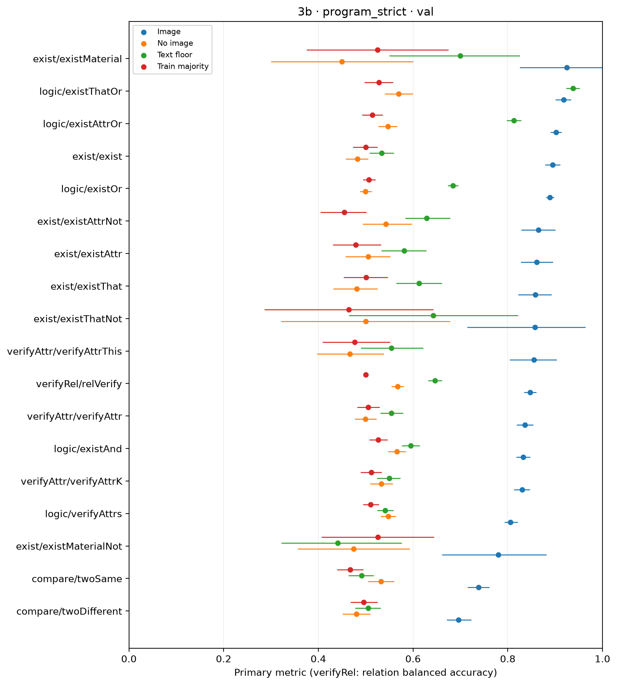
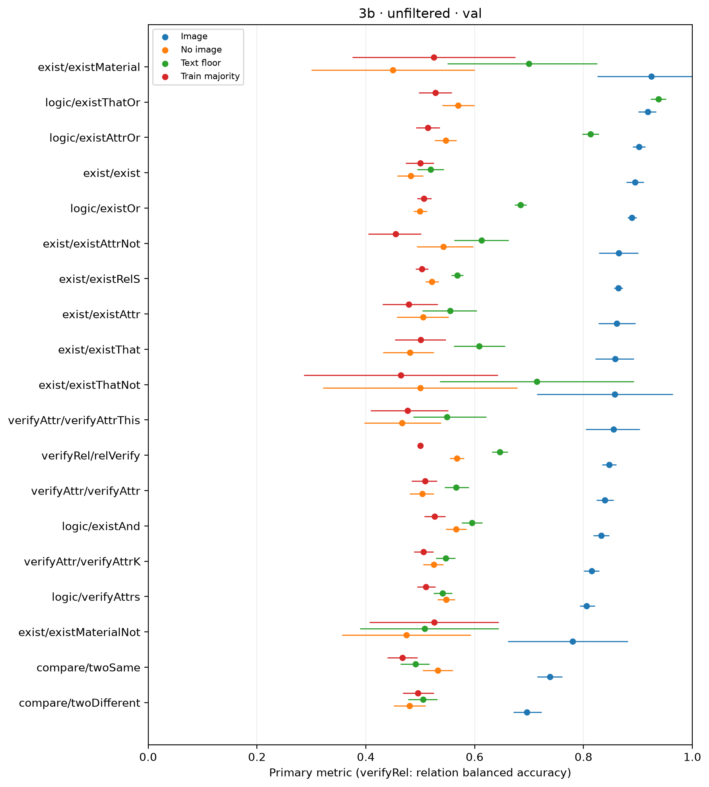
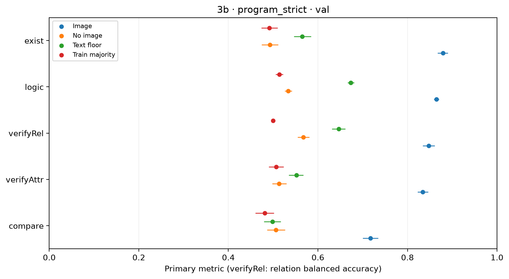
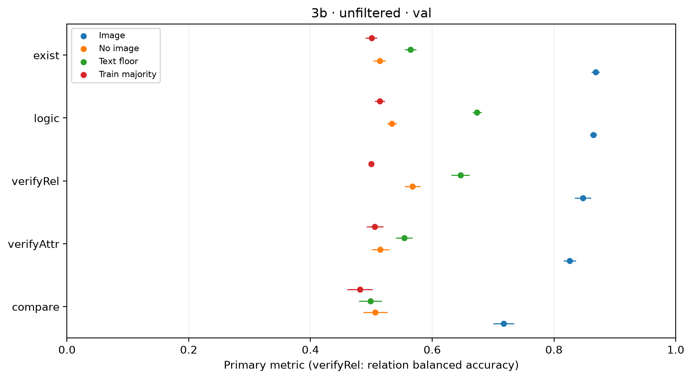
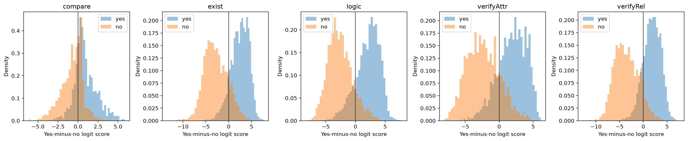
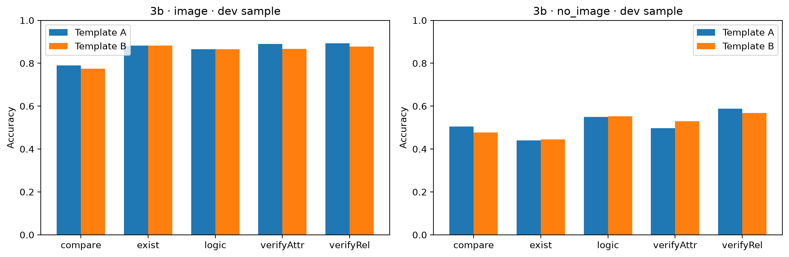
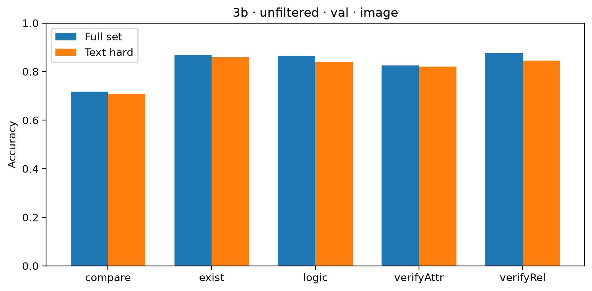

# Stage 3: frozen zero-shot experiment

No training. Dev and val only; testdev remains sealed.

## Environment and provenance

Python environment: `/opt/miniconda3/envs/datpt_mtl/bin/python`; torch `2.9.1+cu128`; transformers `4.57.1`; CUDA `12.8`; driver `595.99.02`; GPU `NVIDIA RTX PRO 4000 Blackwell`.

The human explicitly selected datpt_mtl and top-level configs/, checkpoints/, src/ and scripts/.

Protocol SHA-256: `a0201c1a0a163d81d102f8f1aca677812238c7328305d69774d7101e4ada7ab2`.

All source, accepted-input, image and output hashes are recorded in the manifests. See env_datpt_mtl.txt for exact packages.

## Image verification

Archive CRC verified; SHA-256 `02ce5c49c793accd5305356de9c39a50f80a7aaac193b0203de30dbbc65bde62`; 21,817,965,542 bytes; 148,854 extracted image files. All 74,573 required train/dev/val images pass verification and full decoding. testdev: 395/395 image IDs have files (existence only).

Image dimensions and bytes: image_verification.json; per-image hashes: image_manifest.csv.

## 3b: model and scoring

Model revision: `66285546d2b821cf421d4f5eb2576359d3770cd3`.

First-assistant token checks PASS: `{'yes': 9693, 'Yes': 9454, 'no': 2152, 'No': 2753}`. bf16, sdpa, min_pixels=200704, max_pixels=802816; saved slow image processor; left padding; next-token logits; yes iff score > 0.

Throughput measured after warmup on 64 fixed dev questions:

| condition | questions_per_second | estimated_full_seconds |
| --- | --- | --- |
| image | 8.8197 | 8088.0277 |
| no_image | 55.1717 | 1292.9460 |

### Val primary metrics (95% image-cluster bootstrap CI)

**program_strict**

| task | metric | image [CI] | no image [CI] | text floor | majority |
| --- | --- | --- | --- | --- | --- |
| compare | accuracy | 0.7173 [0.6998, 0.7344] | 0.5060 [0.4864, 0.5263] | 0.4984 | 0.4816 |
| exist | accuracy | 0.8791 [0.8673, 0.8901] | 0.4929 [0.4740, 0.5112] | 0.5651 | 0.4918 |
| logic | accuracy | 0.8648 [0.8592, 0.8704] | 0.5339 [0.5262, 0.5420] | 0.6736 | 0.5137 |
| verifyAttr | accuracy | 0.8343 [0.8229, 0.8462] | 0.5133 [0.4980, 0.5301] | 0.5522 | 0.5070 |
| verifyRel | balanced_accuracy | 0.8473 [0.8340, 0.8606] | 0.5676 [0.5546, 0.5807] | 0.6463 | 0.5000 |

**unfiltered**

| task | metric | image [CI] | no image [CI] | text floor | majority |
| --- | --- | --- | --- | --- | --- |
| compare | accuracy | 0.7173 [0.6998, 0.7344] | 0.5060 [0.4864, 0.5263] | 0.4984 | 0.4816 |
| exist | accuracy | 0.8683 [0.8616, 0.8750] | 0.5137 [0.5033, 0.5233] | 0.5642 | 0.5002 |
| logic | accuracy | 0.8648 [0.8592, 0.8704] | 0.5339 [0.5262, 0.5420] | 0.6736 | 0.5137 |
| verifyAttr | accuracy | 0.8256 [0.8154, 0.8360] | 0.5147 [0.5005, 0.5290] | 0.5541 | 0.5057 |
| verifyRel | balanced_accuracy | 0.8473 [0.8340, 0.8606] | 0.5676 [0.5546, 0.5807] | 0.6463 | 0.5000 |

verifyRel primary uses balanced accuracy on verifyRel_relation. Its val text floor is 0.6463072367 (the frozen within-subset baseline), rather than pooled accuracy or the pooled relation balanced accuracy 0.5553. The reference model is selected per task and retained for each family/stratum/subset, using the corresponding scope and metric; it is not selected anew per unit. verifyRel_Co remains secondary accuracy.

All dev/val units: metrics_3b.csv. Paired image-minus-no-image CIs: paired_differences_3b.csv. Secondary calibration: calibrated_metrics_3b.csv and thresholds_3b.csv. Thresholds maximize balanced accuracy on each whole-task dev union, then apply to val and both variants. Ties use smallest absolute threshold, then lower threshold.

Shortcut table: shortcut_control_3b.csv. source=none denotes zero-shot, not a transfer effect. target_no_image_gain uses the target primary metric; the pooled Stage 2 blind gain is labelled secondary.

## Registered checks and batch diagnostics

The batch1_repeatability rows compare two batch-1 passes. Cross_batch_invariance rows compare larger batches against batch 1 on the same 256 dev questions in the separate post-run benchmark. Larger batches are FLAGged; the scored experiment used batch 1 throughout.

| model | check | unit | condition | variant | value | status | rule |
| --- | --- | --- | --- | --- | --- | --- | --- |
| 3b | headroom_ceiling | compare | image | program_strict | 0.7173 | PASS | >= 0.90 |
| 3b | yes_bias | compare | image | program_strict | 0.0863 | PASS | absolute predicted-minus-true yes rate > 0.15 |
| 3b | headroom_ceiling | exist | image | program_strict | 0.8791 | PASS | >= 0.90 |
| 3b | yes_bias | exist | image | program_strict | 0.0056 | PASS | absolute predicted-minus-true yes rate > 0.15 |
| 3b | headroom_ceiling | logic | image | program_strict | 0.8648 | PASS | >= 0.90 |
| 3b | yes_bias | logic | image | program_strict | 0.0234 | PASS | absolute predicted-minus-true yes rate > 0.15 |
| 3b | headroom_ceiling | verifyAttr | image | program_strict | 0.8343 | PASS | >= 0.90 |
| 3b | yes_bias | verifyAttr | image | program_strict | 0.0121 | PASS | absolute predicted-minus-true yes rate > 0.15 |
| 3b | headroom_ceiling | verifyRel | image | program_strict | 0.8473 | PASS | >= 0.90 |
| 3b | yes_bias | verifyRel | image | program_strict | 0.0300 | PASS | absolute predicted-minus-true yes rate > 0.15 |
| 3b | headroom_ceiling | compare | image | unfiltered | 0.7173 | PASS | >= 0.90 |
| 3b | yes_bias | compare | image | unfiltered | 0.0863 | PASS | absolute predicted-minus-true yes rate > 0.15 |
| 3b | headroom_ceiling | exist | image | unfiltered | 0.8683 | PASS | >= 0.90 |
| 3b | yes_bias | exist | image | unfiltered | 0.0230 | PASS | absolute predicted-minus-true yes rate > 0.15 |
| 3b | headroom_ceiling | logic | image | unfiltered | 0.8648 | PASS | >= 0.90 |
| 3b | yes_bias | logic | image | unfiltered | 0.0234 | PASS | absolute predicted-minus-true yes rate > 0.15 |
| 3b | headroom_ceiling | verifyAttr | image | unfiltered | 0.8256 | PASS | >= 0.90 |
| 3b | yes_bias | verifyAttr | image | unfiltered | 0.0043 | PASS | absolute predicted-minus-true yes rate > 0.15 |
| 3b | headroom_ceiling | verifyRel | image | unfiltered | 0.8473 | PASS | >= 0.90 |
| 3b | yes_bias | verifyRel | image | unfiltered | 0.0300 | PASS | absolute predicted-minus-true yes rate > 0.15 |
| 3b | no_image_reliance | compare | no_image | program_strict | 0.0244 | PASS | primary minus train_core-majority primary > 0.15 |
| 3b | yes_bias | compare | no_image | program_strict | 0.3990 | FLAG | absolute predicted-minus-true yes rate > 0.15 |
| 3b | no_image_reliance | exist | no_image | program_strict | 0.0010 | PASS | primary minus train_core-majority primary > 0.15 |
| 3b | yes_bias | exist | no_image | program_strict | 0.0986 | PASS | absolute predicted-minus-true yes rate > 0.15 |
| 3b | no_image_reliance | logic | no_image | program_strict | 0.0202 | PASS | primary minus train_core-majority primary > 0.15 |
| 3b | yes_bias | logic | no_image | program_strict | 0.1661 | FLAG | absolute predicted-minus-true yes rate > 0.15 |
| 3b | no_image_reliance | verifyAttr | no_image | program_strict | 0.0063 | PASS | primary minus train_core-majority primary > 0.15 |
| 3b | yes_bias | verifyAttr | no_image | program_strict | 0.2345 | FLAG | absolute predicted-minus-true yes rate > 0.15 |
| 3b | no_image_reliance | verifyRel | no_image | program_strict | 0.0676 | PASS | primary minus train_core-majority primary > 0.15 |
| 3b | yes_bias | verifyRel | no_image | program_strict | 0.2626 | FLAG | absolute predicted-minus-true yes rate > 0.15 |
| 3b | no_image_reliance | compare | no_image | unfiltered | 0.0244 | PASS | primary minus train_core-majority primary > 0.15 |
| 3b | yes_bias | compare | no_image | unfiltered | 0.3990 | FLAG | absolute predicted-minus-true yes rate > 0.15 |
| 3b | no_image_reliance | exist | no_image | unfiltered | 0.0135 | PASS | primary minus train_core-majority primary > 0.15 |
| 3b | yes_bias | exist | no_image | unfiltered | 0.2239 | FLAG | absolute predicted-minus-true yes rate > 0.15 |
| 3b | no_image_reliance | logic | no_image | unfiltered | 0.0202 | PASS | primary minus train_core-majority primary > 0.15 |
| 3b | yes_bias | logic | no_image | unfiltered | 0.1661 | FLAG | absolute predicted-minus-true yes rate > 0.15 |
| 3b | no_image_reliance | verifyAttr | no_image | unfiltered | 0.0090 | PASS | primary minus train_core-majority primary > 0.15 |
| 3b | yes_bias | verifyAttr | no_image | unfiltered | 0.2452 | FLAG | absolute predicted-minus-true yes rate > 0.15 |
| 3b | no_image_reliance | verifyRel | no_image | unfiltered | 0.0676 | PASS | primary minus train_core-majority primary > 0.15 |
| 3b | yes_bias | verifyRel | no_image | unfiltered | 0.2626 | FLAG | absolute predicted-minus-true yes rate > 0.15 |
| 3b | template_sensitivity | compare | image | all | 0.0150 | PASS | absolute accuracy(A)-accuracy(B) > 0.03 |
| 3b | template_sensitivity | exist | image | all | 0.0000 | PASS | absolute accuracy(A)-accuracy(B) > 0.03 |
| 3b | template_sensitivity | logic | image | all | 0.0000 | PASS | absolute accuracy(A)-accuracy(B) > 0.03 |
| 3b | template_sensitivity | verifyAttr | image | all | 0.0225 | PASS | absolute accuracy(A)-accuracy(B) > 0.03 |
| 3b | template_sensitivity | verifyRel | image | all | 0.0150 | PASS | absolute accuracy(A)-accuracy(B) > 0.03 |
| 3b | template_sensitivity | compare | no_image | all | 0.0275 | PASS | absolute accuracy(A)-accuracy(B) > 0.03 |
| 3b | template_sensitivity | exist | no_image | all | 0.0050 | PASS | absolute accuracy(A)-accuracy(B) > 0.03 |
| 3b | template_sensitivity | logic | no_image | all | 0.0025 | PASS | absolute accuracy(A)-accuracy(B) > 0.03 |
| 3b | template_sensitivity | verifyAttr | no_image | all | 0.0325 | FLAG | absolute accuracy(A)-accuracy(B) > 0.03 |
| 3b | template_sensitivity | verifyRel | no_image | all | 0.0200 | PASS | absolute accuracy(A)-accuracy(B) > 0.03 |
| 3b | generation_starts_yes_no | 500 dev questions | image | all | 1.0000 | PASS | share < 0.95 |
| 3b | generation_logit_agreement | 500 dev questions | image | all | 0.9840 | PASS | agreement < 0.95 |
| 3b | batch1_repeatability | 256 dev questions; batch 1 repeated | image | all | 0.0000 | PASS | max absolute score difference > 0.05 |
| 3b | batch1_repeatability | 256 dev questions; batch 1 repeated | no_image | all | 0.0000 | PASS | max absolute score difference > 0.05 |
| 3b | cross_batch_invariance | 256 dev questions; batch 2 vs 1 | image | all | 0.3222 | FLAG | max absolute score difference > 0.05 |
| 3b | cross_batch_invariance | 256 dev questions; batch 2 vs 1 | no_image | all | 0.1358 | FLAG | max absolute score difference > 0.05 |
| 3b | cross_batch_invariance | 256 dev questions; batch 4 vs 1 | image | all | 0.3750 | FLAG | max absolute score difference > 0.05 |
| 3b | cross_batch_invariance | 256 dev questions; batch 4 vs 1 | no_image | all | 0.1358 | FLAG | max absolute score difference > 0.05 |
| 3b | cross_batch_invariance | 256 dev questions; batch 8 vs 1 | image | all | 0.3750 | FLAG | max absolute score difference > 0.05 |
| 3b | cross_batch_invariance | 256 dev questions; batch 8 vs 1 | no_image | all | 0.1295 | FLAG | max absolute score difference > 0.05 |
| 3b | cross_batch_invariance | 256 dev questions; batch 16 vs 1 | image | all | 0.3750 | FLAG | max absolute score difference > 0.05 |
| 3b | cross_batch_invariance | 256 dev questions; batch 16 vs 1 | no_image | all | 0.1292 | FLAG | max absolute score difference > 0.05 |
| 3b | image_coverage | train/dev/val registry images | image | all | 1.0000 | PASS | all required images verified |

## Figures

Each figure is also saved as PDF; PNG resolution is 200 dpi.

## Post-run review correction

The original paired-difference table omitted program_strict membership when selecting units. Eight rows (four task and four family rows) have been recomputed from the unchanged saved predictions; see paired_difference_corrections.csv for original and corrected values with confidence intervals. All main per-condition metrics remain unchanged. The checks now distinguish repeatability at batch 1 from cross-batch invariance. No model inference or training was performed during this correction.

## Open decisions for the human

Preflight found score differences beyond 0.05 between bf16 batch 16 and batch 1 in the official model. The experiment therefore fixes batch size 1. Grouped-window SDPA was checked against official attention before the run; see optimization_validation.json and the retained diagnostics/batch16 report. A faster channels-last convolution path was rejected after changing scores and one sampled prediction.

3b/program_strict: tasks below the registered 0.90 ceiling: compare, exist, logic, verifyAttr, verifyRel. Tasks flagged at/above the ceiling: none.

3b/unfiltered: tasks below the registered 0.90 ceiling: compare, exist, logic, verifyAttr, verifyRel. Tasks flagged at/above the ceiling: none.

A 7B comparison is warranted as a next candidate test where 3B retains headroom; consult paired image gains and the no-image and template FLAGS before selecting targets. Phase B requires the human to enable it. No protocol thresholds or samples were changed in response to results.

Qwen2.5-VL may have seen GQA or Visual Genome derived data during training. These scores measure available headroom, and do not establish generalization to unseen training data.

Sampling choices: sorted frozen dev union, tasks sorted alphabetically, NumPy default_rng(0), 400/template and 100/generation per task. Batch checks use 256 dev union IDs. Samples are persisted as CSVs. Runtime warnings are recorded in runtime_warnings.json; batch-size effects are reported without changing the frozen scoring protocol.
